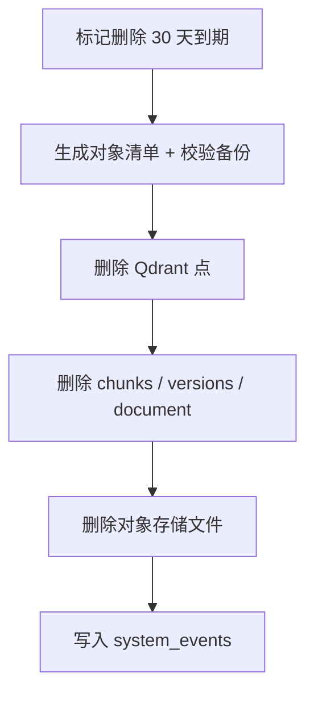

# KnowledgeOS 数据库设计

| 项 | 内容 |
| --- | --- |
| 文档版本 | v1.0 |
| 日期 | 2026-10-31 |
| 上游 | `TECHNICAL_DESIGN.md` v1.0、四份 PRD |
| 数据库 | PostgreSQL 16+ |
| ORM | Prisma 6.x |
| 覆盖范围 | V1 全部表 + V1.5 / V2 / V3 预留表（首次迁移一次建好） |
| 不在本文 | API 路由细节（见技术设计）、任务排期（见实现计划） |

---

## 0. 结论

V1 一次建好全部版本需要的表，后续版本只做增量迁移，不做数据搬迁。数据库以 PostgreSQL 为唯一事实源：文档、版本、块、任务、会话、引用全部落 PG；向量只在 Qdrant；原始文件只在对象存储。中文关键词检索用 `search_text`（应用层 bigram）+ `search_vector`（数据库生成列）实现，不依赖分词扩展。

五条不可违反的约束：

1. 同一文档最多一个当前版本。
2. 同一版本最多一个进行中的处理任务。
3. 块必须属于版本，且块的 `document_id` 必须与版本一致。
4. 同一版本内块序号唯一。
5. 引用可以指向已删除的块，但必须保留引用时的文本快照。

---

## 1. 设计原则

| 原则 | 落地 |
| --- | --- |
| PostgreSQL 是事实源 | 向量、缓存、搜索文本都可重建；只有 PG + 对象存储不可丢 |
| 逻辑删除优先 | 文档删除只置标记；30 天后由保留策略物理清理 |
| 不可变快照 | 文档版本、引用快照、Wiki revision 都不可原地修改 |
| 派生字段显式标记 | `is_current`、`vector_status`、`mention_count` 都是派生数据，可重算 |
| 枚举而非自由文本 | 来源类型、任务类型、关系类型、提案状态全部用数据库枚举 |
| 弱引用显式化 | 引用表不挂文档/版本外键，只保留 ID 与文本快照，避免删除时级联丢失历史 |
| ID 由应用生成 | UUIDv7，时间有序，避免数据库默认值带来的 v4 随机性 |

---

## 2. 数据库与扩展

```sql
-- 必需：无额外扩展
-- 可选：标题模糊搜索
CREATE EXTENSION IF NOT EXISTS pg_trgm;
```

| 项 | 值 |
| --- | --- |
| 版本 | PostgreSQL 16+ |
| 字符集 | UTF8 |
| 时区 | UTC 存储，前端本地化 |
| 时间类型 | `timestamptz(3)` |
| 主键 | `uuid`，应用生成 UUIDv7 |
| 枚举 | PostgreSQL enum |
| 全文检索 | `tsvector` + GIN，`simple` 配置 |
| 迁移工具 | Prisma Migrate |

**不使用的扩展：** `zhparser`、`pg_jieba`、`vector`（pgvector）。前者是部署负担，后者在 A-2 压测不达标时才启用。

---

## 3. ER 总图

```mermaid
erDiagram
    USER ||--o{ DOCUMENT : owns
    USER ||--o{ CONVERSATION : owns
    SOURCE ||--o{ DOCUMENT_SOURCE : referenced_by
    DOCUMENT ||--o{ DOCUMENT_SOURCE : has
    DOCUMENT ||--o{ DOCUMENT_VERSION : versions
    DOCUMENT_VERSION ||--o{ CHUNK : contains
    DOCUMENT_VERSION ||--o{ PROCESSING_JOB : triggers
    PROCESSING_JOB ||--o{ JOB_STEP : records
    CONVERSATION ||--o{ MESSAGE : contains
    MESSAGE ||--o{ CITATION : cites
    MESSAGE ||--o| RETRIEVAL_RUN : traces
    MESSAGE ||--o| MESSAGE_FEEDBACK : receives
    CHUNK ||--o{ CITATION : referenced_by
    CHUNK ||--o{ ENTITY_MENTION : mentions
    ENTITY ||--o{ ENTITY_MENTION : appears_in
    ENTITY ||--o{ RELATION : from
    ENTITY ||--o{ RELATION : to
    ENTITY ||--o{ FACT : subject
    WIKI_PAGE ||--o{ WIKI_REVISION : revisions
    WIKI_PAGE ||--o{ WIKI_PROPOSAL : target
    WIKI_PROPOSAL ||--o{ WIKI_REVISION : produces
    WIKI_PAGE ||--o{ WIKI_LINK : from
    WIKI_PAGE ||--o{ WIKI_LINK : to
    WIKI_PROPOSAL ||--o{ REVIEW_TASK : requires
    AGENT ||--o{ AGENT_VERSION : versions
    AGENT ||--o{ AGENT_RUN : runs
    AGENT_VERSION ||--o{ AGENT_RUN : executes
    AGENT_RUN ||--o{ RUN_STEP : steps
    AGENT_RUN ||--o{ TOOL_CALL : calls
    MCP_TOKEN ||--o{ MCP_AUDIT_LOG : audits
```

---

## 4. 枚举

```prisma
enum SourceType {
  file
  url
  manual
  github
  rss
  notion
}

enum VersionStatus {
  queued
  processing
  ready
  failed
  needs_ocr
  expired
}

enum ChunkType {
  text
  code
  table
  list
}

enum VectorStatus {
  pending
  ready
  failed
}

enum JobType {
  ingest
  reparse
  extract
  wiki_compile
  maintenance
}

enum JobStatus {
  queued
  running
  succeeded
  failed
  canceled
  expired
}

enum JobStepName {
  parse
  clean
  metadata
  dedupe
  chunk
  embed
  index
}

enum StepStatus {
  pending
  running
  succeeded
  failed
  skipped
}

enum MessageRole {
  user
  assistant
  system
}

enum MessageStatus {
  pending
  streaming
  complete
  stopped
  failed
}

enum FeedbackType {
  helpful
  not_helpful
  citation_wrong
}

enum ProviderKind {
  llm
  embedding
  rerank
}

enum WikiPageType {
  concept
  technology
  project
  comparison
  research
  source
}

enum WikiPageStatus {
  draft
  proposed
  published
  archived
  stale
}

enum EditorType {
  model
  human
  system
}

enum ProposalChangeType {
  create
  update
  merge_suggestion
  mark_stale
}

enum ProposalStatus {
  pending
  accepted
  rejected
  expired
  invalid
}

enum ReviewTaskType {
  proposal
  stale_review
  conflict
}

enum ReviewTaskStatus {
  open
  in_progress
  resolved
  dismissed
}

enum EntityType {
  concept
  technology
  project
  agent
  protocol
}

enum EntityStatus {
  active
  merged
  archived
}

enum RelationType {
  RELATED_TO
  DEPENDS_ON
  USES
  IMPLEMENTS
  REFERENCES
  PART_OF
  COMPETES_WITH
  EXTENDS
  CONFLICTS_WITH
}

enum Direction {
  directed
  undirected
}

enum RelationOrigin {
  extracted
  human
  conflict
}

enum RelationStatus {
  active
  pending
  rejected
}

enum AgentStatus {
  active
  archived
}

enum RunStatus {
  queued
  running
  succeeded
  failed
  canceled
}

enum RunStepType {
  thought
  tool_call
  output
}

enum ToolCallStatus {
  succeeded
  failed
}
```

---

## 5. Prisma Schema

> 以下为 `packages/database/prisma/schema.prisma` 的完整内容。`search_vector`、部分唯一索引、触发器不在 Prisma 中声明，由原始 SQL 迁移补充（见第 7 节）。

```prisma
generator client {
  provider = "prisma-client-js"
}

datasource db {
  provider = "postgresql"
  url      = env("DATABASE_URL")
}

// ============================================================
// 身份与设置
// ============================================================

model User {
  id        String   @id @db.Uuid
  name      String   @db.VarChar(128)
  createdAt DateTime @default(now()) @map("created_at") @db.Timestamptz(3)

  documents     Document[]
  conversations Conversation[]

  @@map("users")
}

model ProviderConfig {
  id               String       @id @db.Uuid
  kind             ProviderKind
  provider         String       @db.VarChar(64)
  model            String       @db.VarChar(127)
  baseUrl          String?      @map("base_url") @db.Text
  apiKeyEncrypted  String?      @map("api_key_encrypted") @db.Text
  apiKeyLast4      String?      @map("api_key_last4") @db.VarChar(8)
  isActive         Boolean      @default(false) @map("is_active")
  isDraft          Boolean      @default(true) @map("is_draft")
  extra            Json?
  createdAt        DateTime     @default(now()) @map("created_at") @db.Timestamptz(3)
  updatedAt        DateTime     @updatedAt @map("updated_at") @db.Timestamptz(3)

  @@index([kind, isActive])
  @@map("provider_configs")
}

model AppSetting {
  key       String   @id @db.VarChar(128)
  value     Json
  updatedAt DateTime @updatedAt @map("updated_at") @db.Timestamptz(3)

  @@map("app_settings")
}

model IdempotencyKey {
  key         String   @id @db.VarChar(200)
  scope       String   @db.VarChar(64)
  requestHash String   @map("request_hash") @db.VarChar(64)
  statusCode  Int      @map("status_code")
  response    Json
  createdAt   DateTime @default(now()) @map("created_at") @db.Timestamptz(3)
  expiresAt   DateTime @map("expires_at") @db.Timestamptz(3)

  @@index([expiresAt])
  @@map("idempotency_keys")
}

model SystemEvent {
  id        String   @id @db.Uuid
  level     String   @db.VarChar(16)
  type      String   @db.VarChar(64)
  message   String   @db.Text
  metadata  Json?
  createdAt DateTime @default(now()) @map("created_at") @db.Timestamptz(3)

  @@index([type, createdAt])
  @@map("system_events")
}

model UsageCounter {
  id        String   @id @db.Uuid
  scope     String   @db.VarChar(32)
  key       String   @db.VarChar(128)
  date      String   @db.VarChar(10)
  count     Int      @default(0)
  tokens    Int      @default(0)
  updatedAt DateTime @updatedAt @map("updated_at") @db.Timestamptz(3)

  @@unique([scope, key, date])
  @@map("usage_counters")
}

// ============================================================
// 来源、文档、版本、块
// ============================================================

model Source {
  id          String     @id @db.Uuid
  type        SourceType
  fingerprint String     @db.Text
  identifier  String     @db.Text
  title       String?    @db.Text
  metadata    Json?
  firstSeenAt DateTime   @default(now()) @map("first_seen_at") @db.Timestamptz(3)
  lastSeenAt  DateTime   @default(now()) @map("last_seen_at") @db.Timestamptz(3)
  createdAt   DateTime   @default(now()) @map("created_at") @db.Timestamptz(3)
  updatedAt   DateTime   @updatedAt @map("updated_at") @db.Timestamptz(3)

  documents DocumentSource[]
  versions  DocumentVersion[]

  @@unique([type, fingerprint])
  @@map("sources")
}

model Document {
  id               String    @id @db.Uuid
  ownerId          String?   @map("owner_id") @db.Uuid
  title            String    @db.Text
  currentVersionId String?   @unique @map("current_version_id") @db.Uuid
  isDeleted        Boolean   @default(false) @map("is_deleted")
  deletedAt        DateTime? @map("deleted_at") @db.Timestamptz(3)
  createdAt        DateTime  @default(now()) @map("created_at") @db.Timestamptz(3)
  updatedAt        DateTime  @updatedAt @map("updated_at") @db.Timestamptz(3)

  owner          User?             @relation(fields: [ownerId], references: [id], onDelete: SetNull)
  currentVersion DocumentVersion?  @relation("DocumentCurrentVersion", fields: [currentVersionId], references: [id], onDelete: SetNull)
  versions       DocumentVersion[] @relation("DocumentVersions")
  sources        DocumentSource[]
  chunks         Chunk[]
  jobs           ProcessingJob[]

  @@index([isDeleted, updatedAt])
  @@index([title])
  @@map("documents")
}

model DocumentSource {
  documentId  String   @map("document_id") @db.Uuid
  sourceId    String   @map("source_id") @db.Uuid
  isPrimary   Boolean  @default(false) @map("is_primary")
  firstSeenAt DateTime @default(now()) @map("first_seen_at") @db.Timestamptz(3)
  lastSeenAt  DateTime @default(now()) @map("last_seen_at") @db.Timestamptz(3)

  document Document @relation(fields: [documentId], references: [id], onDelete: Cascade)
  source   Source   @relation(fields: [sourceId], references: [id], onDelete: Cascade)

  @@id([documentId, sourceId])
  @@index([sourceId])
  @@map("document_sources")
}

model DocumentVersion {
  id               String        @id @db.Uuid
  documentId       String        @map("document_id") @db.Uuid
  sourceId         String?       @map("source_id") @db.Uuid
  versionNo        Int           @map("version_no")
  contentHash      String        @map("content_hash") @db.VarChar(64)
  fileHash         String?       @map("file_hash") @db.VarChar(64)
  status           VersionStatus @default(queued)
  isCurrent        Boolean       @default(false) @map("is_current")
  storageKey       String?       @map("storage_key") @db.Text
  storageSize      Int?          @map("storage_size")
  mimeType         String?       @map("mime_type") @db.VarChar(127)
  originalFilename String?       @map("original_filename") @db.Text
  normalizedText   String?       @map("normalized_text") @db.Text
  charCount        Int           @default(0) @map("char_count")
  pageCount        Int?          @map("page_count")
  language         String?       @db.VarChar(16)
  metadata         Json?
  parseWarnings    Json?         @map("parse_warnings")
  suspiciousCount  Int           @default(0) @map("suspicious_count")
  createdAt        DateTime      @default(now()) @map("created_at") @db.Timestamptz(3)
  updatedAt        DateTime      @updatedAt @map("updated_at") @db.Timestamptz(3)
  readyAt          DateTime?     @map("ready_at") @db.Timestamptz(3)

  document   Document         @relation("DocumentVersions", fields: [documentId], references: [id], onDelete: Cascade)
  source     Source?          @relation(fields: [sourceId], references: [id], onDelete: SetNull)
  currentOf  Document?        @relation("DocumentCurrentVersion")
  chunks     Chunk[]
  jobs       ProcessingJob[]
  proposals  WikiProposal[]

  @@unique([documentId, versionNo])
  @@unique([documentId, contentHash])
  @@index([documentId, isCurrent])
  @@index([status])
  @@map("document_versions")
}

model Chunk {
  id             String       @id @db.Uuid
  documentId     String       @map("document_id") @db.Uuid
  versionId      String       @map("version_id") @db.Uuid
  chunkIndex     Int          @map("chunk_index")
  text           String       @db.Text
  tokenCount     Int          @map("token_count")
  startOffset    Int          @map("start_offset")
  endOffset      Int          @map("end_offset")
  pageStart      Int?         @map("page_start")
  pageEnd        Int?         @map("page_end")
  headingPath    String[]     @default([]) @map("heading_path")
  type           ChunkType    @default(text)
  location       Json?
  searchText     String       @map("search_text") @db.Text
  vectorStatus   VectorStatus @default(pending) @map("vector_status")
  embeddingModel String?      @map("embedding_model") @db.VarChar(127)
  embeddingDim   Int?         @map("embedding_dim")
  suspicious     Boolean      @default(false)
  createdAt      DateTime     @default(now()) @map("created_at") @db.Timestamptz(3)
  updatedAt      DateTime     @updatedAt @map("updated_at") @db.Timestamptz(3)

  document      Document       @relation(fields: [documentId], references: [id], onDelete: Cascade)
  version       DocumentVersion @relation(fields: [versionId], references: [id], onDelete: Cascade)
  citations     Citation[]
  entityMentions EntityMention[]

  @@unique([versionId, chunkIndex])
  @@index([documentId])
  @@index([versionId, vectorStatus])
  @@map("chunks")
}

// ============================================================
// 任务
// ============================================================

model ProcessingJob {
  id           String       @id @db.Uuid
  documentId   String       @map("document_id") @db.Uuid
  versionId    String       @map("version_id") @db.Uuid
  type         JobType      @default(ingest)
  status       JobStatus    @default(queued)
  currentStep  JobStepName? @map("current_step")
  attempt      Int          @default(0)
  maxAttempts  Int          @default(3) @map("max_attempts")
  errorCode    String?      @map("error_code") @db.VarChar(64)
  errorMessage String?      @map("error_message") @db.Text
  errorStack   String?      @map("error_stack") @db.Text
  startedAt    DateTime?    @map("started_at") @db.Timestamptz(3)
  finishedAt   DateTime?    @map("finished_at") @db.Timestamptz(3)
  createdAt    DateTime     @default(now()) @map("created_at") @db.Timestamptz(3)
  updatedAt    DateTime     @updatedAt @map("updated_at") @db.Timestamptz(3)

  document Document       @relation(fields: [documentId], references: [id], onDelete: Cascade)
  version  DocumentVersion @relation(fields: [versionId], references: [id], onDelete: Cascade)
  steps    JobStep[]

  @@index([status, createdAt])
  @@index([versionId, status])
  @@map("processing_jobs")
}

model JobStep {
  id            String       @id @db.Uuid
  jobId         String       @map("job_id") @db.Uuid
  step          JobStepName
  stepOrder     Int          @map("step_order")
  status        StepStatus   @default(pending)
  attempt       Int          @default(0)
  startedAt     DateTime?    @map("started_at") @db.Timestamptz(3)
  finishedAt    DateTime?    @map("finished_at") @db.Timestamptz(3)
  inputSummary  Json?        @map("input_summary")
  outputSummary Json?        @map("output_summary")
  errorCode     String?      @map("error_code") @db.VarChar(64)
  errorMessage  String?      @map("error_message") @db.Text
  errorStack    String?      @map("error_stack") @db.Text
  metadata      Json?

  job ProcessingJob @relation(fields: [jobId], references: [id], onDelete: Cascade)

  @@unique([jobId, step])
  @@index([jobId, stepOrder])
  @@map("job_steps")
}

// ============================================================
// 会话、消息、引用、检索轨迹
// ============================================================

model Conversation {
  id        String    @id @db.Uuid
  ownerId   String?   @map("owner_id") @db.Uuid
  title     String    @db.Text
  createdAt DateTime  @default(now()) @map("created_at") @db.Timestamptz(3)
  updatedAt DateTime  @updatedAt @map("updated_at") @db.Timestamptz(3)
  deletedAt DateTime? @map("deleted_at") @db.Timestamptz(3)

  owner    User?     @relation(fields: [ownerId], references: [id], onDelete: SetNull)
  messages Message[]

  @@index([ownerId, updatedAt])
  @@map("conversations")
}

model Message {
  id              String        @id @db.Uuid
  conversationId  String        @map("conversation_id") @db.Uuid
  role            MessageRole
  content         String        @db.Text
  status          MessageStatus @default(pending)
  clientMessageId String?       @map("client_message_id") @db.VarChar(128)
  model           String?       @db.VarChar(127)
  promptVersion   String?       @map("prompt_version") @db.VarChar(64)
  tokenUsage      Json?         @map("token_usage")
  citationCheck   Json?         @map("citation_check")
  errorCode       String?       @map("error_code") @db.VarChar(64)
  createdAt       DateTime      @default(now()) @map("created_at") @db.Timestamptz(3)
  updatedAt       DateTime      @updatedAt @map("updated_at") @db.Timestamptz(3)

  conversation Conversation    @relation(fields: [conversationId], references: [id], onDelete: Cascade)
  citations    Citation[]
  feedback     MessageFeedback?
  retrievalRun RetrievalRun?

  @@unique([conversationId, clientMessageId])
  @@index([conversationId, createdAt])
  @@index([status])
  @@map("messages")
}

model Citation {
  id              String   @id @db.Uuid
  messageId       String   @map("message_id") @db.Uuid
  chunkId         String?  @map("chunk_id") @db.Uuid
  documentId      String   @map("document_id") @db.Uuid
  versionId       String   @map("version_id") @db.Uuid
  ordinal         Int
  quote           String   @db.Text
  startOffset     Int?     @map("start_offset")
  endOffset       Int?     @map("end_offset")
  isValid         Boolean  @default(true) @map("is_valid")
  validationError String?  @map("validation_error") @db.VarChar(64)
  createdAt       DateTime @default(now()) @map("created_at") @db.Timestamptz(3)

  message Message @relation(fields: [messageId], references: [id], onDelete: Cascade)
  chunk   Chunk?  @relation(fields: [chunkId], references: [id], onDelete: SetNull)

  @@unique([messageId, ordinal])
  @@index([chunkId])
  @@map("citations")
}

model MessageFeedback {
  id              String       @id @db.Uuid
  messageId       String       @unique @map("message_id") @db.Uuid
  type            FeedbackType
  citationOrdinal Int?         @map("citation_ordinal")
  comment         String?      @db.Text
  snapshot        Json?
  createdAt       DateTime     @default(now()) @map("created_at") @db.Timestamptz(3)
  updatedAt       DateTime     @updatedAt @map("updated_at") @db.Timestamptz(3)

  message Message @relation(fields: [messageId], references: [id], onDelete: Cascade)

  @@map("message_feedback")
}

model RetrievalRun {
  id              String   @id @db.Uuid
  messageId       String?  @unique @map("message_id") @db.Uuid
  query           String   @db.Text
  rewrittenQuery  String?  @map("rewritten_query") @db.Text
  questionType    String?  @map("question_type") @db.VarChar(32)
  entities        Json?
  config          Json?
  vectorResults   Json?    @map("vector_results")
  keywordResults  Json?    @map("keyword_results")
  fusedResults    Json?    @map("fused_results")
  rerankedResults Json?    @map("reranked_results")
  finalChunkIds   String[] @default([]) @map("final_chunk_ids")
  degraded        String[] @default([])
  durationMs      Int?     @map("duration_ms")
  createdAt       DateTime @default(now()) @map("created_at") @db.Timestamptz(3)

  message Message? @relation(fields: [messageId], references: [id], onDelete: SetNull)

  @@index([createdAt])
  @@map("retrieval_runs")
}

// ============================================================
// V1.5：Wiki 与知识抽取
// ============================================================

model WikiPage {
  id                String         @id @db.Uuid
  slug              String         @unique @db.VarChar(255)
  title             String         @db.Text
  type              WikiPageType
  status            WikiPageStatus @default(draft)
  summary           String?        @db.Text
  aliases           String[]       @default([])
  confidence        Float?
  currentRevisionId String?        @unique @map("current_revision_id") @db.Uuid
  lastReviewedAt    DateTime?      @map("last_reviewed_at") @db.Timestamptz(3)
  archivedAt        DateTime?      @map("archived_at") @db.Timestamptz(3)
  createdAt         DateTime       @default(now()) @map("created_at") @db.Timestamptz(3)
  updatedAt         DateTime       @updatedAt @map("updated_at") @db.Timestamptz(3)

  currentRevision WikiRevision? @relation("WikiCurrentRevision", fields: [currentRevisionId], references: [id], onDelete: SetNull)
  revisions       WikiRevision[] @relation("WikiRevisions")
  proposals       WikiProposal[] @relation("WikiProposalTarget")
  outgoingLinks   WikiLink[]     @relation("WikiLinkFrom")
  incomingLinks   WikiLink[]     @relation("WikiLinkTo")

  @@index([type, status])
  @@map("wiki_pages")
}

model WikiRevision {
  id               String     @id @db.Uuid
  pageId           String     @map("page_id") @db.Uuid
  revisionNo       Int        @map("revision_no")
  parentRevisionId String?    @map("parent_revision_id") @db.Uuid
  editorType       EditorType @map("editor_type")
  changeSummary    String?    @map("change_summary") @db.Text
  content          Json
  evidenceChunkIds String[]   @default([]) @map("evidence_chunk_ids")
  diffStat         Json?      @map("diff_stat")
  proposalId       String?    @map("proposal_id") @db.Uuid
  createdAt        DateTime   @default(now()) @map("created_at") @db.Timestamptz(3)

  page         WikiPage @relation("WikiRevisions", fields: [pageId], references: [id], onDelete: Cascade)
  parent       WikiRevision? @relation("WikiRevisionParent", fields: [parentRevisionId], references: [id], onDelete: SetNull)
  children     WikiRevision[] @relation("WikiRevisionParent")
  currentOf    WikiPage? @relation("WikiCurrentRevision")
  proposal     WikiProposal? @relation("WikiProposalResult", fields: [proposalId], references: [id], onDelete: SetNull)
  baseOf       WikiProposal[] @relation("WikiProposalBase")

  @@unique([pageId, revisionNo])
  @@index([pageId, createdAt])
  @@map("wiki_revisions")
}

model WikiProposal {
  id                String             @id @db.Uuid
  targetPageId      String?            @map("target_page_id") @db.Uuid
  changeType        ProposalChangeType @map("change_type")
  baseRevisionId    String?            @map("base_revision_id") @db.Uuid
  dedupeKey         String             @unique @map("dedupe_key") @db.VarChar(64)
  patch             Json
  evidence          Json
  conflicts         Json?
  validation        Json?
  status            ProposalStatus     @default(pending)
  documentVersionId String?            @map("document_version_id") @db.Uuid
  modelMeta         Json?              @map("model_meta")
  reviewedBy        String?            @map("reviewed_by") @db.Uuid
  reviewedAt        DateTime?          @map("reviewed_at") @db.Timestamptz(3)
  rejectReason      String?            @map("reject_reason") @db.VarChar(64)
  rejectComment     String?            @map("reject_comment") @db.Text
  createdAt         DateTime           @default(now()) @map("created_at") @db.Timestamptz(3)
  updatedAt         DateTime           @updatedAt @map("updated_at") @db.Timestamptz(3)
  expiresAt         DateTime?          @map("expires_at") @db.Timestamptz(3)

  targetPage      WikiPage?        @relation("WikiProposalTarget", fields: [targetPageId], references: [id], onDelete: SetNull)
  baseRevision    WikiRevision?    @relation("WikiProposalBase", fields: [baseRevisionId], references: [id], onDelete: SetNull)
  documentVersion DocumentVersion? @relation(fields: [documentVersionId], references: [id], onDelete: SetNull)
  resultRevisions WikiRevision[]   @relation("WikiProposalResult")
  reviewTasks     ReviewTask[]

  @@index([status, createdAt])
  @@index([targetPageId, status])
  @@map("wiki_proposals")
}

model WikiLink {
  id           String   @id @db.Uuid
  fromPageId   String   @map("from_page_id") @db.Uuid
  toPageId     String?  @map("to_page_id") @db.Uuid
  targetSlug   String   @map("target_slug") @db.VarChar(255)
  relationType String?  @map("relation_type") @db.VarChar(32)
  context      String?  @db.Text
  createdAt    DateTime @default(now()) @map("created_at") @db.Timestamptz(3)

  fromPage WikiPage  @relation("WikiLinkFrom", fields: [fromPageId], references: [id], onDelete: Cascade)
  toPage   WikiPage? @relation("WikiLinkTo", fields: [toPageId], references: [id], onDelete: SetNull)

  @@index([toPageId])
  @@index([targetSlug])
  @@map("wiki_links")
}

model Entity {
  id              String       @id @db.Uuid
  canonicalName   String       @map("canonical_name") @db.Text
  normalizedName  String       @map("normalized_name") @db.Text
  type            EntityType
  aliases         String[]     @default([])
  sourceChunkIds  String[]     @default([]) @map("source_chunk_ids")
  mentionCount    Int          @default(0) @map("mention_count")
  confidence      Float        @default(0)
  status          EntityStatus @default(active)
  mergedIntoId    String?      @map("merged_into_id") @db.Uuid
  createdAt       DateTime     @default(now()) @map("created_at") @db.Timestamptz(3)
  updatedAt       DateTime     @updatedAt @map("updated_at") @db.Timestamptz(3)

  mergedInto  Entity?         @relation("EntityMerge", fields: [mergedIntoId], references: [id], onDelete: SetNull)
  mergedFrom  Entity[]        @relation("EntityMerge")
  mentions    EntityMention[]
  relationsFrom Relation[]    @relation("RelationFrom")
  relationsTo   Relation[]    @relation("RelationTo")
  facts       Fact[]

  @@index([type, status])
  @@index([normalizedName])
  @@map("entities")
}

model EntityMention {
  id          String   @id @db.Uuid
  entityId    String   @map("entity_id") @db.Uuid
  chunkId     String   @map("chunk_id") @db.Uuid
  startOffset Int      @map("start_offset")
  endOffset   Int      @map("end_offset")
  createdAt   DateTime @default(now()) @map("created_at") @db.Timestamptz(3)

  entity Entity @relation(fields: [entityId], references: [id], onDelete: Cascade)
  chunk  Chunk  @relation(fields: [chunkId], references: [id], onDelete: Cascade)

  @@unique([entityId, chunkId, startOffset])
  @@index([chunkId])
  @@map("entity_mentions")
}

model Relation {
  id               String         @id @db.Uuid
  fromEntityId     String         @map("from_entity_id") @db.Uuid
  toEntityId       String         @map("to_entity_id") @db.Uuid
  type             RelationType
  direction        Direction      @default(directed)
  evidenceChunkIds String[]       @default([]) @map("evidence_chunk_ids")
  confidence       Float          @default(0)
  origin           RelationOrigin @default(extracted)
  status           RelationStatus @default(active)
  createdAt        DateTime       @default(now()) @map("created_at") @db.Timestamptz(3)
  updatedAt        DateTime       @updatedAt @map("updated_at") @db.Timestamptz(3)

  fromEntity Entity @relation("RelationFrom", fields: [fromEntityId], references: [id], onDelete: Cascade)
  toEntity   Entity @relation("RelationTo", fields: [toEntityId], references: [id], onDelete: Cascade)

  @@index([fromEntityId, type, status])
  @@index([toEntityId, type, status])
  @@map("relations")
}

model Fact {
  id              String   @id @db.Uuid
  subjectEntityId String   @map("subject_entity_id") @db.Uuid
  predicate       String   @db.VarChar(128)
  valueText       String   @map("value_text") @db.Text
  valueType       String?  @map("value_type") @db.VarChar(32)
  evidenceChunkId String   @map("evidence_chunk_id") @db.Uuid
  capturedAt      DateTime @default(now()) @map("captured_at") @db.Timestamptz(3)
  identityHash    String   @map("identity_hash") @db.VarChar(64)
  createdAt       DateTime @default(now()) @map("created_at") @db.Timestamptz(3)

  subject Entity @relation(fields: [subjectEntityId], references: [id], onDelete: Cascade)

  @@unique([subjectEntityId, predicate, valueText, evidenceChunkId])
  @@index([identityHash])
  @@map("facts")
}

model ReviewTask {
  id         String           @id @db.Uuid
  type       ReviewTaskType
  targetType String           @map("target_type") @db.VarChar(32)
  targetId   String           @map("target_id") @db.Uuid
  priority   Int              @default(0)
  status     ReviewTaskStatus @default(open)
  proposalId String?          @map("proposal_id") @db.Uuid
  createdAt  DateTime         @default(now()) @map("created_at") @db.Timestamptz(3)
  resolvedAt DateTime?        @map("resolved_at") @db.Timestamptz(3)

  proposal WikiProposal? @relation(fields: [proposalId], references: [id], onDelete: SetNull)

  @@index([status, priority, createdAt])
  @@map("review_tasks")
}

model ExtractionCache {
  id            String   @id @db.Uuid
  chunkId       String   @map("chunk_id") @db.Uuid
  model         String   @db.VarChar(127)
  promptVersion String   @map("prompt_version") @db.VarChar(64)
  result        Json
  createdAt     DateTime @default(now()) @map("created_at") @db.Timestamptz(3)

  @@unique([chunkId, model, promptVersion])
  @@map("extraction_cache")
}

// ============================================================
// V2：Agent（图谱复用 Entity / Relation）
// ============================================================

model Agent {
  id          String      @id @db.Uuid
  name        String      @db.VarChar(128)
  description String?     @db.Text
  status      AgentStatus @default(active)
  createdAt   DateTime    @default(now()) @map("created_at") @db.Timestamptz(3)
  updatedAt   DateTime    @updatedAt @map("updated_at") @db.Timestamptz(3)

  versions AgentVersion[]
  runs     AgentRun[]

  @@map("agents")
}

model AgentVersion {
  id             String   @id @db.Uuid
  agentId        String   @map("agent_id") @db.Uuid
  versionNo      Int      @map("version_no")
  systemPrompt   String   @map("system_prompt") @db.Text
  model          String   @db.VarChar(127)
  temperature    Float    @default(0.2)
  toolAllowlist  String[] @default([]) @map("tool_allowlist")
  maxSteps       Int      @default(8) @map("max_steps")
  tokenBudget    Int      @default(20000) @map("token_budget")
  toolCallBudget Int      @default(12) @map("tool_call_budget")
  allowProposal  Boolean  @default(false) @map("allow_proposal")
  createdAt      DateTime @default(now()) @map("created_at") @db.Timestamptz(3)

  agent Agent      @relation(fields: [agentId], references: [id], onDelete: Cascade)
  runs  AgentRun[]

  @@unique([agentId, versionNo])
  @@map("agent_versions")
}

model AgentRun {
  id                String    @id @db.Uuid
  agentId           String    @map("agent_id") @db.Uuid
  agentVersionId    String    @map("agent_version_id") @db.Uuid
  trigger           String    @db.VarChar(32)
  input             Json
  status            RunStatus @default(queued)
  totalSteps        Int       @default(0) @map("total_steps")
  totalTokens       Int       @default(0) @map("total_tokens")
  durationMs        Int?      @map("duration_ms")
  terminationReason String?   @map("termination_reason") @db.VarChar(64)
  createdAt         DateTime  @default(now()) @map("created_at") @db.Timestamptz(3)
  finishedAt        DateTime? @map("finished_at") @db.Timestamptz(3)

  agent        Agent        @relation(fields: [agentId], references: [id], onDelete: Cascade)
  agentVersion AgentVersion @relation(fields: [agentVersionId], references: [id], onDelete: Restrict)
  steps        RunStep[]
  toolCalls    ToolCall[]

  @@index([agentId, createdAt])
  @@map("agent_runs")
}

model RunStep {
  id            String      @id @db.Uuid
  runId         String      @map("run_id") @db.Uuid
  stepIndex     Int         @map("step_index")
  type          RunStepType
  outputSummary String?     @map("output_summary") @db.Text
  durationMs    Int?        @map("duration_ms")
  createdAt     DateTime    @default(now()) @map("created_at") @db.Timestamptz(3)

  run AgentRun @relation(fields: [runId], references: [id], onDelete: Cascade)

  @@unique([runId, stepIndex])
  @@map("run_steps")
}

model ToolCall {
  id             String         @id @db.Uuid
  runId          String         @map("run_id") @db.Uuid
  stepIndex      Int            @map("step_index")
  toolName       String         @map("tool_name") @db.VarChar(64)
  paramsRedacted Json           @map("params_redacted")
  resultSummary  String?        @map("result_summary") @db.Text
  status         ToolCallStatus
  durationMs     Int            @map("duration_ms")
  errorCode      String?        @map("error_code") @db.VarChar(64)
  createdAt      DateTime       @default(now()) @map("created_at") @db.Timestamptz(3)

  run AgentRun @relation(fields: [runId], references: [id], onDelete: Cascade)

  @@index([runId, stepIndex])
  @@map("tool_calls")
}

// ============================================================
// V3：MCP 令牌与审计
// ============================================================

model McpToken {
  id             String    @id @db.Uuid
  name           String    @db.VarChar(128)
  tokenHash      String    @unique @map("token_hash") @db.VarChar(64)
  tokenPrefix    String    @map("token_prefix") @db.VarChar(16)
  documentScope  Json?     @map("document_scope")
  toolAllowlist  String[]  @default([]) @map("tool_allowlist")
  dailyLimit     Int       @default(500) @map("daily_limit")
  qpsLimit       Int       @default(5) @map("qps_limit")
  expiresAt      DateTime? @map("expires_at") @db.Timestamptz(3)
  revokedAt      DateTime? @map("revoked_at") @db.Timestamptz(3)
  lastUsedAt     DateTime? @map("last_used_at") @db.Timestamptz(3)
  createdAt      DateTime  @default(now()) @map("created_at") @db.Timestamptz(3)

  audits McpAuditLog[]

  @@index([revokedAt, expiresAt])
  @@map("mcp_tokens")
}

model McpAuditLog {
  id            String   @id @db.Uuid
  tokenId       String?  @map("token_id") @db.Uuid
  tool          String   @db.VarChar(64)
  paramsSummary Json?    @map("params_summary")
  resultCount   Int?     @map("result_count")
  durationMs    Int      @map("duration_ms")
  statusCode    Int      @map("status_code")
  transport     String   @db.VarChar(16)
  suspicious    Boolean  @default(false)
  createdAt     DateTime @default(now()) @map("created_at") @db.Timestamptz(3)

  token McpToken? @relation(fields: [tokenId], references: [id], onDelete: SetNull)

  @@index([tokenId, createdAt])
  @@index([createdAt])
  @@map("mcp_audit_logs")
}
```

---

## 6. 表说明与关键字段

### 6.1 `documents`

| 字段 | 说明 |
| --- | --- |
| `current_version_id` | 当前有效版本；由应用在版本切换事务中维护 |
| `is_deleted` / `deleted_at` | 逻辑删除；物理清理在 30 天后 |
| `title` | 可重复，判重不依赖标题 |

**文档状态不单独存字段。** 列表与 Dashboard 通过 `current_version.status` 派生，避免两处状态不一致。

### 6.2 `document_versions`

| 字段 | 说明 |
| --- | --- |
| `content_hash` | 规范化文本 SHA-256，`(document_id, content_hash)` 唯一 |
| `file_hash` | 原始字节 SHA-256，仅用于上传时快速判重 |
| `normalized_text` | 引用偏移的坐标系；UTF-16 code unit |
| `is_current` | 同一文档只能有一个 `true`，由部分唯一索引保证 |
| `storage_key` | 对象存储键，不可变 |
| `status` | `queued/processing/ready/failed/needs_ocr/expired` |

### 6.3 `chunks`

| 字段 | 说明 |
| --- | --- |
| `chunk_index` | 版本内序号，从 0 开始 |
| `start_offset` / `end_offset` | 在 `normalized_text` 中的 UTF-16 下标 |
| `page_start` / `page_end` | PDF 页码；Markdown 为空 |
| `heading_path` | 标题路径数组，用于阅读定位与过滤 |
| `location` | PDF 高亮矩形等结构化定位信息 |
| `search_text` | 应用生成的 bigram + 英文 token 文本 |
| `search_vector` | 数据库生成列，不在 Prisma 中声明 |
| `vector_status` | `pending/ready/failed`，决定版本能否置 ready |
| `suspicious` | 命中提示注入模式，仅标记不阻断 |

**`location` JSON 结构：**

```json
{
  "pdf": {
    "page": 3,
    "rects": [
      { "x": 72, "y": 120, "width": 420, "height": 14 },
      { "x": 72, "y": 138, "width": 380, "height": 14 }
    ]
  },
  "markdown": { "headingPath": ["Hybrid Retrieval", "RRF"] }
}
```

### 6.4 `processing_jobs` / `job_steps`

- `processing_jobs` 一行一次处理尝试；`steps` 保存每步状态与摘要。
- 单步重试复用 `job_steps` 中已成功的上游产物。
- `attempt` 表示整单尝试次数；`job_steps.attempt` 表示该步尝试次数。
- 活动任务唯一性由部分唯一索引保证。

### 6.5 `citations`

- `document_id` / `version_id` 故意不建外键：文档物理清理后引用仍需保留快照。
- `chunk_id` 外键 `ON DELETE SET NULL`：块删除后引用变弱引用。
- `quote` 保存引用时的文本快照，保证历史消息可读。
- `ordinal` 是回答内的引用序号，`(message_id, ordinal)` 唯一。

### 6.6 `retrieval_runs`

- 一条助手消息最多一条轨迹；调试接口产生的轨迹 `message_id` 为空。
- `vector_results` / `keyword_results` / `fused_results` / `reranked_results` 保存原始排序，供「为什么没搜到」排查。
- 默认保留 90 天，可采样。

### 6.7 `wiki_*`（V1.5）

- `wiki_revisions.content` 是段落级结构化 JSON，见下。
- 每个 revision 是不可变快照；回滚 = 以旧内容创建新 revision。
- `wiki_proposals.dedupe_key` 由 `sha256(documentVersionId|targetPageId|changeType)` 生成，保证幂等。
- `wiki_proposals.base_revision_id` 是并发审核的关键字段。

**`wiki_revisions.content` 结构：**

```json
{
  "summary": "...",
  "sections": [
    {
      "title": "工作原理",
      "paragraphs": [
        {
          "text": "混合检索同时使用向量与关键词两路召回。",
          "evidenceChunkIds": ["..."],
          "origin": "model",
          "versionIntroduced": 3,
          "protected": false
        }
      ]
    }
  ],
  "relatedPageIds": ["..."]
}
```

### 6.8 `entities` / `relations` / `facts`

- `source_chunk_ids` / `evidence_chunk_ids` 不得为空；应用层在入库前校验。
- 实体合并只置 `status='merged'` 并写 `merged_into_id`，不物理删除。
- 同一对实体同一类型只允许一条 `active` 关系，由部分唯一索引保证。
- `facts.identity_hash` 用于判断同一事实的新旧版本，不参与唯一约束。

### 6.9 `mcp_tokens` / `mcp_audit_logs`（V3）

- `token_hash` 存 SHA-256，明文只在创建时返回。
- `document_scope` 结构：`{ "mode": "all" | "tags" | "documents", "tags": [], "documentIds": [] }`。
- 审计不记录返回正文，只记录条数与耗时。

---

## 7. 原始 SQL 迁移

Prisma 不能表达生成列、部分唯一索引与触发器，以下内容放在 `migrations/*_search_and_constraints/migration.sql`。

### 7.1 关键词索引

```sql
CREATE EXTENSION IF NOT EXISTS pg_trgm;

ALTER TABLE chunks
  ADD COLUMN search_vector tsvector
  GENERATED ALWAYS AS (to_tsvector('simple', search_text)) STORED;

CREATE INDEX chunks_search_vector_idx
  ON chunks USING GIN (search_vector);

CREATE INDEX chunks_search_text_trgm_idx
  ON chunks USING GIN (search_text gin_trgm_ops);

CREATE INDEX documents_title_trgm_idx
  ON documents USING GIN (title gin_trgm_ops);
```

### 7.2 部分唯一索引

```sql
-- 同一文档最多一个当前版本
CREATE UNIQUE INDEX document_versions_one_current_idx
  ON document_versions (document_id)
  WHERE is_current = true;

-- 同一版本最多一个进行中的任务
CREATE UNIQUE INDEX processing_jobs_one_active_idx
  ON processing_jobs (version_id)
  WHERE status IN ('queued', 'running');

-- 每类模型最多一个启用配置
CREATE UNIQUE INDEX provider_configs_one_active_idx
  ON provider_configs (kind)
  WHERE is_active = true;

-- 同一对实体同一类型只允许一条有效关系
CREATE UNIQUE INDEX relations_one_active_idx
  ON relations (from_entity_id, to_entity_id, type)
  WHERE status = 'active';

-- 同类型下规范名唯一（仅 active 实体）
CREATE UNIQUE INDEX entities_active_unique_idx
  ON entities (type, normalized_name)
  WHERE status = 'active';
```

### 7.3 数据一致性触发器

```sql
-- 块的 document_id 必须与版本的 document_id 一致
CREATE OR REPLACE FUNCTION assert_chunk_document_match()
RETURNS trigger AS $$
BEGIN
  IF NOT EXISTS (
    SELECT 1 FROM document_versions v
    WHERE v.id = NEW.version_id AND v.document_id = NEW.document_id
  ) THEN
    RAISE EXCEPTION 'chunk.document_id % does not match version %', NEW.document_id, NEW.version_id;
  END IF;
  RETURN NEW;
END;
$$ LANGUAGE plpgsql;

CREATE TRIGGER chunks_document_match_trg
  BEFORE INSERT OR UPDATE ON chunks
  FOR EACH ROW EXECUTE FUNCTION assert_chunk_document_match();

-- 实体与关系的来源块不得为空（仅对 active 记录）
ALTER TABLE entities
  ADD CONSTRAINT entities_source_chunks_not_empty
  CHECK (status <> 'active' OR cardinality(source_chunk_ids) > 0);

ALTER TABLE relations
  ADD CONSTRAINT relations_evidence_not_empty
  CHECK (status <> 'active' OR cardinality(evidence_chunk_ids) > 0);
```

### 7.4 更新时间触发器（可选）

Prisma `@updatedAt` 已在应用层维护；如果存在绕过 Prisma 的写入，可加数据库触发器兜底：

```sql
CREATE OR REPLACE FUNCTION touch_updated_at()
RETURNS trigger AS $$
BEGIN
  NEW.updated_at = now();
  RETURN NEW;
END;
$$ LANGUAGE plpgsql;

-- 对需要的表逐个创建
CREATE TRIGGER documents_touch_updated_at
  BEFORE UPDATE ON documents
  FOR EACH ROW EXECUTE FUNCTION touch_updated_at();
```

---

## 8. 关键查询

### 8.1 关键词检索（bigram）

```sql
WITH q AS (
  SELECT to_tsquery('simple', $1) AS tsq  -- 例：'稀疏 & 疏向 & 向量'
)
SELECT
  c.id,
  c.document_id,
  c.version_id,
  c.chunk_index,
  c.text,
  ts_rank_cd(c.search_vector, q.tsq) AS rank
FROM chunks c
JOIN document_versions v ON v.id = c.version_id
JOIN documents d ON d.id = c.document_id
CROSS JOIN q
WHERE c.search_vector @@ q.tsq
  AND c.document_id = ANY($2::uuid[])
  AND v.is_current = true
  AND d.is_deleted = false
ORDER BY rank DESC, c.id
LIMIT $3;
```

**注意：** `$1` 由应用层用 bigram 生成，不是原始问题；`$2` 是范围过滤，必须先下推。

### 8.2 文档列表（游标分页）

```sql
SELECT
  d.id,
  d.title,
  d.updated_at,
  v.status,
  v.version_no,
  v.char_count,
  v.page_count
FROM documents d
JOIN document_versions v ON v.id = d.current_version_id
WHERE d.is_deleted = false
  AND ($1::text IS NULL OR v.status::text = $1)
  AND ($2::timestamptz IS NULL OR (d.updated_at, d.id) < ($2, $3))
ORDER BY d.updated_at DESC, d.id DESC
LIMIT $4;
```

### 8.3 Dashboard 指标

```sql
SELECT
  (SELECT count(*) FROM documents WHERE is_deleted = false) AS document_count,
  (
    SELECT count(*)
    FROM chunks c
    JOIN document_versions v ON v.id = c.version_id
    JOIN documents d ON d.id = c.document_id
    WHERE v.is_current = true AND d.is_deleted = false
  ) AS chunk_count,
  (
    SELECT count(*)
    FROM documents d
    JOIN document_versions v ON v.id = d.current_version_id
    WHERE d.is_deleted = false AND v.status = 'failed'
  ) AS failed_document_count,
  (
    SELECT count(*)
    FROM processing_jobs
    WHERE status IN ('queued', 'running')
  ) AS active_job_count;
```

### 8.4 对账：当前版本中向量缺失的块

```sql
SELECT c.id, c.text, c.embedding_model
FROM chunks c
JOIN document_versions v ON v.id = c.version_id
JOIN documents d ON d.id = c.document_id
WHERE v.is_current = true
  AND d.is_deleted = false
  AND c.vector_status <> 'ready'
ORDER BY c.created_at
LIMIT 500;
```

### 8.5 会话消息与引用

```sql
SELECT
  m.id,
  m.role,
  m.content,
  m.status,
  m.created_at,
  coalesce(
    json_agg(
      json_build_object(
        'ordinal', c.ordinal,
        'chunkId', c.chunk_id,
        'documentId', c.document_id,
        'quote', c.quote,
        'isValid', c.is_valid
      ) ORDER BY c.ordinal
    ) FILTER (WHERE c.id IS NOT NULL),
    '[]'::json
  ) AS citations
FROM messages m
LEFT JOIN citations c ON c.message_id = m.id
WHERE m.conversation_id = $1
GROUP BY m.id
ORDER BY m.created_at;
```

### 8.6 V1.5 过期检测

```sql
-- 页面引用的块所属文档出现了新版本，且块内容发生变化
SELECT DISTINCT p.id, p.slug, p.title
FROM wiki_pages p
JOIN wiki_revisions r ON r.id = p.current_revision_id
CROSS JOIN LATERAL unnest(r.evidence_chunk_ids) AS eid
JOIN chunks c ON c.id = eid::uuid
JOIN document_versions old_v ON old_v.id = c.version_id
JOIN document_versions new_v
  ON new_v.document_id = old_v.document_id
 AND new_v.is_current = true
 AND new_v.id <> old_v.id
WHERE p.status = 'published'
  AND old_v.is_current = false;
```

### 8.7 V2 路径查询（3 跳以内）

```sql
WITH RECURSIVE paths AS (
  SELECT
    r.from_entity_id AS start_id,
    r.to_entity_id AS current_id,
    ARRAY[r.from_entity_id, r.to_entity_id] AS node_ids,
    ARRAY[r.id] AS relation_ids,
    1 AS hops
  FROM relations r
  WHERE r.status = 'active' AND r.from_entity_id = $1

  UNION ALL

  SELECT
    p.start_id,
    r.to_entity_id,
    p.node_ids || r.to_entity_id,
    p.relation_ids || r.id,
    p.hops + 1
  FROM paths p
  JOIN relations r ON r.from_entity_id = p.current_id AND r.status = 'active'
  WHERE p.hops < $3
    AND NOT r.to_entity_id = ANY(p.node_ids)
)
SELECT *
FROM paths
WHERE current_id = $2
ORDER BY hops, relation_ids
LIMIT 20;
```

---

## 9. 数据不变量与校验

| 编号 | 不变量 | 保证方式 |
| --- | --- | --- |
| I-1 | 同一文档最多一个当前版本 | 部分唯一索引 + 应用事务 |
| I-2 | 同一版本最多一个进行中任务 | 部分唯一索引 |
| I-3 | 块序号在版本内唯一 | `@@unique([versionId, chunkIndex])` |
| I-4 | 块与版本的文档一致 | 触发器 `chunks_document_match_trg` |
| I-5 | 同一文档同一内容不产生两个版本 | `@@unique([documentId, contentHash])` |
| I-6 | 回答内引用序号唯一 | `@@unique([messageId, ordinal])` |
| I-7 | 每条助手消息最多一条反馈 | `messageId @unique` |
| I-8 | 每条助手消息最多一条检索轨迹 | `retrieval_runs.messageId @unique` |
| I-9 | 每类模型最多一个启用配置 | 部分唯一索引 |
| I-10 | 活动实体来源块非空 | CHECK 约束 |
| I-11 | 活动关系证据块非空 | CHECK 约束 |
| I-12 | 同类型实体规范名唯一 | 部分唯一索引 |
| I-13 | 同一对实体同类型一条活动关系 | 部分唯一索引 |
| I-14 | 提案幂等 | `wiki_proposals.dedupeKey @unique` |
| I-15 | 版本号单调递增 | `@@unique([documentId, versionNo])` + 应用事务 |

**应用层必须额外校验：**

- 创建版本时计算 `versionNo = max(versionNo) + 1`，在事务内完成。
- 切换当前版本时，在同一事务中把旧版本 `is_current=false`、新版本 `is_current=true`、更新 `documents.current_version_id`。
- 删除文档时只置 `is_deleted=true`，不删除版本与块。

---

## 10. 迁移计划

### 10.1 迁移顺序

| 迁移 | 内容 | 版本 |
| --- | --- | --- |
| `0001_init` | 全部表、枚举、外键、常规索引 | V1 |
| `0002_search_and_constraints` | `search_vector`、GIN、部分唯一索引、触发器 | V1 |
| `0003_seed` | 一条 owner、默认设置、示例模型配置（草稿） | V1 |
| `0004_v15_additive` | 仅当 V1.5 需要新字段时追加；V1 已建表不重建 | V1.5 |
| `0005_v2_additive` | 同上 | V2 |
| `0006_v3_additive` | 同上 | V3 |

### 10.2 迁移纪律

- 迁移只前进，不回滚；本地开发可 `migrate reset`，生产不允许。
- 破坏性变更分两步：先加新列并双写，再切读，最后删旧列。
- 大表加索引用 `CREATE INDEX CONCURRENTLY`，不锁表。
- 枚举新增值必须向后兼容，不删除已使用的值。
- 每次迁移在 CI 的干净数据库上跑一遍，再跑集成测试。
- 自定义 SQL 迁移（生成列、部分索引、触发器）用 `--create-only` 创建，写好后用 `migrate deploy` 应用。**应用后不要再运行 `migrate dev` 的自动 diff**，否则 Prisma 可能生成删除这些对象的迁移。

### 10.3 初始化数据

```sql
-- owner 单用户
INSERT INTO users (id, name)
VALUES ('00000000-0000-7000-8000-000000000001', 'Owner')
ON CONFLICT DO NOTHING;

-- 默认设置
INSERT INTO app_settings (key, value) VALUES
  ('retrieval.topK', '10'),
  ('retrieval.vectorTopN', '40'),
  ('retrieval.keywordTopN', '40'),
  ('retrieval.rrfK', '60'),
  ('retrieval.rerankEnabled', 'true'),
  ('retrieval.includeHistoryVersions', 'false'),
  ('chunking.targetMin', '300'),
  ('chunking.targetMax', '800'),
  ('chunking.hardMax', '1200'),
  ('processing.concurrency', '2'),
  ('answering.concurrency', '3'),
  ('answering.evidenceTokenBudget', '6000'),
  ('privacy.sendExternalContext', 'true')
ON CONFLICT (key) DO NOTHING;
```

---

## 11. 数据保留与清理

| 数据 | 保留 | 清理方式 |
| --- | --- | --- |
| 逻辑删除文档 | 30 天 | 生成对象清单 → 删除版本/块 → 删对象 → 删文档行 |
| 失败任务临时产物 | 24 小时 | 删除 `job_steps.metadata` 中的临时键 |
| `idempotency_keys` | 24 小时 | 定时删除过期行 |
| `retrieval_runs` | 90 天 | 按 `created_at` 删除；可采样 |
| `mcp_audit_logs` | 90 天 | 按 `created_at` 删除 |
| `system_events` | 180 天 | 按 `created_at` 删除 |
| 会话与消息 | 永久 | 用户显式删除 |
| 原始文件 | 与文档同生命周期 | 物理清理前生成清单 |
| Qdrant 点 | 随块删除 | 按 payload `versionId` 批量删除 |

**清理顺序（必须）：**



先删派生数据再删事实源，避免出现「块还在但向量没了」的长窗口；对象文件最后删，保证可回溯。

---

## 12. 备份与恢复

### 12.1 备份

```bash
# 数据库
pg_dump -Fc -f backup/knowledgeos-$(date +%F).dump "$DATABASE_URL"

# 对象存储
tar -czf backup/objects-$(date +%F).tar.gz -C "$DATA_DIR" objects

# Qdrant 可选；向量可重建，不备份也能恢复
```

- 每日全量，保留 14 天。
- 备份文件校验 SHA-256，写入备份清单。
- 至少每周做一次恢复演练。

### 12.2 恢复

```bash
# 1. 恢复数据库
pg_restore --clean --if-exists -d "$DATABASE_URL" backup/knowledgeos-2026-10-31.dump

# 2. 恢复对象存储
tar -xzf backup/objects-2026-10-31.tar.gz -C "$DATA_DIR"

# 3. 重建向量（可选，Qdrant 丢失时）
pnpm --filter @kos/worker reindex --all

# 4. 校验
pnpm --filter @kos/api healthcheck
```

**恢复目标：** RPO 24 小时，RTO 2 小时。恢复后必须跑一次检索评测，确认索引可用。

---

## 13. 性能与容量估算

| 数据 | 单条估算 | 10 万块规模 |
| --- | --- | --- |
| 文档 | 1 KB | 1,000 文档约 1 MB |
| 版本 | 文本 400 KB（20 万字符） | 1,000 版本约 400 MB |
| 块 | 文本 3 KB + 索引 | 10 万块约 300 MB |
| 引用 | 1 KB | 1 万条约 10 MB |
| 检索轨迹 | 20 KB JSON | 1 万条约 200 MB |
| Qdrant 向量 | 1536 × 4B ≈ 6 KB | 10 万块约 600 MB |

**索引建议：**

- `chunks` 的 GIN 索引约为文本大小的 30%–50%；10 万块约 100–150 MB。
- `retrieval_runs` 增长最快，默认 90 天保留并采样。
- `messages.content` 与 `chunks.text` 都是 TOAST 友好类型，避免整行加载。

---

## 14. 示例：一次完整写入

```text
输入：用户上传 paper.pdf

1. 计算 fileHash = sha256(bytes)
2. 未命中 → 写入对象 objects/ab/cd/<fileHash>
3. 事务：
   INSERT documents (id, title='paper', owner_id=...)
   INSERT sources (type='file', fingerprint='paper.pdf', identifier='paper.pdf')
   INSERT document_sources
   INSERT document_versions (version_no=1, status='queued', file_hash=...)
   UPDATE documents SET current_version_id=...
   INSERT processing_jobs (status='queued', type='ingest')
   INSERT job_steps (7 行，全部 pending)
4. 入队 BullMQ jobId=versionId

worker：
5. parse → UPDATE document_versions SET normalized_text, metadata, page_count
6. clean → 计算 contentHash，UPDATE document_versions
7. dedupe → 命中则 job skipped；未命中继续
8. chunk → INSERT chunks（含 offsets、location、search_text）
9. embed → Qdrant upsert，UPDATE chunks SET vector_status='ready'
10. index → 校验全部 ready，UPDATE document_versions SET status='ready'
```

---

## 15. 注意事项

1. **不要用 `documents.title` 判重。** 判重只认 `content_hash`。
2. **不要把 `search_text` 写成原始文本。** 必须是 bigram + 英文 token，否则中文检索会退化为整句匹配。
3. **不要让 `search_vector` 由应用写入。** 它是生成列，应用只写 `search_text`。
4. **不要在删除文档时级联删引用。** `citations` 不挂文档外键，保留快照。
5. **不要让块的 `document_id` 只信任入参。** 触发器会校验它与版本一致。
6. **不要在 `messages` 里存完整检索轨迹。** 轨迹在 `retrieval_runs`，消息只存摘要。
7. **不要把模型 API Key 明文落库。** 必须 AES-256-GCM 加密，前端只回显末四位。
8. **不要在 V1.5 重建 Wiki 表。** V1 首次迁移已建好，后续只加字段。
9. **不要用 offset 分页。** 导入过程中列表会变化，统一游标分页。
10. **不要依赖 Qdrant 做主键或事实源。** 向量丢失后必须能重建。

---

**下一步。** 本文定稿后进入 `IMPLEMENTATION_PLAN.md`：按 M0–M8 里程碑拆任务，每个任务给出验证命令与对应验收项。
