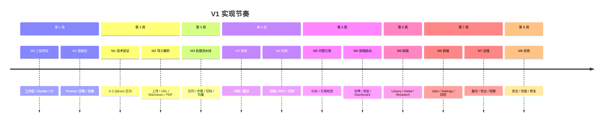
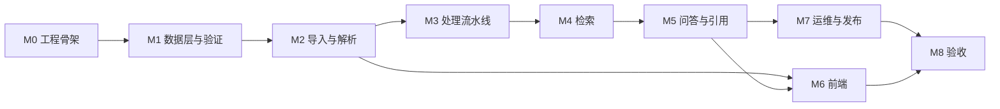

# KnowledgeOS 实现计划

| 项 | 内容 |
| --- | --- |
| 文档版本 | v1.0 |
| 日期 | 2026-10-31 |
| 上游 | `TECHNICAL_DESIGN.md`、`DATABASE_DESIGN.md`、四份 PRD |
| 覆盖范围 | V1 逐任务可执行；V1.5 / V2 / V3 里程碑级拆解 |
| 执行方式 | 单人开发，串行版本；版本内允许前后端并行 |
| 进度维护 | `docs/PROGRESS.md` 为唯一进度台账，本文件只定义计划 |

---

## 0. 结论

V1 按 9 个里程碑推进：M0 工程骨架 → M1 数据层与技术验证 → M2 导入解析 → M3 处理流水线 → M4 检索 → M5 问答引用 → M6 前端 → M7 运维发布 → M8 验收。后端主链路约 5 周，前端从 M2 后并行约 4 周，总计约 7.5–8 周。

每个任务都必须有：可运行的验证命令、对应的 PRD 验收项、明确的完成定义。**没有验证命令的任务不算完成。**

版本节奏不变：V1 全部验收通过前，不启动 V1.5 开发。

---

## 1. 阶段总览



### 1.1 里程碑依赖



### 1.2 里程碑出口条件

| 里程碑 | 出口条件 |
| --- | --- |
| M0 | `pnpm typecheck`、`pnpm lint`、`docker compose up -d`、`/health/ready` 全部通过 |
| M1 | 迁移可在空库执行；集成测试通过；A-2 压测报告产出 |
| M2 | 四类来源可导入；去重/版本/SSRF 验收通过 |
| M3 | 20 页 PDF 端到端 `ready`；单步重试与对账通过 |
| M4 | Recall@10 ≥ 0.85、MRR ≥ 0.6；对比问题两方均召回 |
| M5 | 流式问答可用；引用 100% 可解析；无证据兜底生效 |
| M6 | 五页可用；四档响应式；键盘全流程；E2E 通过 |
| M7 | 备份恢复演练成功；镜像可一键启动 |
| M8 | PRD 22.1 清单全部通过；发布包产出 |

---

## 2. M0 工程骨架（2 天）

| 任务 | 产出 | 依赖 | 验证 |
| --- | --- | --- | --- |
| M0-T1 | pnpm workspace、Turborepo、TS strict、ESLint、Prettier | — | `pnpm install && pnpm typecheck && pnpm lint` |
| M0-T2 | `docker-compose.yml`：PostgreSQL 16、Redis 7、Qdrant 1.x | — | `docker compose up -d && docker compose ps` |
| M0-T3 | `packages/shared` 基础：错误码、Zod 基础 Schema、常量 | M0-T1 | 单测覆盖错误码映射 |
| M0-T4 | Fastify 骨架、请求 ID、错误信封、CORS、Helmet | M0-T1 | `curl -i http://127.0.0.1:3000/api/v1/health/live` |
| M0-T5 | `/health/ready` 检查 PG/Redis/Qdrant | M0-T2, M0-T4 | 依次停依赖，确认返回 503 与失败项 |
| M0-T6 | CI：lint、typecheck、unit、build | M0-T1 | PR 上 CI 全绿 |

**完成定义：** 新机器按 README 三步（安装、起依赖、起服务）能跑通健康检查。

**验证命令：**

```bash
pnpm install
docker compose up -d
pnpm --filter @kos/api dev
curl http://127.0.0.1:3000/api/v1/health/ready
```

---

## 3. M1 数据层与技术验证（4 天）

| 任务 | 产出 | 依赖 | 验证 |
| --- | --- | --- | --- |
| M1-T1 | `packages/database`：Prisma Schema（全部表）、客户端封装 | M0 | `pnpm --filter @kos/database migrate:dev` 在空库成功 |
| M1-T2 | 原始 SQL 迁移：`search_vector`、GIN、部分唯一索引、触发器 | M1-T1 | 迁移后 `\d+ chunks` 可见生成列与索引 |
| M1-T3 | 仓储层：documents、versions、chunks、jobs、conversations | M1-T1 | 集成测试覆盖 CRUD 与约束冲突 |
| M1-T4 | 种子脚本：owner、默认设置、示例模型配置 | M1-T3 | `pnpm --filter @kos/database seed` 幂等 |
| M1-T5 | Qdrant 客户端封装：建集合、别名、upsert、search、删除 | M0 | 集成测试起临时集合 |
| M1-T6 | A-2 压测脚本：10 万块、3 条件、Top-20 | M1-T5 | `pnpm bench:qdrant` 输出 P50/P95/P99 |
| M1-T7 | 压测结论写入 ADR；决定保留 Qdrant 或切 pgvector | M1-T6 | ADR 更新，后续任务按结论执行 |

**A-2 门槛：**

- P95 ≤ 300ms：保留 Qdrant。
- 300–600ms：优化索引与 HNSW 后复测。
- > 600ms：切 pgvector，更新技术设计与数据库设计。

**完成定义：** 全部表可迁移；约束冲突有测试；A-2 有报告与结论。

**验证命令：**

```bash
docker compose up -d postgres redis qdrant
pnpm --filter @kos/database migrate:dev
pnpm --filter @kos/database seed
pnpm test:integration -- --filter database
pnpm bench:qdrant
```

**注意事项：**

- Prisma Schema 与原始 SQL 迁移分成两个迁移文件，顺序不能反。
- 部分唯一索引 Prisma 不认识，`migrate dev` 可能提示漂移；以迁移文件为准，不执行 `db push`。
- 压测使用临时集合，结束后删除，避免污染开发数据。

---

## 4. M2 导入与解析（5 天）

| 任务 | 产出 | 依赖 | 验证 |
| --- | --- | --- | --- |
| M2-T1 | `StorageAdapter` 本地实现：分片路径、原子写、读取流 | M1 | 单测覆盖路径生成与重名 |
| M2-T2 | 哈希工具：fileHash、contentHash、规范化 | M2-T1 | 相同内容不同换行得到同一 contentHash |
| M2-T3 | `POST /documents/files`：multipart、文件头校验、大小/数量限制 | M2-T1 | 上传 201 个文件被拒绝；伪装扩展名被拒绝 |
| M2-T4 | `POST /documents/text`：长度校验、来源指纹 | M2-T1 | 200,001 字符返回 `TEXT_TOO_LONG` |
| M2-T5 | `POST /documents/urls`：SSRF 防护、重定向逐跳校验、响应体上限 | M2-T1 | 私网、回环、重定向到私网全部拒绝 |
| M2-T6 | Markdown 解析器：标题、段落、列表、代码、表格 + 偏移 | M2-T2 | 固定 fixture 的结构快照测试 |
| M2-T7 | 纯文本解析器：段落与空行 | M2-T2 | 固定 fixture |
| M2-T8 | PDF 解析器：页码、文本项、矩形、加密/扫描件识别 | M2-T6 | 20 页 fixture 抽查 5 个块定位 |
| M2-T9 | HTML 正文提取：readability + linkedom | M2-T5 | 3 个真实网页 fixture |
| M2-T10 | 去重与版本判定：两级哈希、来源追加、版本号 | M1-T3, M2-T2 | AC-M2-1、AC-M2-2 |
| M2-T11 | 文档列表/详情/标签/逻辑删除 API | M1-T3 | 游标分页与筛选测试 |
| M2-T12 | 集成测试：导入 200 文件、10 个损坏 | M2-T3 | AC-M2-3 |

**完成定义：** 四类来源都能生成 `document + version + source + job`；失败项有可读原因；去重和版本规则符合 PRD。

**验证命令：**

```bash
pnpm test:integration -- --filter documents
pnpm test:e2e -- --grep "import"
```

**对应验收：** AC-M2-1、AC-M2-2、AC-M2-3、AC-M2-4、AC-M2-5。

**注意事项：**

- 文件上传先落盘再建记录；事务失败要清理临时文件。
- URL 抓取在 API 层完成，解析器只接收已抓取的 HTML/PDF，避免解析包联网。
- PDF 加密与扫描件是确定性失败，任务标 `failed/needs_ocr`，不自动重试。
- 偏移坐标系统一 UTF-16 code unit，测试要覆盖中文与 emoji。

---

## 5. M3 处理流水线（6 天）

| 任务 | 产出 | 依赖 | 验证 |
| --- | --- | --- | --- |
| M3-T1 | BullMQ：队列定义、连接、worker 启动、优雅退出 | M1 | 重启后任务不丢 |
| M3-T2 | 流水线编排：步骤顺序、`job_steps` 持久化、恢复跳过成功步骤 | M3-T1 | 中断后重试不重跑 parse |
| M3-T3 | `clean` 步骤：页眉页脚、空白、控制字符；长度异常判定 | M2-T6 | fixture 对比 |
| M3-T4 | `metadata` 步骤：标题、语言、作者、字数 | M2-T6 | 缺失时文件名兜底 |
| M3-T5 | 切块器：标题分组、句子边界、代码/表格、重叠、合并 | M2-T6 | golden 测试：10 份 fixture |
| M3-T6 | Embedding Adapter：OpenAI 兼容 + Fake；批量、超时、重试 | M0 | Fake 单测；真实提供商连接测试 |
| M3-T7 | Qdrant 写入：点 ID=chunkId、payload、批量 upsert | M1-T5, M3-T6 | 重跑同一版本不产生重复点 |
| M3-T8 | `index` 步骤：全部块 ready 才置版本 ready | M3-T7 | 人为让 1 块失败，版本不 ready |
| M3-T9 | 对账任务：向量缺失重试、孤儿点删除、事件记录 | M3-T8 | 注入失败 5 分钟内修复 |
| M3-T10 | 任务 API：列表、详情、步骤、单步/整单重试、取消 | M3-T2 | AC-M6-1/2/3 |
| M3-T11 | 并发控制：worker 并发 2，问答并发 3 | M3-T1 | 10 文档处理时接口 P95 ≤ 500ms |

**完成定义：** 上传 20 页 PDF 后端到端 `ready`；块可定位；重复处理块数不变；失败可单步重试；对账可修复。

**验证命令：**

```bash
pnpm --filter @kos/worker dev
pnpm test:integration -- --filter pipeline
pnpm test -- --filter chunking
```

**对应验收：** AC-M3-1、AC-M3-2、AC-M3-3、AC-M3-4、AC-M3-5、AC-M6-1、AC-M6-2、AC-M6-3。

**注意事项：**

- 单步重试必须复用上游产物，不能从头跑。
- 同版本重处理用 `(versionId, chunkIndex)` upsert；不要先删后插，避免引用悬空。
- Qdrant 点 ID 用 chunk UUID，保证 upsert 幂等。
- worker 重启把 `running` 任务标 `failed(WORKER_INTERRUPTED)`，不要静默丢。

---

## 6. M4 检索（5 天）

| 任务 | 产出 | 依赖 | 验证 |
| --- | --- | --- | --- |
| M4-T1 | bigram 生成与查询构造；`search_text` 回填脚本 | M3-T5 | 中文查询召回 fixture |
| M4-T2 | 关键词检索仓储：`ts_rank_cd`、范围过滤、Top-N | M4-T1 | 单测 + 集成测试 |
| M4-T3 | 向量检索仓储：Qdrant filter、Top-N、阈值 | M3-T7 | 过滤条件下推验证 |
| M4-T4 | 查询理解 Adapter：改写、实体、类型；超时降级 | M0 | Fake 输出 + 真实提供商 |
| M4-T5 | 对比型拆分：按实体分别召回后合并 | M4-T4 | AC-M4-1 的双专名场景 |
| M4-T6 | RRF 融合、去重、保序、确定性排序 | M0 | 单测覆盖并列名次 |
| M4-T7 | 重排 Adapter + 失败跳过 | M0 | Fake 与超时测试 |
| M4-T8 | 证据装配：token 预算、块边界截断 | M4-T6 | 预算边界测试 |
| M4-T9 | 检索调试 API + 轨迹持久化 | M4-T2, M4-T3 | 返回每路原始顺序与融合结果 |
| M4-T10 | 评测集：50 条问题 + 期望块；评测脚本 | M4-T2, M4-T3 | `pnpm eval:retrieval` |
| M4-T11 | A-1 关键词召回验证与结论 | M4-T10 | `pnpm bench:keyword` 输出 Recall/MRR |
| M4-T12 | 降级矩阵：向量/关键词/重排单路失败 | M4-T9 | 单路停用后仍返回并标注 |

**门槛：**

- 混合检索 Recall@10 ≥ 0.85，MRR ≥ 0.6。
- 关键词单路 Recall@10 目标 ≥ 0.70；低于 0.50 时按 PRD R-02 收缩为英文 + 专名。
- 不达标时按技术设计 17.1 的退路处理，不静默降级。

**完成定义：** 评测达标；调试 API 能回答「为什么没搜到」与「为什么搜到它」；单路故障可降级。

**验证命令：**

```bash
pnpm eval:retrieval -- --dataset packages/evaluation/fixtures/retrieval.jsonl
pnpm bench:keyword
pnpm test:integration -- --filter retrieval
```

**对应验收：** PRD 17.4、22.1 检索清单、AC-M4-1。

**注意事项：**

- 评测集是产品资产，改动检索参数必须附评测结果。
- RRF 同分排序必须确定，否则测试不稳定。
- 重排不得改变候选集，只能改顺序。
- 范围过滤必须在查询时下推，不能先查后滤。

---

## 7. M5 问答与引用（5 天）

| 任务 | 产出 | 依赖 | 验证 |
| --- | --- | --- | --- |
| M5-T1 | 会话与消息 API：创建、列表、详情、删除、`clientMessageId` 幂等 | M1 | 重复提交返回同一条消息 |
| M5-T2 | SSE 处理：`meta/status/retrieval/delta/citations/done/error` | M5-T1 | curl 可见完整事件序列 |
| M5-T3 | Prompt 构建：证据结构化、注入隔离、引用格式约束 | M4-T8 | Prompt 快照测试 |
| M5-T4 | 流式生成：AI SDK Adapter、首 token 超时、总超时、停止 | M5-T2 | AC-M4-6 |
| M5-T5 | 引用解析与后校验：编号范围、参与生成、块存在 | M5-T4 | AC-M4-3、AC-M4-5 |
| M5-T6 | 无证据路径：不调模型、固定文案、`no_evidence` | M4-T8 | AC-M4-2 |
| M5-T7 | 多轮上下文：最近 6 轮、3000 token、截断提示 | M5-T4 | 回溯性问题从 DB 回答 |
| M5-T8 | 反馈 API：类型、引用序号、快照 | M5-T1 | `citation_wrong` 无序号被拒绝 |
| M5-T9 | 消息历史与引用查询 API | M5-T5 | 历史消息可读、引用可展开 |

**完成定义：** 空库返回「未找到相关内容」；引用 100% 可解析；引用后校验失败有 UI 标识；停止生成保留部分内容。

**验证命令：**

```bash
curl -N -X POST http://127.0.0.1:3000/api/v1/conversations/<id>/messages \
  -H 'content-type: application/json' \
  -d '{"content":"Claude Code 的 skill 和 MCP server 有什么区别"}'
pnpm test:integration -- --filter answering
```

**对应验收：** AC-M4-1、AC-M4-2、AC-M4-3、AC-M4-4、AC-M4-5、AC-M4-6。

**注意事项：**

- 无证据时绝不调用模型，这是产品硬规则。
- 引用解析要排除代码块中的 `[n]`。
- 客户端断开要中止上游请求，保存 `stopped` 状态。
- 助手消息先写 `streaming`，结束再更新，避免刷新丢失。

---

## 8. M6 前端（8 天，可与 M5 并行）

| 任务 | 产出 | 依赖 | 验证 |
| --- | --- | --- | --- |
| M6-T1 | 设计令牌 → Tailwind 4；shadcn 基座；深浅主题 | M0 | 对比度检查；主题切换无写死色值 |
| M6-T2 | 应用壳：导航、路由、查询客户端、错误边界、命令面板 | M6-T1 | 键盘可达；404 正常 |
| M6-T3 | Dashboard：六指标卡、最近导入、任务流、空/加载/错误 | M6-T2 | AC-M1-1..4 |
| M6-T4 | Library：列表/卡片、筛选、搜索、批量、导入抽屉 | M6-T2 | AC-M2 的界面部分 |
| M6-T5 | Document Detail：阅读器、块边界、Chunk 面板、PDF 高亮、版本 | M6-T4 | 引用跳转准确定位 |
| M6-T6 | Research：会话、流式、引用角标、证据面板、轨迹、停止 | M6-T2, M5 | AC-M4-4 |
| M6-T7 | Jobs：列表、详情、步骤时间线、单步/整单重试 | M6-T2, M3 | AC-M6-1..3 的界面部分 |
| M6-T8 | Settings：模型配置、连接测试、检索偏好、存储、Danger Zone | M6-T2 | AC-M12-1..3 |
| M6-T9 | 四态、响应式四档、键盘全流程、深浅主题 | M6-T3..T8 | PRD 22.1 界面清单 |
| M6-T10 | Playwright E2E：导入 → 查看 → 提问 → 引用 → 反馈 | M6-T3..T9 | `pnpm e2e` |

**完成定义：** 五个 V1 页面在 390/768/1024/1440 无横向滚动；每页四态可达；键盘可完成主流程。

**验证命令：**

```bash
pnpm --filter @kos/web dev
pnpm e2e
pnpm test -- --filter web
```

**对应验收：** AC-M1-1..4、AC-M12-1..3、PRD 22.1 界面清单。

**注意事项：**

- 组件从第一行起只用语义令牌，不写十六进制。
- 列表轮询在页面隐藏时暂停。
- 引用角标的悬浮卡要做碰撞检测，不能超出视口。
- PDF 只渲染可视页 ±1，矩形层与 canvas 同步滚动。

---

## 9. M7 运维与发布（3 天）

| 任务 | 产出 | 依赖 | 验证 |
| --- | --- | --- | --- |
| M7-T1 | 数据导出：文档、版本、块、会话、设置（不含密钥明文） | M1 | 导出包可解压、结构完整 |
| M7-T2 | 清空知识库：输入 DELETE、二次确认、清对象与向量 | M7-T1 | AC-M12-3 |
| M7-T3 | 备份脚本：`pg_dump` + 对象目录 + 清单 | M1 | `pnpm backup` 生成可校验文件 |
| M7-T4 | 恢复脚本与演练 | M7-T3 | 恢复后检索可用 |
| M7-T5 | 保留策略任务：逻辑删除 30 天、临时产物 24h、轨迹 90 天 | M3 | 定时任务单测 |
| M7-T6 | 可观测性：健康卡片、队列积压、失败率 | M3 | 人为制造失败可见 |
| M7-T7 | Docker 镜像与生产 compose；升级脚本 | 全部 | `docker compose -f docker-compose.prod.yml up -d` |
| M7-T8 | 运维文档：启动、备份、恢复、升级、故障排查 | 全部 | 他人照文档可完成 |

**完成定义：** 新机器按文档从零启动并提问；备份恢复演练成功；清空知识库后 Dashboard 归零。

**验证命令：**

```bash
pnpm backup
pnpm restore --file backup/knowledgeos-2026-10-31.dump
docker compose -f docker-compose.prod.yml up -d
curl http://127.0.0.1:3000/api/v1/health/ready
```

**对应验收：** AC-M12-3、PRD 22.1 运维清单。

---

## 10. M8 验收与发布（4 天）

| 任务 | 产出 | 验证 |
| --- | --- | --- |
| M8-T1 | 跑 PRD 22.1 全部验收项，逐条记录证据 | 验收记录表 |
| M8-T2 | 性能：非 LLM 接口 P95、检索 P95、首 token P95、处理耗时 | 压测报告 |
| M8-T3 | 安全：SSRF、伪装文件、密钥泄露、提示注入 | 安全测试报告 |
| M8-T4 | 缺陷修复与回归 | 全部 AC 通过 |
| M8-T5 | 发布：版本号、CHANGELOG、镜像 tag、部署包 | 发布清单 |

**完成定义：** PRD 22.1 清单全部通过；无 P0/P1 缺陷；发布包可在干净机器启动。

**验收记录格式：**

| 验收项 | 结果 | 证据 | 日期 |
| --- | --- | --- | --- |
| AC-M2-1 | 通过 | `tests/import/dedupe.spec.ts` + 截图 | 2026-11-XX |

---

## 11. 测试策略

### 11.1 分层

| 层 | 工具 | 覆盖 |
| --- | --- | --- |
| 单元 | Vitest | 切块、bigram、RRF、引用解析、SSRF 判断、哈希 |
| 组件 | Testing Library | 四态、表单校验、引用角标 |
| 集成 | Vitest + Testcontainers | 迁移、仓储、任务、检索、SSE |
| 端到端 | Playwright | 导入 → 查看 → 提问 → 引用 → 反馈 |
| 评测 | 自研脚本 | Recall@10、MRR |
| 压测 | 自研脚本 | Qdrant、接口 P95 |
| 安全 | 集成 + 手工 | SSRF、文件头、注入、密钥 |

### 11.2 测试数据

- `packages/evaluation/fixtures/documents/`：Markdown、文本、20 页 PDF、双栏 PDF、加密 PDF、扫描件。
- `packages/evaluation/fixtures/retrieval.jsonl`：50 条问题与期望块。
- `packages/llm/src/testing/FakeProvider.ts`：固定输出、可控超时、可控失败。
- 所有集成测试使用独立 schema 或临时数据库，不污染开发数据。

### 11.3 必测边界

- 同一文件重复导入、内容修改后导入、不同文件名同内容。
- 200 文件批量中 10 个损坏。
- 20 万字符上限、2000 字符问题上限。
- 中文、英文、代码块、表格、emoji 偏移。
- 向量写入部分失败、Qdrant 短暂不可用。
- LLM 超时、返回非法格式、引用编号越界。
- SSRF：私网、回环、链路本地、重定向绕过、DNS 重绑定。
- 提示注入文本不影响回答行为。

---

## 12. 版本扩展计划

### 12.1 V1.5 LLM Wiki（6–8 周）

**前置：** V1 的 AC-M3-1、AC-M4-2、AC-M4-3 全部通过。

| 里程碑 | 任务 | 验证 |
| --- | --- | --- |
| V15-M1 | 抽取 Schema、LLM 结构化输出、按块缓存、失败跳过 | 抽取 100 块，Schema 通过率 ≥ 98% |
| V15-M2 | 实体对齐、关系/事实入库、来源块校验 | 抽检 50 条，来源可解析率 100% |
| V15-M3 | 归属判定三级规则、判定记录 | 构造 20 组近似概念，无误并 |
| V15-M4 | Wiki 编译：页面模板、段落-证据绑定、引用验证 | 每段至少一个证据锚点 |
| V15-M5 | 冲突检测：数值/否定/时间 | 构造 10 组冲突，全部标记 |
| V15-M6 | 提案生成、10 分钟合并、幂等 | 同一版本重复触发不产生重复提案 |
| V15-M7 | 审核工作台 API：接受/拒绝/改写、`baseRevisionId` 校验 | AC-V15-6 |
| V15-M8 | 版本、回滚、过期提醒、双链 | AC-V15-4、AC-V15-8、AC-V15-10 |
| V15-M9 | Wiki 前端：页面树、阅读、编辑、审核、冲突 | 四态 + 响应式 |
| V15-M10 | 12 条验收 + 提案质量报告 | AC-V15-1..12 |

**出口：** 12 条验收通过；提案质量报告（前 100 条接受率、拒绝原因分布、平均审核耗时）产出。

### 12.2 V2 图谱与 Agent（6–8 周）

**前置：** V1.5 的实体/关系质量达标。

| 里程碑 | 任务 | 验证 |
| --- | --- | --- |
| V2-M1 | 关系入图门槛、待定区、去噪 | AC-V2-4 |
| V2-M2 | 邻域查询（≤3 跳）、路径查询、每条边带证据块 | AC-V2-1 |
| V2-M3 | 路径评分、第三路检索、RRF 融合 | 关系型问题证据面板出现路径 Tab |
| V2-M4 | 图谱 UI：两跳聚焦、按需展开、400 节点聚合 | AC-V2-2、AC-V2-11 |
| V2-M5 | Agent 运行时：工具注册、白名单、步数/预算、失败恢复 | AC-V2-6、AC-V2-7 |
| V2-M6 | 执行记录：完整调用链、脱敏、不可编辑 | AC-V2-9 |
| V2-M7 | Agent UI：配置、试运行、执行记录 | 四态 |
| V2-M8 | 12 条验收 + 图谱质量报告 | AC-V2-1..12 |

**出口：** 12 条验收通过；抽样 200 条关系的质量报告产出。

### 12.2.1 V2.1 3D 图谱（1 周）

**前置：** V2 已验收；2D 图谱与列表可用。

| 里程碑 | 任务 | 验证 |
| --- | --- | --- |
| V2.1-T1 | 视图模式、WebGL 探测、UIUX 3D 章节 | 视图模式 7 条单测 |
| V2.1-T2 | 3D 数据适配、配色与几何体 | 适配/样式 6 条单测 |
| V2.1-T3 | 3D 组件：懒加载、冻结布局、几何体标签 | 组件单测；独立 chunk ≤450KB |
| V2.1-T4 | GraphPage 三态切换与持久化 | RTL + E2E 默认 3D/平面 |
| V2.1-T5 | 相机、悬停、搜索定位、重置 | 组件单测 + E2E |
| V2.1-T6 | 隐藏节点列表与键盘 | RTL + E2E |
| V2.1-T7 | WebGL 降级、上下文丢失、慢设备提示 | E2E 无 WebGL/上下文丢失 |
| V2.1-T8 | 10 条验收 + 3D 性能报告 | AC-V2.1-1..10；首帧/帧率/chunk |

**出口：** 10 条验收通过；`GRAPH_3D_PERFORMANCE_REPORT.md` 产出。

### 12.2.2 V2.2 平面图谱交互（1 周）

| 里程碑 | 任务 | 验证 |
| --- | --- | --- |
| V2.2-T1 | 视口数学 | 缩放/平移/坐标换算 4 条单测 |
| V2.2-T2 | 稳定布局 | 已有节点不重算 3 条单测 |
| V2.2-T3 | Graph2DView 缩放/平移/重置 | 组件单测 + 2D E2E |
| V2.2-T4 | 搜索聚焦与面包屑 | 页面单测 + 2D E2E |
| V2.2-T5 | 悬停/边标签/图标/点阵 | 组件与图标单测 |
| V2.2-T6 | 展开动画/无邻居/图例 | 组件单测 + 位置稳定 E2E |
| V2.2-T7 | 8 条验收 | `ACCEPTANCE_V2.2.md` |

**出口：** 8 条验收通过；平面视图缩放、平移、搜索、面包屑、悬停可用。

### 12.3 V3 MCP Server（4–6 周）

**前置：** V1 检索质量稳定，V1.5 Wiki 已发布。

| 里程碑 | 任务 | 验证 |
| --- | --- | --- |
| V3-M1 | stdio MCP 服务、五个只读工具 | AC-V3-1 |
| V3-M2 | 令牌创建/吊销/作用域；哈希存储 | AC-V3-3、AC-V3-4 |
| V3-M3 | 检索阶段作用域下推 | AC-V3-2 |
| V3-M4 | 审计与限流；不记录正文 | AC-V3-8、AC-V3-9 |
| V3-M5 | `propose_knowledge_update`（默认关闭） | AC-V3-5 |
| V3-M6 | 32KB 截断与可疑内容标记 | AC-V3-7、AC-V3-10 |
| V3-M7 | HTTP 传输 + TLS + Origin 校验 | 远程调用可用 |
| V3-M8 | Claude Code / Cursor 接入验证 | 两份配置片段与验证记录 |
| V3-M9 | 10 条验收 + 外部可用性报告 | AC-V3-1..10 |

**出口：** 10 条验收通过；外部可用性报告产出。

---

## 13. 发布清单

### 13.1 V1 发布前检查

- [ ] 全部迁移在空库可执行。
- [ ] `pnpm typecheck`、`pnpm lint`、`pnpm test`、`pnpm test:integration`、`pnpm e2e` 全绿。
- [ ] 检索评测达标并记录。
- [ ] PRD 22.1 验收清单全部通过。
- [ ] 备份恢复演练成功。
- [ ] 安全测试通过（SSRF、文件头、密钥、注入）。
- [ ] 生产 compose 在干净机器启动成功。
- [ ] README、`.env.example`、运维文档完整。
- [ ] CHANGELOG 与版本号更新。
- [ ] 镜像 tag 与部署包归档。

### 13.2 发布命令

```bash
pnpm install --frozen-lockfile
pnpm build
pnpm test
pnpm test:integration
pnpm e2e
docker compose -f docker-compose.prod.yml build
docker compose -f docker-compose.prod.yml up -d
pnpm --filter @kos/database migrate:deploy
```

---

## 14. 进度维护

### 14.1 台账规则

- 唯一台账：`docs/PROGRESS.md`。
- 任务状态只有四种：`TODO`、`DOING`、`DONE`、`BLOCKED`。
- 每完成一个任务，更新状态、日期、证据链接（测试文件或 PR）。
- 每完成一个里程碑，更新出口条件检查结果。
- 阻塞项必须写原因与解除条件，不能只标 `BLOCKED`。

### 14.2 状态模板

| 里程碑 | 任务 | 状态 | 开始 | 完成 | 证据 |
| --- | --- | --- | --- | --- | --- |
| M0 | M0-T1 工作区 | TODO | — | — | — |

### 14.3 每周检查

- 本周完成任务与计划偏差。
- 阻塞项是否解除。
- 评测指标是否退化。
- 是否需要调整里程碑顺序。

---

## 15. 风险与缓冲

| 风险 | 触发信号 | 应对 |
| --- | --- | --- |
| A-2 压测不达标 | P95 > 600ms | 切 pgvector；更新两处设计；不影响上层接口 |
| A-1 关键词召回不达标 | 关键词 Recall < 0.5 | 收缩为英文 + 专名并标注；不引入 ES |
| PDF 解析质量差 | 评测 PDF 命中率显著低 | 标注「仅支持单栏文本型」；V2 再评估独立服务 |
| 引用后校验误报高 | 失败率 > 5% | 调阈值；只提示不降级 |
| 前端工期超预期 | M6 第 6 周仍未完成 Research | 砍 P1：检索轨迹面板、版本对照延后 |
| 模型成本超预算 | 单日 token 超预算 | 降并发、缓存向量、限制证据预算 |
| Windows 开发环境差异 | 路径/换行/文件锁问题 | 统一对象键为 posix；测试用固定换行 |

**缓冲：** 每个里程碑预留 0.5 天；M8 预留 2 天修复。总缓冲约 5 天，符合 7.5–8 周目标。

---

## 16. 任务与验收映射

| 验收项 | 主要任务 |
| --- | --- |
| AC-M1-1..4 | M6-T3、M1-T3 |
| AC-M2-1..5 | M2-T3、M2-T5、M2-T10、M2-T12 |
| AC-M3-1..5 | M3-T5、M3-T7、M3-T8、M3-T11 |
| AC-M4-1..6 | M4-T5、M5-T4、M5-T5、M5-T6 |
| AC-M6-1..3 | M3-T10、M6-T7 |
| AC-M12-1..3 | M6-T8、M7-T2 |
| PRD 22.1 检索 | M4-T10、M4-T11 |
| PRD 22.1 安全 | M2-T5、M8-T3 |
| PRD 22.1 运维 | M7-T3、M7-T4、M7-T7 |

---

**下一步。** 技术设计、数据库设计、实现计划三份文档定稿后，按 M0-T1 开始编码；每完成一个任务更新 `docs/PROGRESS.md`。
