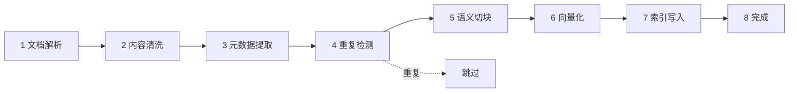
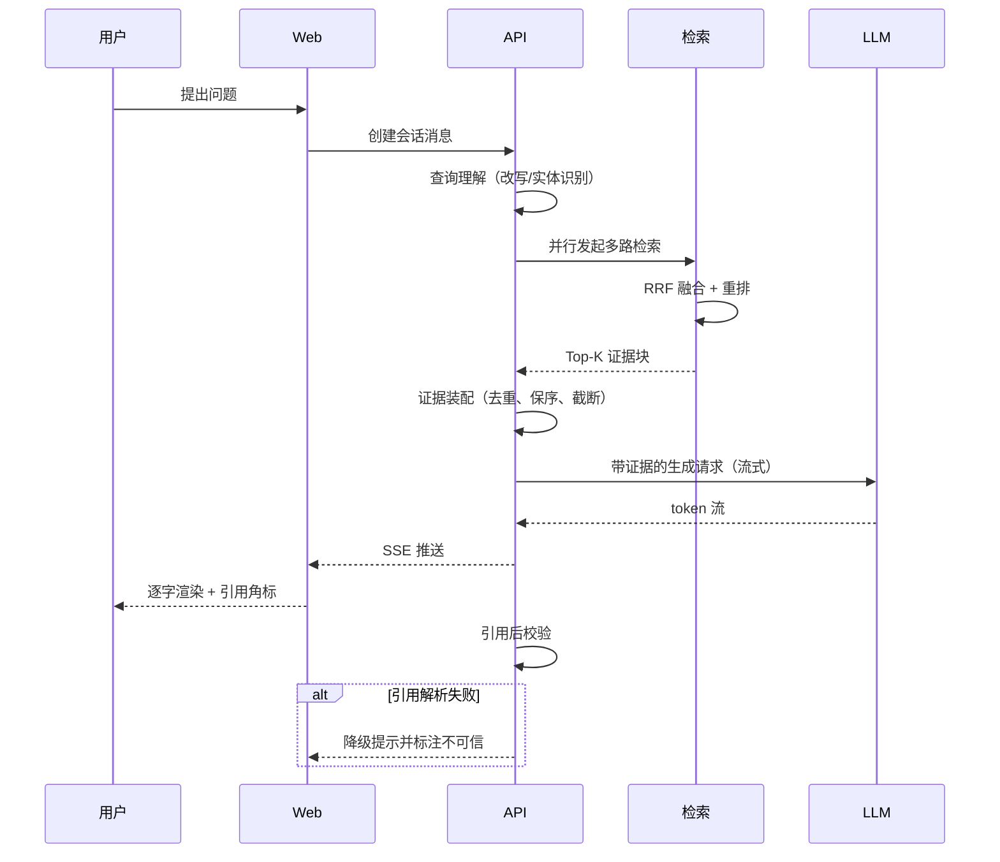
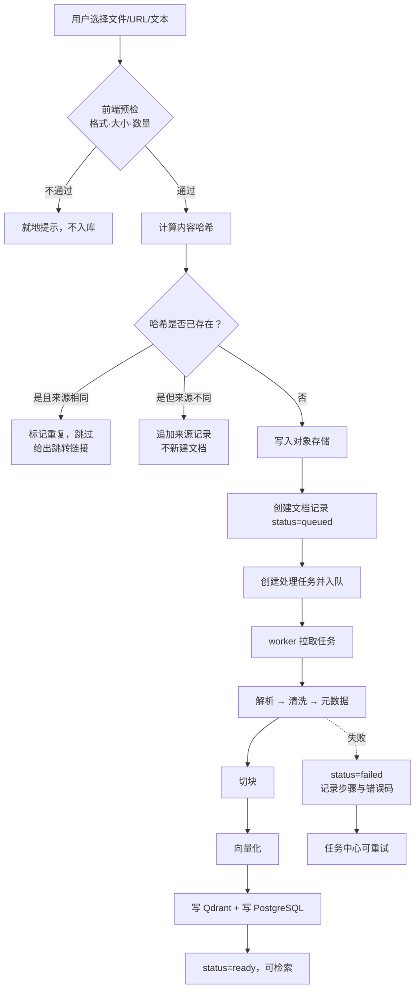
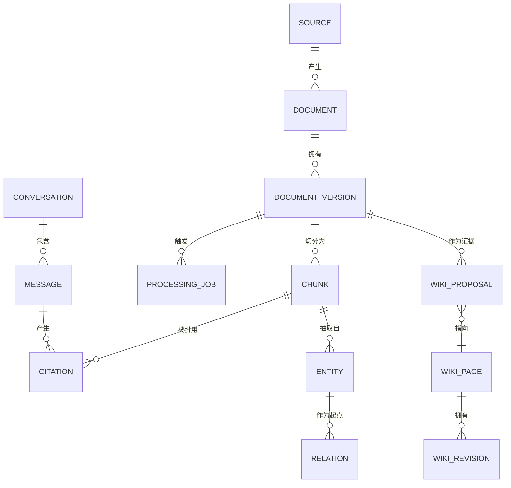
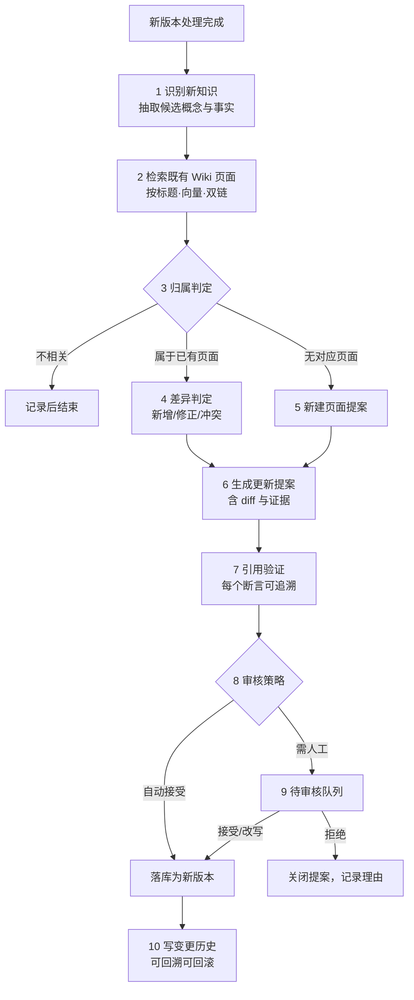
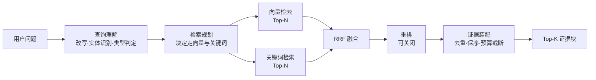
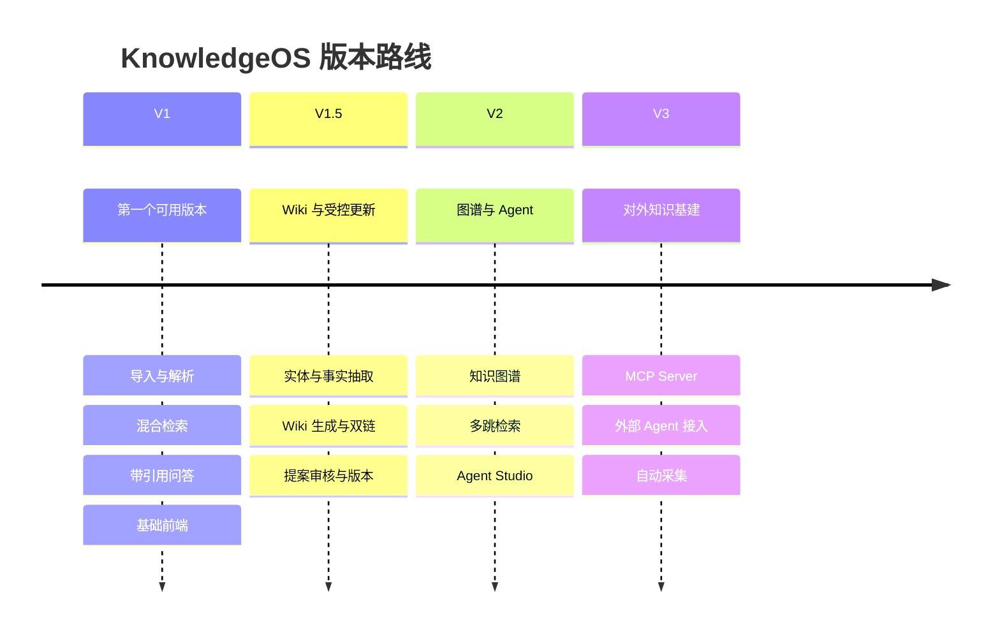

# KnowledgeOS — AI Knowledge Engine 产品需求文档（V1 基线）

| 项 | 内容 |
| --- | --- |
| 对应版本 | **V1**。本文即 V1 的 PRD；V1.5 见 `PRD_V1.5_Wiki.md`，V2 / V3 尚未产出 |
| 文档版本 | v1.0（评审稿） |
| 撰写日期 | 2026-10-31 |
| 文档状态 | 待评审，评审通过后进入 Technical Design |
| 适用阶段 | V1 需求冻结基线；V1.5–V3 仅作范围指引 |
| 读者 | 产品、前端、后端、AI 工程、后续 AI Coding Agent |
| 文档边界 | 本文只回答「做什么、为什么、验收标准是什么」。表结构、接口签名、目录结构、算法实现不在本文定稿，见后续 `TECHNICAL_DESIGN.md`、`DATABASE_DESIGN.md`、`IMPLEMENTATION_PLAN.md` |

---

## 0. 阅读须知

### 0.1 本文的定位

这份 PRD 是四个文档中的第一份。它负责把范围、规则和验收标准钉死，让后续三份文档有唯一依据。

判断一段内容该不该写进本文，用的是同一个尺子：**如果写错会导致产品做错东西，就写进 PRD；如果写错只会导致实现难看，就留给技术设计。** 所以本文会出现「同一文档重复导入必须命中去重而不是新建」「回答里的引用必须能解析到真实 Chunk」这类规则，但不会出现建表语句和函数签名。

### 0.2 版本标记约定

全文所有能力都带一个范围标记，含义固定：

- **【V1】** 本期必须实现，缺失即视为 V1 未交付。
- **【V1.5】**、**【V2】**、**【V3】** 已规划但不在本期实现，写在这里是为了让 V1 的数据模型和接口留出生长空间，**不代表本期要做**。
- **【预留】** 只约束架构边界（比如「检索层不得直连具体向量库」），本期不产生任何用户可见功能。

### 0.3 一条必须先说清楚的事

原始需求把 LLM Wiki、知识图谱、Agent Studio、MCP Server 全部写进了「V1 必须实现的目标」，又把它们分别排在 V1.5、V2、V3。这两套说法差了一个版本。

本 PRD 采用**版本规划口径**：V1 只做「导入 → 解析 → Chunk → Embedding → 混合检索 → 带引用的问答」加基础前端。Wiki 从 V1.5 开始，图谱 V2，MCP V3。

这个取舍有代价，写在第二十三章风险 R-01 里，并已在 0.4 决策。

### 0.4 已决事项（2026-10-31）

原文里三条悬而未决的项已经定了。**定了就不再在评审里反复讨论**，除非出现新证据。三条都属于「选了会限制后续选项」的类型，所以每条都写清理由与后果。

**决策一：R-01 同质化风险——接受，不扩 V1 范围。**

理由：V1 的差异化不是「有没有 Wiki」，而是「每条回答都敢信」。把 Wiki 提前，工期会从 7.5 周涨到 12 周以上，而 Wiki 依赖的块质量此刻还没被验证——在没验证地基的情况下先盖楼，是拿最大的风险换最小的收益。

后果与补救：如果早期用户反馈「和普通 RAG 没区别」，**第一个动作是做「结构化摘要」**（把回答归纳成「结论 / 依据 / 分歧」三层骨架），而不是提前上 Wiki。这个补救的成本约一周，且能被 V1.5 复用。

**决策二：A-1 中文关键词检索——采用二元分词 + PostgreSQL 全文索引。**

理由：单机部署下引入独立搜索引擎（Elasticsearch / OpenSearch）会多一套要运维的进程，而本产品的检索规模（十万块以内）远没到需要它的程度。二元分词（bigram）在中文技术材料上的召回通常够用，成本最低且可控。

验证门槛：50 条评测集上 Recall@10 ≥ 0.85。**不达标时的退路是把关键词路径收缩为「只覆盖英文与专名」**，并在检索轨迹里明确标注这条路径的能力边界——不静默降级，也不为了指标好看而引入新组件。

**决策三：A-2 Qdrant 过滤性能——保留 Qdrant，但设压测门禁。**

理由：双存储的运维成本确实存在，但 Qdrant 在「向量 + 多条件过滤」的组合查询上强于 pgvector，而本产品的检索几乎总是带过滤（按标签、按文档集合、排除历史版本）。换 pgvector 省的是运维，换来的是查询能力下降，这笔交换在十万块量级不划算。

门禁：10 万块数据、3 个过滤条件、Top-20，P95 ≤ 300ms。**这条在技术设计阶段用压测执行，不等到实现阶段**——不达标就换 pgvector 单库，而不是硬扛。

三条决策的共同逻辑：**优先减少系统里需要维护的东西，其次才是追求单项指标的最优。** 单用户产品的失败原因通常不是「不够先进」，而是「组件太多，坏了一个就起不来」。

---

## 目录

1. 产品概述
2. 产品定位
3. 产品愿景
4. 目标用户
5. 用户痛点
6. 核心使用场景
7. 产品功能架构
8. 功能模块详细需求
9. 用户角色和权限
10. 核心业务流程
11. 页面信息架构
12. 页面交互设计
13. 数据模型
14. API 需求
15. Agent 能力设计
16. LLM Wiki 更新机制
17. 检索系统设计
18. MCP 接入设计
19. 非功能性需求
20. 技术架构
21. 版本迭代规划
22. 验收标准
23. 风险分析
24. 后续扩展方向
附录 A. 待验证技术清单
附录 B. 术语表

---

## 1. 产品概述

KnowledgeOS 是一个跑在自己电脑或自己服务器上的个人知识系统。用户把散落在各处的材料——Markdown 笔记、PDF 论文、网页、随手记的片段——丢进去，系统负责解析、切块、建索引，最后让用户能用一个自然语言问题把答案连着原文出处一起问出来。

它要解决的不是「我有没有存下这份资料」，而是「三个月前读过的东西，现在还记得它说了什么、在哪一页、和哪篇文档互相矛盾」。

和市面上三类产品相比，它的边界是清楚的：

**不是笔记软件。** Obsidian、Notion 的信任模型是「人写、机器存」。KnowledgeOS 的写入方主要是机器，人只做校对和裁决。这决定了它必须有处理流水线、有失败重试、有幂等，而这些在笔记软件里是不存在的概念。

**不是 RAG 问答玩具。** 那种产品通常只有一个上传框和一个聊天框，回答完就结束，引用是装饰性的。KnowledgeOS 的引用是产品的一等公民：每一条回答都必须能点回具体的文档、具体的段落，甚至具体的高亮位置。

**不是知识图谱产品。** 图谱在这个产品里是**服务检索和理解的手段**，不是目的。V1 甚至不构建图谱，而是靠 Chunk 与来源的强关联来保证可追溯。把每条笔记都强行变成三元组，是把成本花在了用户看不见的地方，这个错误我们明确不犯。

产品在 V1 之后的演进方向，是把「存下来的知识」逐步变成「会自己长大的知识」——LLM 依据新进来的材料，主动提出对既有 Wiki 页面的修改提案，人审过之后才落库。这条路径的技术核心不是更大的模型，而是**受控的知识更新机制**：谁能改、改什么、依据是什么、改坏了怎么退回去。

---

## 2. 产品定位

一句话：**面向个人开发者与 AI Agent 的、可持续生长的本地知识引擎。**

拆成三个关键词：

**本地优先（Local-first）。** 数据默认落在用户自己的 PostgreSQL 与对象存储里，原始文档永不外流到第三方平台。调用外部 LLM 时，只发送必要的上下文片段，且发送内容对用户可见、可关闭。这一点决定了产品的隐私叙事，也决定了它不能做成纯 SaaS。

**开发者导向。** 目标用户的材料是 Claude Code、MCP、Agent Skills、TypeScript 这类技术内容，提问方式也偏技术（「Claude Code 的 skill 和 MCP tool 有什么区别」「这个仓库用的还是 LangGraph 旧版 API 吗」）。产品不需要为「非技术用户」做降智，反而要能读得懂代码块、能定位到行号、能区分「文档说」和「代码里实际是」。

**面向 Agent 的第二形态。** 人用界面，Agent 用接口。同一个知识库，既能在浏览器里问答，也能通过 MCP 被 Claude Code、Cursor 读取。这决定了系统从一开始就要把「检索」设计成一个与 UI 解耦的能力，而不是写在某个 React 组件里的 fetch。

与相邻产品的差异化，落在四个地方：

| 维度 | 普通 RAG 工具 | 笔记 + AI 插件 | KnowledgeOS |
| --- | --- | --- | --- |
| 引用可信度 | 装饰性引用，常有胡编 | 无引用 | 引用必须解析到真实 Chunk，解析失败即视为回答失败 |
| 更新机制 | 无 | 人工 | V1.5 起为「提案—验证—审核—版本」的受控流程 |
| 对外能力 | 无 | 无 | V3 起提供只读 MCP 工具 |
| 数据归属 | 平台 | 本地 | 本地，原始文档与索引都在用户手里 |

---

## 3. 产品愿景

**让知识持续生长，而不是只被存储。**

这句话有三个可以验收的推论，避免它变成一句空话：

其一，**知识应当可被重新组织，而不只是被检索。** 一份新论文进来，系统应该能意识到「它补充了已有的某篇 Wiki 页面」，而不是在库里多出第十个孤立的文档。这是 V1.5 的目标。

其二，**知识的可信度应当可被检验，而不只是被引用。** 任何一句回答，用户都能在三次点击内看到原文、看到上下文、看到这段原文属于哪个版本。这是 V1 的目标。

其三，**知识的边界应当可被外部复用，而不只是被本人使用。** 用户写的 Agent 应该能读到这套知识，就像读到一套文档。这是 V3 的目标。

长期看，这个产品想回答的问题是：**当一个人持续学习三年，他积累的东西能不能形成一个有结构、可维护、可被机器使用的知识体，而不是一堆再也打不开的收藏夹。** 这个问题当前没有好答案，我们想试着给一个。

---

## 4. 目标用户

### 4.1 第一阶段：个人开发者（唯一目标用户）

V1 只服务一个用户群体，不做多租户，不做组织协作。以下是四类典型画像，按优先级排列。

**P1 前端开发者，正在往 AI 方向转。** 手里有一堆教程、博客、开源仓库 README，学过 RAG 但总记不住 LangChain 和 LangGraph 的分工。提问方式是「我想做一个能记住上下文的客服 bot，用 LangGraph 的话状态该放哪」。他需要的是能把零散材料串成体系，而不是再收藏十篇公众号文章。

**P1 AI Agent 工程师。** 同时跟踪 MCP 协议版本、Anthropic 的 Agent Skills 规范、各种 Agent 框架的 API 变更。材料更新极快，最痛的是「我记得有个字段改过名，但记不清是哪版」。他需要的是版本敏感、能回答「现在是什么」而不是「曾经是什么」。

**P2 技术研究人员。** 读论文、记实验、比方法。需要 PDF 解析足够好、需要能对同一篇论文的不同版本做对比、需要引用精确到章节。

**P2 长期学习者。** 没有明确项目压力，纯粹想把学的东西沉淀下来。使用频率低但周期长，对「三个月后回来还能用」的要求最高。

四类人共享一个特征：**他们既写代码也用 AI，所以能容忍配置，但不能容忍黑箱。** 这直接影响产品决策——允许用户看到检索命中了哪些 Chunk、允许手动关闭某一路检索、允许查看每次处理任务的日志。

### 4.2 明确不服务的用户（V1）

非技术用户、企业团队、需要多人协作编辑的团队、需要云端同步多设备的用户。不是永远不做，是 V1 的架构和交互都不为这些人优化，避免为了兼容他们牺牲开发者的使用体验。

### 4.3 目标用户的共同材料特征

理解这一点比理解画像更重要，因为它决定了处理流水线的设计：

材料是**长短极度不均**的（一条推文和一本书）、**结构极度不均**的（PDF 双栏排版 vs 纯 Markdown）、**时效性极强**的（框架 API 三个月一变）、**互相引用极多**的（一篇博客引用一个仓库，仓库引用一份规范）。任何假设「文档是同质的」的设计都会在真实使用中崩掉。

---

## 5. 用户痛点

按「痛感强度 × 当前无解程度」排序，前四条是 V1 必须缓解的，后两条是 V1.5 之后才有解的。

**痛点一：存了等于没存。** 收藏夹、书签、下载目录里的 PDF，存的那一刻是「我以后会看」，之后再也打不开。根本原因不是懒，是**重新进入的成本太高**——要找、要回忆在哪、要重新读。检索式问答能把这个成本压到一次输入。

**痛点二：搜得到字，搜不到意思。** 用 `grep` 或编辑器全文搜索，只能匹配字面。用户记得「那个说 embedding 维度选太大会拖慢检索的段落」，但原文用的是「高维向量会显著增加近邻搜索开销」，关键词搜不到。这是纯关键词检索的根本局限，也是必须做向量检索的理由。

**痛点三：反过来，只懂意思，答不准。** 只做向量检索又会丢精确性。用户问「`maxCharsPerRequest` 这个字段叫什么」，向量检索会召回语义相近但字段名不同的段落。技术内容里专有名词、字段名、版本号极多，**关键词这一路不能砍**。这是本产品坚持混合检索而不是纯向量的原因。

**痛点四：回答不可信。** 通用聊天模型对用户私有材料只能瞎猜，或者基于训练数据里过时的版本回答。用户真正需要的是「用我库里的材料回答我」，并且**能验证**。没有可点击引用的问答，对技术用户来说价值接近于零。

**痛点五（V1.5）：知识之间没有关系。** 同一个概念在五份材料里出现，用户读的是五份割裂的文档，而不是一个统一的概念页。系统不会告诉他「你上周读的那篇和这篇在打架」。

**痛点六（V1.5/V2）：知识会过期，但没人提醒。** MCP 规范更新了，库里还是旧版描述，用户不知道。系统也不知道自己不知道。

---

## 6. 核心使用场景

以下六个场景是 V1 验收时逐条走查的，编号会在后续章节被引用。

### S-01 批量导入与首次建库【V1】

用户把下载目录里 30 个 PDF、20 个 Markdown、10 个收藏的网页链接一次性导入。系统逐个解析、去重、切块、建索引，过程中用户能看到每个文件的处理阶段，失败的有明确原因和重试按钮。全部完成后，Dashboard 上的数字与他实际导入的数量对得上。

关键点：**不能要求用户一个个点上传。** 批量是常态。也**不能因为一个文件失败就阻塞其余文件**。

### S-02 精确召回某个技术细节【V1】

用户问：「Claude Code 的 skill 和 MCP server 到底什么区别」。系统做查询理解，识别这是个对比型问题、涉及两个专有名词，同时走向量与关键词两路检索，融合排序后取前若干 Chunk，生成回答，并给出两条可点击引用，分别落在讲 skill 的文档和讲 MCP 的文档上。

关键点：**两个专有名词都要被召回**，只召回其中一个即为失败。

### S-03 验证一个回答是否编造【V1】

用户对回答里「Qdrant 支持稀疏向量做混合检索」这句话不放心，点击引用，右侧抽屉打开原文，高亮到具体段落，并显示来源文件、导入时间、版本号。用户判断：确实有这句，但原文说的是某个版本之后才支持，回答省略了版本限定——于是给出「部分正确」的反馈。

关键点：**点击引用必须落到段落级，不是落到文档首页。** 落到首页等于没做引用。

### S-04 同一份材料的更新替换【V1】

用户下载了某规范的第二版 PDF，导入后发现文档列表里没有多出一条重复项，而是原文档变为「版本 2」，且问答时优先使用新版本。旧版本仍可查、可对照。

关键点：**去重是按内容哈希判定的，不是按文件名。** 文件名相同但内容不同是更新；文件名不同但内容相同是同一条。

### S-05 新增材料后知识体系随之更新【V1.5】

新论文进来后，系统发现它与已有 Wiki 页面「Hybrid Retrieval」强相关，同时提出了一个与既有描述不一致的结论。系统生成更新提案：建议修改该页面的第二节，附上新来源引用，并标记冲突点。用户在待审核列表里看到提案、看到 diff、看到证据，选择接受、拒绝或手动改写。

关键点：**系统不能自动落库。** 未经审核的提案对 Wiki 只读部分不可见。

### S-06 让外部 Agent 使用这套知识【V3】

用户在 Claude Code 里配置了 KnowledgeOS 的 MCP server，然后说「查一下我知识库里关于 RRF 的实现细节」。Claude Code 调用 `search_knowledge`，拿到带来源的片段，继续工作。整个过程用户不需要切换窗口。

关键点：**只读。** 外部 Agent 不得通过 MCP 写入或修改知识，写入必须走人工审核通道。

## 7. 产品功能架构

### 7.1 分层结构

系统按「能力层」而不是「页面」分层。页面是能力的组合，不是能力本身——同一份检索能力既被 AI Research 页面使用，也被 V3 的 MCP 工具使用，如果按页面组织代码，这份能力会被复制两遍。

```mermaid
flowchart TB
    subgraph L1["接入层"]
        WEB["Web 工作台<br/>React + Vite"]
        MCP["MCP Server<br/>V3"]
    end
    subgraph L2["应用服务层"]
        API["API 服务<br/>Fastify"]
        JOB["任务调度<br/>BullMQ"]
    end
    subgraph L3["知识能力层"]
        PARSE["解析与清洗"]
        CHUNK["语义切块"]
        EMB["向量化"]
        RET["混合检索"]
        ANS["问答编排"]
        EXTRACT["实体/关系/事实抽取<br/>V1.5"]
        WIKI["Wiki 编译引擎<br/>V1.5"]
    end
    subgraph L4["基础设施层"]
        PG[("PostgreSQL<br/>元数据 + 关键词索引")]
        QD[("Qdrant<br/>向量索引")]
        RD[("Redis<br/>队列 + 缓存")]
        OBJ[("对象存储<br/>原始文件")]
        LLM["LLM / Embedding / Rerank<br/>Adapter"]
    end
    WEB --> API
    MCP --> API
    API --> JOB
    API --> RET
    API --> ANS
    JOB --> PARSE
    PARSE --> CHUNK
    CHUNK --> EMB
    EMB --> QD
    PARSE --> PG
    CHUNK --> PG
    EMB --> LLM
    ANS --> RET
    ANS --> LLM
    RET --> PG
    RET --> QD
    JOB --> RD
    PARSE --> OBJ
    EXTRACT -.V1.5.-> WIKI
    WIKI -.V1.5.-> PG
```

图里有两处值得注意。一是 **MCP Server 与 Web 走同一个 API**，不是一个独立的数据通路，避免两套权限判断。二是 **V1.5 的 Wiki 编译依赖 V1 的 Chunk 与来源关系**，这条虚线决定了 V1 的 Chunk 设计必须一次做对，否则 V1.5 要回炉。

### 7.2 模块总表

| 编号 | 模块 | 范围 | 一句话职责 | 依赖 |
| --- | --- | --- | --- | --- |
| M1 | Dashboard | V1 | 真实指标总览，点得进去 | M2–M6 |
| M2 | Knowledge Library | V1 | 原始材料的收、管、看 | M3 |
| M3 | Knowledge Processing | V1 | 把原始材料变成可检索的块 | M2 |
| M4 | AI Research | V1 | 带引用的问答 | M3, M5 |
| M5 | 检索系统 | V1 | 混合召回与排序 | M3 |
| M6 | 处理任务中心 | V1 | 任务状态、日志、重试 | M3 |
| M7 | LLM Wiki | V1.5 | 自动生成与维护结构化页面 | M3, M8 |
| M8 | 知识抽取 | V1.5 | 实体、关系、事实 | M3 |
| M9 | Knowledge Graph | V2 | 关系查询与可视化 | M8 |
| M10 | Agent Studio | V2 | Agent 配置与执行记录 | M4 |
| M11 | MCP Server | V3 | 对外只读知识接口 | M5 |
| M12 | Settings | V1 | 模型、密钥、存储、偏好 | — |

表中 M5（检索系统）不在第 8 章单独展开，其需求集中写在第 17 章，因为检索是跨模块能力而不是一个页面；M6（任务中心）见 8.9。

### 7.3 V1 范围内外的边界（速查）

V1 交付后，用户能做的事：导入四类来源、看每个文档的处理进度和日志、搜索文档、查看原文与 Chunk、用自然语言提问并看到可点击引用、查看检索过程、给回答反馈。

V1 交付后，用户**不能**做的事：看到自动生成的 Wiki 页面、浏览实体与关系、做图谱可视化、配置 Agent、从外部客户端访问知识库。这些在界面上不出现入口，而不是显示为「即将上线」——**灰掉的按钮会让人以为产品坏了**，只在路线图页面说明。

---

## 8. 功能模块详细需求

本章每个模块统一按十个字段描述：功能目标、用户场景、功能说明、输入、输出、操作流程、业务规则、异常处理、验收标准、优先级。优先级只有三档：P0 为 V1 不可缺，P1 为 V1 应有但可延后一周，P2 为 V1.5 及以后。

### 8.1 M1 Dashboard — 知识总览【V1】

**功能目标。** 让用户在一屏内判断「系统现在是否健康」和「我该从哪继续」。它不是报表，是驾驶舱：每个数字都必须能点进去看明细。

**用户场景。** S-01 导入完成后来这里确认没有失败任务；日常打开时看昨晚有没有处理失败；发现待审核数量在涨说明该清理积压（V1.5）。

**功能说明。** 页面分四个区域：顶部指标卡、中部任务与近期活动、底部待办与变更记录。所有指标值来自实时聚合查询，**不允许出现占位数字、不允许出现按时间推算的假曲线**。

**输入。** 无用户输入，页面加载即查询。

**输出。** 六个指标卡：来源数（按类型分解）、文档数（按处理状态分解）、Chunk 数、Wiki 页面数（V1.5 前显示「—」并附说明）、实体与关系数（V1.5 前同上）、待审核数（V1.5 前同上）。三个列表：最近导入的 10 份文档、最近更新的 10 个页面（V1.5 前为最近查看的文档）、最近 20 条任务状态。

**操作流程。** 进入页面 → 并行拉取各指标 → 渲染 → 用户点击任一指标卡 → 跳转到对应模块并带上筛选条件（例如点「失败文档」跳转到 Library 并自动筛选 `parseStatus=failed`）。

**业务规则。**

其一，指标定义必须唯一。文档数按「当前有效版本」计数，历史版本不计入；Chunk 数按「当前有效版本的块」计数。同一定义在所有页面复用，不允许 Dashboard 和 Library 的文档数对不上。

其二，没有数据的模块显示真实的空状态，不显示 0 作为伪装。若 Wiki 尚未启用，该卡片显示禁用态并写明「V1.5 开放」，不显示为 0 页。

其三，指标延迟容忍 5 秒。允许缓存，但缓存时间不得超过 30 秒，避免用户导入完刷新看不到变化。

**异常处理。** 单个指标查询失败不影响其余卡片渲染，失败卡片显示重试入口而非整页报错。整页数据源全部失败时显示全局错误态。

**验收标准。**

- AC-M1-1：导入 1 份文档并处理成功后，刷新 Dashboard，文档数与 Chunk 数各自 +1，误差为 0。
- AC-M1-2：任意指标卡点击后，跳转目标页面的筛选条件与卡片含义一致。
- AC-M1-3：手动制造一条失败任务，Dashboard 的失败任务列表在 30 秒内出现该任务。
- AC-M1-4：V1 未启用模块的卡片不显示为数值 0。

**优先级。** P0（指标卡与任务列表）；P1（近期活动与变更记录）。

---

### 8.2 M2 Knowledge Library — 知识库管理【V1】

**功能目标。** 成为所有原始材料的唯一入口与唯一事实源。用户对「我到底有什么」这个问题的答案，只能来自这里。

**用户场景。** S-01 批量导入；S-04 判重与版本替换；日常的查找、打标签、看原文。

**功能说明。** 由五个面组成：导入入口、文档列表、文档详情、搜索与筛选、来源管理。

**支持的导入类型【V1】**：Markdown 文件（`.md`、`.markdown`）、PDF（文本型）、网页 URL、手动纯文本输入。

**导入类型【V1.5/V2】**：GitHub 仓库与文件、RSS、Notion 导出包。V1 的数据模型必须能容纳这些类型（来源类型是枚举而非硬编码字段），但界面不出现入口。

**输入。**

| 输入方式 | 参数 | 限制 |
| --- | --- | --- |
| 文件上传 | 单文件或多文件 | 单文件 ≤ 20MB，单批次 ≤ 200 个文件 |
| URL 导入 | 一个或多个 URL | 单批 ≤ 20 条；需通过 SSRF 校验 |
| 手动输入 | 标题 + 正文 | 正文 ≤ 200,000 字符 |

**输出。** 文档记录（含来源、版本、状态）、处理任务、可查看的原文与 Chunk。

**操作流程（文件上传）。** 选择文件 → 前端做格式与大小预检 → 逐文件计算内容哈希 → 上传至对象存储并创建文档记录 → 创建解析任务 → 列表项立即出现且状态为「排队中」→ 任务中心驱动状态流转。

**操作流程（URL 导入）。** 输入 URL → 服务端校验协议与目标地址 → 抓取 → 提取正文（去导航、去广告）→ 与文件上传共用同一后续流程。

**业务规则。**

其一，**去重以内容哈希为准，不以文件名为准。** 计算正文规范化的 SHA-256；命中已有哈希且来源相同，则本次导入被标记为「重复，已跳过」，不新建文档、不新建任务。命中已有哈希但来源不同，仍视为同一条文档，只追加一条来源记录。

其二，**版本判定规则。** 同一来源标识（URL 或手动输入的标题）下，内容哈希变化即为新版本。旧版本保留可查，但默认不参与检索；检索范围可切换为「含历史版本」。

其三，**失败不阻塞批次。** 批量导入中单个文件失败，其余继续，失败项在任务中心可单独重试。

其四，**原始文件不可变。** 任何后续操作（重新解析、Wiki 更新）都不得修改或删除原始文件；对象存储中的对象只增不删，删除文档时仅标记状态，物理清理由独立的保留策略执行。

其五，**处理的幂等性。** 对同一文档同一版本重复触发解析，结果必须一致，且不得产生重复的 Chunk。

其六，**URL 抓取的安全边界。** 必须拒绝私有网段、回环地址、链路本地地址；必须限制重定向次数；必须限制响应体大小与超时。这是 XSS 之外另一条容易被忽略的攻击面，详见 19.5。

**异常处理。**

| 异常 | 处理 |
| --- | --- |
| 格式不支持 | 上传阶段即拒绝，附支持列表 |
| 文件超限 | 拒绝并提示具体上限 |
| 加密 PDF | 标记为 `failed`，原因「需要密码」，不重试 |
| 扫描件 PDF（无可提取文字） | 标记为 `needs_ocr`，提示该能力未开放，保留文件 |
| URL 抓取 403/超时 | 标记为 `failed`，可重试；重试上限 3 次 |
| 内容为空 | 标记为 `failed`，原因「解析后正文为空」 |
| 命中重复 | 不报错，提示「已存在，已跳过」并给出跳转链接 |

**验收标准。**

- AC-M2-1：上传同一份文件两次，文档总数只增加 1，第二次结果提示重复。
- AC-M2-2：修改同一份文件的内容后再上传，文档仍为 1 条，版本数为 2，检索默认命中新版本。
- AC-M2-3：批量上传 200 个文件中 10 个损坏，其余 190 个处理成功，10 个可单独重试。
- AC-M2-4：删除文档后，其原始文件在对象存储中仍存在（逻辑删除生效）。
- AC-M2-5：导入指向 `127.0.0.1` 或 `192.168.x.x` 的 URL 时被拒绝，且错误提示不泄露内网探测结果。

**优先级。** P0（上传、列表、详情、去重、状态展示）；P1（标签与分类、版本对照、Chunk 查看）；P2（GitHub/RSS/Notion）。

---

### 8.3 M3 Knowledge Processing — 知识处理【V1】

**功能目标。** 把「一份文件」变成「一组可被精确引用的语义块」。这一步的质量上限，决定了整个产品的上限——检索再聪明，也找不回切坏了的东西。

**用户场景。** 后台自动发生，用户主要通过任务中心观察与干预。

**功能说明。** 十一步流水线，每一步有独立状态、独立日志、独立重试能力：



V1 只执行第 1–7 步，第 8 步「完成」是状态标记而非处理动作。请求中列出的实体抽取、关系抽取、事实抽取、Wiki 编译（原第 8–11 步）属于 V1.5，位置已在流水线中预留，V1 不实现、界面也不显示这些步骤。

**逐步规格。**

| 步骤 | 输入 | 输出 | 关键规则 | 失败处理 |
| --- | --- | --- | --- | --- |
| 1 解析 | 原始文件或 URL 正文 | 纯文本 + 结构信息（标题层级、页码、表格） | 保留页码与标题层级，供后续定位引用 | 可重试；加密或空内容不重试 |
| 2 清洗 | 纯文本 | 规范化文本 | 去页眉页脚、去重复空白、保留代码块原样、去除控制字符 | 清洗后长度不足原文 5% 视为异常，转失败 |
| 3 元数据提取 | 纯文本 + 文件名 | 标题、语言、作者（若有）、字数 | 标题优先取文档内首个一级标题，其次文件名 | 缺失不阻断，用文件名兜底 |
| 4 重复检测 | 内容哈希 | 判定结果 | 见 8.2 业务规则一 | 命中则终止流水线并记录 |
| 5 切块 | 规范化文本 | 有序块列表 | 见下方切块规则 | 单块超限则强制切分，不失败 |
| 6 向量化 | 块文本 | 向量 | 批量提交，失败按批重试 | 可重试，最多 3 次 |
| 7 索引写入 | 向量 + 块元数据 | 可检索状态 | 写 Qdrant 与写 PostgreSQL 必须最终一致 | 可重试；不一致由对账任务修复 |

**切块规则（V1 必须写死的部分）。**

其一，**按语义边界切，不按固定字数硬切。** 优先级：Markdown 标题 > 段落 > 句子 > 强制切分。禁止在句子中间截断。

其二，**块大小目标区间 300–800 token，上限 1200 token，下限 80 token。** 低于下限的块合并到相邻块，但不得跨越标题层级——合并后若跨标题，宁可不合并。

其三，**每块必须携带可定位的溯源信息**：所属文档 ID、版本 ID、在原文中的起始与结束偏移、页码（PDF）或标题路径（Markdown）。没有这四项信息的块，无法支撑 S-03 的段落级引用，视为不合格块。

其四，**重叠策略**：相邻块保留约 10% 的重叠文本，用于缓解边界处语义被切断。重叠部分不得计入引用高亮的范围。

其五，**代码块独立成块。** 技术材料里代码与其解释文本混在一起时，混合切块会导致引用高亮错位。含代码的块标记类型为 `code`，检索时可按类型过滤。

其六，**表格不拆散。** 表格整体作为一个块，超限时按行分组并重复表头。

**输入。** 文档 ID 与版本 ID。

**输出。** 块记录集合、每个块的向量写入结果、处理状态。

**操作流程。** 文档创建后自动入队 → worker 拉取 → 逐步执行并写步骤状态 → 任一步失败则整体标记失败并记录失败步骤 → 用户可在任务中心查看日志、单步重试或整单重试。

**业务规则。**

其一，**不阻塞前端请求。** 所有处理异步化，创建接口只返回任务 ID，同步耗时上限 200ms。

其二，**幂等。** 同一文档同一版本的重复处理，不得产生重复块；实现上以「版本 + 块序号」为唯一约束（技术设计细化）。

其三，**增量更新。** 文档新版本进来时，仅重新处理发生变化的区域是 V1.5 的目标；V1 允许整篇重处理，但必须保证不产生重复块、且旧版本块被标记为历史而非删除。

其四，**步骤状态必须可观测。** 用户能看到当前卡在哪一步、耗时多久，而不是只有一个「处理中」转圈。

其五，**并发上限可配置。** 默认 2 个并发文档，避免打爆 LLM 配额与内存。

**异常处理。** 每步最多自动重试 3 次，指数退避；全部失败后进入 `failed`，保留失败步骤与错误码。用户可单步重试（复用上游产物，不重跑已成功步骤）。超过 24 小时未完成的任务标记为 `expired` 并可重试。

**验收标准。**

- AC-M3-1：解析一份 20 页文本型 PDF，产出的块均有页码与偏移，抽查 5 个块的偏移能定位到原文对应句子。
- AC-M3-2：同一文档重复触发处理两次，块总数不变。
- AC-M3-3：人为让向量化步骤失败，任务状态显示失败步骤为「向量化」，单步重试成功后可继续到完成，不重跑解析。
- AC-M3-4：处理 10 份文档期间，前端任何页面请求的 P95 延迟不超过 500ms。
- AC-M3-5：包含超长表格的文档，表格不被拆成多块导致表头丢失。

**优先级。** P0（解析、清洗、切块、向量化、索引、状态机）；P1（单步重试、日志查看）；P2（增量重处理）。

### 8.4 M4 AI Research — 知识问答【V1】

**功能目标。** 让用户用自然语言问自己的材料，并拿到**可验证**的答案。这个模块的产品价值不在「能聊」，而在「敢信」。

**用户场景。** S-02 精确召回；S-03 验证引用；多轮追问（「那它和 LightRAG 比呢」）；对答案不满时的反馈。

**功能说明。** 对话式界面 + 流式回答 + 结构化引用 + 检索过程可视化 + 多轮上下文。

**输入。** 用户问题文本；可选的检索范围限定（全部文档 / 指定标签 / 指定文档）；可选的回答风格（简明 / 详细 / 只给原文摘录）。

**输出。** 流式回答正文；引用列表（每条含文档、块、偏移、片段摘要）；检索轨迹（每路检索的命中数与融合后顺序）；置信说明（证据充分/不足/存在冲突）。

**操作流程。**



**业务规则。**

其一，**无证据不生成。** 若检索返回的证据块数量为 0 或全部低于相关度阈值，系统必须直接回答「知识库中没有找到相关内容」，并给出改进建议（换关键词、扩大检索范围、导入更多材料），**不得依靠模型自身知识作答**。这条是硬规则，因为产品承诺的是「用你的材料回答」。

其二，**引用必须可解析。** 回答中每个引用角标必须映射到真实存在的块 ID，且该块必须实际参与了生成。生成结束后做一次引用后校验：凡是角标指向不存在块、或指向未参与本次生成的块，一律判定为幻觉引用，在 UI 上标记该引用为「无法验证」并降低整条回答的可信标识。

其三，**不允许伪造引用来源。** 提示词层面要求模型只能引用给定证据，技术上做后校验。两层都要有，因为提示词不是安全边界。

其四，**证据不足要明说。** 当最高相关度低于阈值、或证据块答案互相冲突时，回答开头必须给出明确声明，而不是含糊带过。

其五，**多轮上下文的边界。** 仅将最近若干轮的用户问题与答案纳入上下文，纳入的条数与 token 预算在技术设计定稿；回溯性问题（「刚才第三条引用是哪份文档」）必须能从会话历史中直接查到，不依赖模型记忆。

其六，**反馈要可归因。** 用户点「有用/无用」时，同时记录当时的检索参数、命中块、模型与提示版本，否则反馈数据无法用于改进。

**异常处理。**

| 异常 | 处理 |
| --- | --- |
| 检索服务不可用 | 明确报错，不降级为纯模型回答 |
| LLM 超时 | 保留已生成的 token，标注「回答不完整」，提供重试 |
| LLM 返回格式不合法 | 重试一次；仍失败则给出错误，不展示半成品 |
| 引用后校验失败 | 展示回答但整体标注「引用不可验证」，并提供「查看证据」入口 |
| 会话过长超出上下文 | 截断最早的轮次并提示已截断 |
| 用户中途停止生成 | 立即中止请求，保留已完成部分，不计入失败 |

**验收标准。**

- AC-M4-1：提问「Claude Code 的 skill 和 MCP server 有什么区别」，回答同时引用到讲 skill 与讲 MCP 的两份文档，两个专有名词均被召回。
- AC-M4-2：在空知识库中提问，回答为「未找到相关内容」，且不包含任何来自模型自身知识的断言。
- AC-M4-3：随机抽取 20 条回答，其引用块 100% 可解析到真实块，且块内容与引用上下文一致。
- AC-M4-4：点击任意引用角标，右侧抽屉打开并高亮到该块对应原文段落，滚动位置准确。
- AC-M4-5：人为制造引用后校验失败，UI 出现「引用不可验证」标识而非静默通过。
- AC-M4-6：流式响应的首 token 延迟 P95 ≤ 2.5 秒。

**优先级。** P0（问答、流式、引用、无证据兜底）；P1（检索轨迹展示、反馈归因、会话历史）；P2（多轮改写、范围限定）。

---

### 8.5 M7 LLM Wiki — 核心知识模块【V1.5】

**功能目标。** 把散落在不同文档里的知识，编译成**以概念为单位**的结构化页面，并随新材料持续演进。

**用户场景。** S-05；日常查阅「Hybrid Retrieval 到底是什么」而不想读五份原文；发现知识冲突。

**功能说明。** 页面自动生成 + 双向链接 + 手动编辑 + 版本历史 + diff 对照 + 回滚 + 待审核提案 + 冲突标记 + 过期提醒。

**页面类型。** Concepts（核心概念）、Technologies（技术/工具）、Projects（项目）、Comparisons（技术对比）、Research（研究资料）、Sources（来源索引）。

**统一元数据。** `id`、`title`、`slug`、`type`、`version`、`status`（draft/proposed/published/archived）、`createdAt`、`updatedAt`、`sourceIds`、`relatedPageIds`。

**业务规则。**

其一，**LLM 不得直接写入已发布页面。** 任何由模型产生的修改，必须以「提案」形式存在，经审核后才生成新版本。这条在 16 章展开。

其二，**每个页面段落都要能追到源。** 页面正文中每个非导语段落至少挂一个来源块；无来源的段落允许存在（例如综述性过渡句），但必须由人工编辑产生，模型生成的无来源段落不得入库。

其三，**冲突不合并，要并列。** 当两个来源对同一事实给出不同结论，系统不得「取平均」或选一个，而应并列展示并标记冲突，等待人工裁决。

其四，**过期知识要提醒，不自动删除。** 当页面引用的来源被新版本替代，页面标记为「可能过期」，触发复核待办。

**输入/输出。** 输入为新完成的文档处理结果 + 现有 Wiki 快照 + 审核策略；输出为页面草稿或更新提案。

**验收标准。**

- AC-M7-1：导入一篇新论文后，系统生成至少 1 条更新提案，提案中含 diff、来源引用与冲突标记（若有）。
- AC-M7-2：未经审核的提案在 Wiki 阅读界面不可见。
- AC-M7-3：任意页面的任意章节可回滚到历史版本，回滚本身也产生新版本记录，历史不被覆盖。
- AC-M7-4：双链跳转在两个页面之间双向可达。

**优先级。** P2（本模块整体属于 V1.5，V1 不实现）。

---

### 8.6 M9 Knowledge Graph — 知识关系【V2】

**功能目标。** 让系统能回答「这些东西之间什么关系」，支撑多跳检索与关联发现。

**核心实体。** Concept、Technology、Project、Agent、Protocol、Document、WikiPage。

**关系类型。** RELATED_TO、DEPENDS_ON、USES、IMPLEMENTS、REFERENCES、PART_OF、COMPETES_WITH、EXTENDS、CONFLICTS_WITH。

**功能。** 实体列表与详情、关系查询、关联知识、页面关系、图谱可视化（节点搜索、展开、关系详情、来源追踪）。

**业务规则。**

其一，**不是所有知识都要变成图。** 只有满足「稳定名词 + 明确关系类型 + 至少两个来源」的实体才进入图谱。把每个句子都三元组化，会让图谱变成垃圾场。

其二，**关系必须带来源与置信度。** 没有来源的关系不显示。

其三，**V1 阶段不建图，但数据模型预留。** 关系可用 PostgreSQL 关系表实现，V2 再评估是否迁移 Neo4j；检索层不得出现对具体图数据库的直接依赖。

**优先级。** P2（V2）。

---

### 8.7 M10 Agent Studio — Agent 管理与调试【V2】

**功能目标。** 为后续 Agent 能力提供配置与观测入口，本期不要求可视化工作流编排。

**V2 功能。** Agent 配置（名称、描述、System Prompt、模型、温度）、可用 Tool 列表、执行记录、执行状态、执行日志、Tool Calling 明细。

**预留（V3+）。** 多 Agent 协作、Workflow 编排、Memory 管理、评测集、MCP Tool 集成。

**业务规则。**

其一，**Agent 的写操作默认关闭。** 任何会修改知识库的 Tool 必须显式授权，且走人工审核通道。

其二，**执行记录必须完整可回放。** 每次执行保留输入、工具调用序列与参数、返回摘要、最终输出，便于定位「它为什么这么做」。

其三，**System Prompt 变更要留版本。** 否则同一份记录无法复现。

**优先级。** P2（V2）。

---

### 8.8 M11 MCP Server — 外部 Agent 接入【V3】

**功能目标。** 让 Claude Code、Cursor 等 MCP 客户端把 KnowledgeOS 当作可查询的知识源。

**工具清单（V1 形态只读）。** `search_knowledge`、`read_wiki`、`get_related_knowledge`、`get_knowledge_sources`、`ask_knowledge`、`propose_knowledge_update`（最后一项仅创建提案，不落库，且默认关闭）。

**业务规则。**

其一，**只读为主，写入必须审核。** 即使提供 `propose_knowledge_update`，它也只能生成待审核提案。

其二，**权限按令牌作用域控制。** 令牌可限定可访问的文档集合、可用工具、每日调用上限。

其三，**返回结构必须稳定。** 工具输出的字段一旦发布不得破坏性变更，新增字段需向后兼容。

其四，**不返回未经授权的原文。** 只有被令牌覆盖的文档内容才可返回。

**优先级。** P2（V3）。

---

### 8.9 M6 处理任务中心 — 任务状态与干预【V1】

**功能目标。** 让「后台在干什么、为什么失败、怎么救」这三个问题有唯一答案。它是处理流水线的观测面，不是独立业务。

**用户场景。** 批量导入后确认进度；某份文档状态不动时排查；失败后单步重试。

**功能说明。** 任务列表 + 任务详情。列表展示任务名、所属文档、状态、当前步骤、耗时、尝试次数。详情展示步骤时间线、每步的输入摘要与输出摘要、错误码与堆栈摘要、重试按钮。

**输入。** 筛选条件（状态、时间范围、文档）；重试或取消操作。

**输出。** 任务记录、步骤日志、可执行的重试动作。

**操作流程。** 从 Dashboard 或导入反馈进入 → 筛选定位 → 打开详情 → 查看失败步骤 → 单步重试或整单重试。

**业务规则。**

其一，**日志可读优先于完整。** 默认展示人类可读摘要，原始堆栈折叠在「诊断信息」里，并提供复制按钮。

其二，**重试分粒度。** 单步重试复用上游产物；整单重试从头执行。两者按钮文案必须不同，避免误操作。

其三，**不可重试的失败不显示重试按钮**（见 10.4 的三分类）。

其四，**任务状态与实际一致。** 任务成功即文档可检索，不存在「任务成功但文档未就绪」的中间态。

**异常处理。** 日志量过大时分页加载；任务已被取消时重试按钮置灰并说明原因；worker 重启导致的中断标记为「已中断，可重试」。

**验收标准。**

- AC-M6-1：任一失败任务在详情中能看到失败的具体步骤与错误码。
- AC-M6-2：单步重试不重跑已成功的上游步骤（以日志时间戳验证）。
- AC-M6-3：取消排队中的任务后，worker 不再执行它。

**优先级。** P0（列表、详情、重试）；P1（日志折叠、取消）。

---

### 8.10 M12 Settings — 设置【V1】

**功能目标。** 让用户掌握模型、密钥、存储与行为偏好，且这些配置可被验证而不是靠猜。

**功能说明。**

| 分组 | 内容 | V1 |
| --- | --- | --- |
| 模型配置 | LLM / Embedding / Rerank 的提供商、模型名、API Key、Base URL | 是 |
| 连接测试 | 对每类模型做一次真实连通性测试，返回延迟与错误 | 是 |
| 检索偏好 | 默认 Top-K、是否启用重排、是否包含历史版本 | 是 |
| 处理偏好 | 并发数、切块大小上限 | 是 |
| 存储 | 对象存储类型与路径（本地/MinIO）、占用统计 | 是 |
| 数据管理 | 导出全部数据、清空知识库（二次确认） | 是 |
| 主题 | 深色 / 浅色 / 跟随系统 | 是 |
| 账号与多用户 | 登录、团队 | 否（V1 单用户，无登录） |

**业务规则。**

其一，**密钥只存服务端，前端永不回显。** 前端只显示「已配置」与末四位，不回传完整值。

其二，**配置变更需验证。** 保存模型配置前必须通过连通性测试，否则不允许保存为启用状态（可保存为草稿）。

其三，**空状态即引导。** 首次进入且未配置任何模型时，设置页是不可跳过的引导，而不是一个空表单。

**验收标准。**

- AC-M12-1：填入错误的 API Key，连接测试明确失败并给出可读原因，不泄露完整响应体。
- AC-M12-2：保存配置后刷新页面，Key 显示为掩码，且不出现于任何前端网络响应中。
- AC-M12-3：清空知识库需输入确认词，执行后文档、块、向量、对象存储对象均被清理，Dashboard 归零。

**优先级。** P0（模型配置与连接测试）；P1（其余）。

## 9. 用户角色和权限

### 9.1 V1 的现实：只有一个用户

V1 是单用户本地系统，不做注册登录。第一次启动时创建本地账户，之后所有操作视为该用户。**这不是偷懒，是范围控制**——多用户会连带引入会话管理、权限校验、数据隔离、审计，每一项都能吃掉两周工期，而目标用户是自己用，用不上。

但架构必须预留扩展，因此权限模型按「能力」而不是「用户」定义。

### 9.2 角色定义

| 角色 | 存在形式 | 能做什么 | 不能做什么 |
| --- | --- | --- | --- |
| Owner | 本地主用户（V1 唯一） | 全部操作：导入、删除、配置模型、审核提案、导出数据 | — |
| Reviewer | V1.5 起，可由 Owner 指派或即 Owner 本人 | 审核 Wiki 更新提案、裁决冲突 | 修改系统配置、删除原始文档 |
| Read-Only Client | V3 的 MCP 令牌 | 检索、读取页面与来源 | 写入、修改、删除、触发重处理 |
| Agent Executor | V2 的 Agent 运行时 | 调用被授权的只读工具 | 未经审核修改知识、访问未授权文档 |

### 9.3 权限矩阵（功能 × 动作）

| 功能 | Owner | Reviewer | Read-Only Client |
| --- | --- | --- | --- |
| 导入文档 | 是 | 否 | 否 |
| 删除文档（逻辑） | 是 | 否 | 否 |
| 触发重新处理 | 是 | 否 | 否 |
| 查看原文与块 | 是 | 是 | 是（限授权范围） |
| 检索 | 是 | 是 | 是 |
| 提问并生成回答 | 是 | 是 | 是（若启用该工具） |
| 查看 Wiki 已发布页 | 是 | 是 | 是 |
| 编辑 Wiki 页面 | 是 | 是 | 否 |
| 审核 / 拒绝提案 | 是 | 是 | 否 |
| 回滚页面版本 | 是 | 是 | 否 |
| 修改模型配置与密钥 | 是 | 否 | 否 |
| 清空知识库 / 导出 | 是 | 否 | 否 |
| 管理 MCP 令牌 | 是 | 否 | 否 |

### 9.4 三条不可协商的权限规则

其一，**任何能修改知识的路径都必须经过人工确认环节。** 自动化只能「提议」，不能「提交」。V1 没有 Wiki 所以这条暂不生效，但 6.1 的数据模型（`status` 字段、提案表）必须在 V1 就位，否则 V1.5 要改建表。

其二，**外部客户端永远拿不到写权限。** 即使未来开放 `propose_knowledge_update`，它产生的也只是提案，落库仍需 Owner 操作。

其三，**删除是逻辑删除。** 任何角色的删除操作都不立即清除原始文件与历史版本，物理清理由独立保留策略执行，避免误删不可恢复。

---

## 10. 核心业务流程

### 10.1 文档入库流程（V1 主流程）



这条流程有三个决策点值得单列。

**决策点一：为什么先算哈希再上传？** 对大文件而言，先上传再判重会浪费带宽和存储。V1 允许前端计算哈希后先查重，查不中再上传。代价是需要在服务端二次校验，防止前端伪造。

**决策点二：为什么重复检测放在解析之后而不是之前？** 文件级哈希只能识别「字节完全相同」。同一篇文章存成 PDF 和 Markdown，字节不同但内容相同。V1 采用两级：文件级哈希即时判重（快），内容级哈希在清洗后判定（准）。两级都要有。

**决策点三：索引写入失败怎么办？** PostgreSQL 与 Qdrant 双写天然存在不一致窗口。规则是**以 PostgreSQL 为准**，Qdrant 为派生索引；写入失败时任务标记失败，由对账任务在 5 分钟内重试；若长期不一致，该块标记为「向量缺失」，检索时仍可被关键词路径命中，只是失去语义召回。**不允许出现「文档显示 ready 但其实搜不到」的情况**，状态必须反映真实可检索性。

### 10.2 问答流程（V1 主流程）

已在 8.4 的时序图给出。这里补充三个不在图里的规则。

**规则一：查询理解失败不阻断。** 若改写模型超时，直接用原始问题检索，并在轨迹中标注「未做改写」。**宁可降级，不可失败**。

**规则二：多路检索部分失败可降级。** 向量路径挂掉时，纯关键词结果仍可返回，但必须在 UI 上明确标注「本次仅使用关键词检索」，因为两类检索的召回特性不同，静默降级会误导用户。

**规则三：证据装配有预算。** 送进模型的证据总量受 token 预算约束，超出时按相关度截断，且截断必须落在块边界，不得截断半个块。

### 10.3 Wiki 更新流程（V1.5，此处定义以便 V1 预留）

用户导入新文档 → 处理完成 → 触发 Wiki 编译 → 识别新知识 → 检索既有页面 → 判定「新建/更新/忽略」→ 生成提案（含 diff 与证据）→ 引用验证 → 进入待审核 → 人工接受/拒绝/改写 → 生成新版本 → 记录变更历史。

关键约束：**提案生成与提案落库是两个独立动作**，中间必须有人工环节。详见第 16 章。

### 10.4 失败恢复流程（V1）

失败分三类，恢复策略不同：

| 类别 | 例子 | 策略 |
| --- | --- | --- |
| 可重试（瞬时） | 网络超时、LLM 429、向量库短暂不可用 | 自动指数退避重试 3 次，仍失败则转人工 |
| 可重试（需干预） | 模型配置错误、配额耗尽 | 不自动重试，提示用户修正配置后手动重试 |
| 不可重试（确定性） | 加密 PDF、空文档、格式不支持 | 直接失败，不提供重试按钮，避免用户反复点 |

**这条区分很重要。** 给一个永远会失败的加密 PDF 显示「重试」按钮，是在浪费用户时间。

---

## 11. 页面信息架构

### 11.1 站点结构

```text
KnowledgeOS
├── /                          重定向到 /dashboard
├── /dashboard                 知识总览
├── /library                   知识库
│   ├── /library?view=list     文档列表（默认）
│   ├── /library?view=import   导入面板
│   └── /library/:documentId   文档详情
├── /jobs                      处理任务中心
│   └── /jobs/:jobId           任务详情与日志
├── /research                  知识问答
│   └── /research/:sessionId   指定会话
├── /wiki                      LLM Wiki（V1.5）
│   ├── /wiki/:slug            页面阅读
│   └── /wiki/:slug/edit       页面编辑（V1.5）
├── /wiki/review               待审核提案（V1.5）
├── /graph                     知识图谱（V2）
├── /agents                    Agent Studio（V2）
│   └── /agents/:agentId       配置与执行记录
└── /settings
    ├── /settings/models       模型与密钥
    ├── /settings/retrieval    检索偏好
    ├── /settings/storage      存储与数据
    └── /settings/about        版本与路线图
```

### 11.2 导航策略

主导航固定五项：总览、知识库、问答、Wiki、设置。任务中心不进主导航，而是从总览与上传反馈中进入——它是一个**在有事时才需要看**的地方，常驻会稀释主路径。V1.5 起 Wiki 从「即将开放」变为可用项。

### 11.3 跨页面的通用状态

任何页面都必须实现四态，不允许只做「正常态」：

**空状态。** 区分三种：从未有过数据（引导去导入）、筛选后无结果（提示清空筛选）、权限或无版本导致（说明原因）。三者文案不同，**不能都用一句「暂无数据」**。

**加载状态。** 首屏用骨架屏而非居中转圈；列表分页加载用行内骨架；按钮提交用行内 spinner 且禁用重复提交。

**错误状态。** 分可恢复与不可恢复。可恢复显示重试；不可恢复显示错误码与排查建议，并提供复制诊断信息按钮。

**部分失败。** 列表中有个别项加载失败时，渲染其余项 + 该行错误占位，不整页报错。

---

## 12. 页面交互设计

本章按九页面逐一说明。V1 页面写到可直接实现的粒度，V1.5 及以后页面给出结构但标注「本期不实现」。

### 12.1 Dashboard

**布局。** 三行结构。第一行六列指标卡（≥1280px 六列，1024px 三列两行，768px 两列三行，390px 单列横滑或两列紧凑）。第二行左右 2:1 分割：左侧「最近导入」列表，右侧「最近任务」状态流。第三行整宽「最近变更」。

**组成。** 指标卡（标题、主数值、辅助分解、点击态）、文档列表项（图标、标题、类型、状态徽标、时间）、任务流（状态点、任务名、阶段、耗时、失败原因）。

**核心组件。** `MetricCard`、`RecentList`、`StatusStream`、`EmptyState`、`SkeletonBlock`。

**主要交互。** 指标卡 hover 显示「查看明细」；点击跳转带筛选。任务流中的失败项点击直达任务详情。整页支持 30 秒自动刷新，但用户滚动查看时不自动刷新（避免列表跳动），改为顶部出现「有 3 条更新，点击刷新」提示。

**操作流程。** 进入即加载 → 骨架屏 → 数据到位 → 用户点击任一入口进入下游页面。

**空状态。** 首次使用且知识库为空时，指标卡区域显示一张引导卡：「还没有任何知识。导入第一份文档开始」+ 主按钮「导入文档」，其余区域隐藏而不是显示一排 0。

**加载状态。** 六张卡各自骨架，不整页阻塞。

**错误状态。** 单卡失败显示卡内重试；全部失败显示页面级错误与「复制诊断信息」。

**响应式。** 390px 下指标卡改为两列，列表项隐藏次要列（类型、大小），任务流改为可折叠。

### 12.2 Knowledge Library

**布局。** 顶部工具条 + 左侧筛选栏（≥1024px 常驻，以下折叠为抽屉）+ 主列表区。工具条含搜索框、导入按钮、视图切换、批量操作。

**组成。** 搜索框（支持标题与全文）、筛选器（类型、状态、标签、时间范围）、文档列表（表格或卡片两视图）、分页、批量选择、导入抽屉。

**核心组件。** `DocumentTable`、`DocumentCard`、`FilterBar`、`ImportDrawer`、`StatusBadge`、`BulkActionBar`。

**主要交互。**

搜索：输入防抖 300ms，支持 `标题:` 前缀精确匹配。搜索期间保留上次结果并降低透明度，避免列表闪空。

导入抽屉：三个 Tab（文件 / 链接 / 文本）。文件 Tab 支持拖拽与点击选择；选择后立即显示待上传列表，每项含格式校验结果；确认后逐项上传并显示单个进度。**不允许用一个总进度条糊住 200 个文件**——用户需要知道是哪一个卡住了。

列表行：点击标题进详情；点击状态徽标弹出该文档的步骤状态浮层；右键或悬浮显示「重新处理 / 查看原文 / 删除」。

批量操作：选中后底部出现操作条（打标签、删除、重新处理），操作前显示影响条数。

**操作流程（导入）。** 打开抽屉 → 选 Tab → 添加材料 → 预检结果 → 确认 → 逐项上传 → 抽屉可关闭但任务继续 → 列表实时更新状态。

**空状态。** 无文档：整页引导卡 + 导入按钮 + 支持的格式说明。筛选无结果：文案「没有符合当前筛选的文档」+ 「清空筛选」按钮。

**加载状态。** 表格用 8 行骨架；导入抽屉上传项用单项进度条，未开始项显示等待态。

**错误状态。** 单文件失败的项标红并提供「重试」「移除」；整批失败显示原因与重试全部。

**响应式。** ≥1024px 表格视图；<1024px 默认卡片视图，筛选收进抽屉；390px 下隐藏列「大小」「来源类型」，保留标题、状态、时间。

### 12.3 Document Detail

**布局。** 顶部信息条 + 左侧正文阅读区（占 2/3）+ 右侧信息面板（1/3，可折叠）。

**组成。** 信息条（标题、状态、版本、来源、操作按钮）、正文渲染器（Markdown 或 PDF 文本视图）、块高亮层、右侧面板（元数据、处理日志、Chunk 列表、来源信息、版本历史）。

**核心组件。** `DocumentReader`、`ChunkInspector`、`VersionTimeline`、`ProcessingLog`、`SourceMeta`。

**主要交互。**

块高亮：从问答引用跳转进来时，URL 带 `?chunk=xxx&highlight=1`，页面自动滚动到该块并高亮 2 秒后渐隐。

Chunk 面板：列出该文档所有块，显示序号、token 数、类型（文本/代码/表格）；点击某块，正文对应位置高亮；悬浮显示该块是否被检索命中过（V1 可显示命中次数）。

版本历史：时间线展示各版本，可切换查看旧版正文；两版本并排对照（P1）。

重新处理：二次确认，说明会重建所有块与向量。

**操作流程。** 从列表或引用进入 → 加载文档元数据与正文 → 若带块参数则定位高亮 → 用户可切换到日志/版本/块视图。

**空状态。** 文档正在处理时，正文区显示「解析中」占位与当前步骤；处理失败时显示失败步骤与重试。

**加载状态。** 正文骨架 + 右侧面板骨架独立加载。

**错误状态。** 文档不存在或已删除：404 页面并给出返回列表链接，不显示内部 ID。

**响应式。** 768px 以下右侧面板改为底部抽屉；390px 下信息条只保留标题与状态，操作收进「更多」菜单。

### 12.4 LLM Wiki【V1.5】

**布局。** 左侧页面树（按类型分组）+ 中间阅读区 + 右侧目录与关联面板。

**组成。** 页面树（Concepts / Technologies / Projects / Comparisons / Research / Sources）、搜索、正文渲染器（支持双链与引用角标）、目录（自动生成）、关联面板（相关页面、来源列表、版本信息）、页面操作（编辑、历史、标记过期）。

**核心组件。** `WikiTree`、`WikiRenderer`、`BacklinkPanel`、`TableOfContents`、`VersionDiff`。

**主要交互。** 双链点击跳转；引用角标悬停预览来源片段；关联面板显示反向链接；页面顶部显示状态徽标（已发布 / 草稿 / 待审核 / 可能过期）。

**空状态。** V1 阶段该页面不出现。V1.5 启用但尚未生成页面时，显示「Wiki 会随新材料自动生成，先导入一些文档」+ 处理进度。

**加载 / 错误状态。** 同通用规则。

**响应式。** <1024px 页面树收进抽屉；390px 下关联面板移至文末。

### 12.5 Wiki Editor【V1.5】

**布局。** 左右分栏编辑（Markdown 源码 / 实时预览），顶部工具条，底部状态栏。

**组成。** 编辑器、预览、工具栏（加粗、链接、引用来源、插入块引用）、来源选择器、保存/提交审核按钮、未保存提示。

**主要交互。** 自动保存草稿（本地）；插入引用时弹出块搜索器，选中后插入可解析的引用标记；离开页面若有未保存改动需确认。

**业务规则。** 人工编辑直接生成新版本，无需审核（Owner 即 Reviewer）；但若页面处于「待审核」状态，编辑会同时关闭该提案。

### 12.6 Knowledge Graph【V2】

**布局。** 全屏画布 + 左上浮动搜索与筛选 + 右侧详情抽屉 + 底部图例。

**组成。** 力导向图或分层布局、节点、边、缩放控制、布局切换、节点详情、关系详情、来源追踪。

**主要交互。** 搜索定位并聚焦节点；点击节点展开邻居（限制一跳，避免视觉爆炸）；边悬停显示关系类型与来源；点击边打开关系详情。**默认只渲染当前焦点节点的两跳邻域**，全量渲染在节点数过百时会卡死。

**空状态。** 无实体时说明「图谱依赖实体抽取，需先处理文档」（V2）。

### 12.7 AI Research

**布局。** 左侧会话列表（可折叠）+ 中间对话流 + 右侧证据面板（可折叠）。

**组成。** 会话列表、消息流、输入框（含检索范围选择器）、流式回答、引用角标、证据面板（命中的块列表、检索轨迹、相关度分数）、反馈按钮。

**核心组件。** `MessageList`、`StreamingAnswer`、`CitationBadge`、`EvidencePanel`、`RetrievalTrace`、`ScopeSelector`。

**主要交互。**

提问：Enter 发送，Shift+Enter 换行。发送后用户消息立即上屏，助手消息显示「检索中 → 生成中」两阶段状态——**这两阶段要分开显示**，因为检索通常 1 秒内完成，而生成要几秒，混在一起会让人以为卡住。

引用：角标为可点击的小圆标，点击打开右侧证据面板并定位到该块；悬浮显示前 120 字摘要。角标编号在整条回答内连续递增，跨回答不重复计数。

证据面板：三个 Tab——证据块（含相关度、来源文档、命中路径）、检索轨迹（每路检索的查询词、命中数、融合后排名）、原始片段全文。

停止生成：有独立的停止按钮，点击后保留已生成内容并标记「已停止」。

反馈：每条回答底部有「有用 / 无用」与「引用有误」。选择「引用有误」时需要具体指出哪一条，不允许只给一个布尔值。

**操作流程。** 新建会话 → 输入问题 → 观察两阶段状态 → 阅读流式回答 → 点击引用验证 → 追问或反馈。

**空状态。** 无会话时，中间区显示欢迎语 + 三个示例问题（示例问题从用户真实文档标题生成，而非硬编码）。无文档时，显示「先导入文档才能提问」并给导入入口，**输入框禁用**。

**加载状态。** 检索阶段显示「正在检索 N 份文档」；生成阶段显示流式光标。历史会话切换时用骨架。

**错误状态。** 检索失败显示错误卡与重试；生成失败保留问题与证据，给出重试；引用校验失败在回答顶部显示黄色提示条。

**响应式。** <1280px 右侧证据面板改为覆盖式抽屉；<1024px 会话列表收进抽屉；390px 下引用改为点击弹出底部面板。

### 12.8 Agent Studio【V2】

**布局。** 左侧 Agent 列表 + 中间配置表单 + 右侧执行记录。

**组成。** Agent 列表、配置项（名称、描述、System Prompt、模型、温度、工具开关）、保存与试运行、执行记录表、执行详情（工具调用序列）。

**主要交互。** 工具开关变更需二次确认（涉及权限）；试运行输入示例问题并展示完整调用链；执行记录可展开查看每次工具调用的入参与返回摘要。

**空状态。** 无 Agent 时提供「创建示例 Agent」引导。

### 12.9 Settings

**布局。** 左侧分组导航 + 右侧表单区。单列最大宽度 720px，避免表单拉满整屏。

**组成。** 模型配置表单（LLM / Embedding / Rerank 三段）、连接测试按钮与结果、检索偏好、处理偏好、存储信息、数据管理（导出/清空）、主题切换、关于与路线图。

**核心组件。** `ProviderForm`、`ConnectionTest`、`DangerZone`、`ThemeToggle`。

**主要交互。**

连接测试：点击后按钮进入 loading，结果区显示成功（含延迟）或失败（含可读原因与状态码）。**失败原因不得直接回显上游完整响应体**，防止泄露密钥相关信息。

保存：有未保存改动时离开页面需确认；保存成功后顶部出现短暂成功提示。

清空知识库：置于 Danger Zone，需输入「DELETE」确认，且二次弹窗说明将删除的范围（文档、块、向量、对象存储文件）。

**空状态。** 首次进入且未配置模型时，页面顶部显示引导横幅，导航默认落在「模型」分组，其余分组置灰但可点（查看说明）。

**加载状态。** 表单首屏骨架；测试按钮行内 spinner。

**错误状态。** 连接测试失败的字段就地标红；保存失败保留用户输入不清空。

**响应式。** <768px 左侧导航变为顶部横向 Tab；390px 下分段表单上下堆叠。

## 13. 数据模型

本章只定义**实体、关系与约束**，不定义建表语句、字段类型与索引。表结构在 `DATABASE_DESIGN.md` 中细化。

### 13.1 实体清单

**Source（来源）。** 一条来源代表「这份材料从哪来」。字段要求：来源类型（文件 / URL / 手动）、原始 URL 或文件名、抓取时间、来源指纹（用于判定同一来源的后续版本）。约束：同一类型 + 同一标识只能有一条有效来源。

**Document（文档）。** 逻辑上的「一份材料」，跨越多个版本。字段要求：标题、来源引用、当前有效版本、标签、逻辑删除标记、创建与更新时间。约束：标题不唯一，去重依据是版本哈希而非标题。

**DocumentVersion（文档版本）。** 一次具体的内容快照。字段要求：所属文档、内容哈希、原始文件引用、解析出的规范化文本引用、版本号（单调递增）、处理状态、字符数、页数。约束：`(文档, 内容哈希)` 唯一，保证同一内容不产生两个版本。

**Chunk（知识块）。** 检索与引用的最小单元。字段要求：所属版本、序号、文本、起始偏移、结束偏移、页码或标题路径、块类型（文本 / 代码 / 表格）、token 数、向量是否已写入的标记。约束：`(版本, 序号)` 唯一；一块必须能定位回原文。

**ProcessingJob（处理任务）。** 一次处理尝试。字段要求：目标版本、状态、当前步骤、步骤级结果集合、尝试次数、错误码、开始与结束时间。约束：同一版本同一时刻只允许一个进行中的任务。

**Conversation / Message（会话与消息）。** 字段要求：会话标题、创建时间；消息的角色、内容、引用的块集合、反馈。约束：一条助手消息的引用必须指向真实存在的块。

**Citation（引用关系）。** 可内嵌在消息中，也可独立成表。字段要求：消息、块、在回答中的序号、是否通过后校验。约束：`(消息, 序号)` 唯一。

**WikiPage / WikiRevision / WikiProposal（V1.5）。** 页面、版本、提案三张表分离。`WikiProposal` 必须携带：目标页面、变更内容、证据块、冲突标记、状态（待审 / 接受 / 拒绝 / 过期）、生成时的模型与提示版本。**V1 不实现业务逻辑，但表结构随首次迁移建立**，避免 V1.5 做数据迁移。

**Entity / Relation（V2）。** 实体与关系，均需携带来源块引用与置信度。

**Settings / ApiToken（配置与令牌）。** 密钥必须加密存储，令牌只存哈希。

### 13.2 关系图



### 13.3 五条数据约束

其一，**原始内容不可变。** 版本一旦创建，其文本与原始文件引用不得修改。重新解析产生新版本或覆盖派生数据，但不改原文。

其二，**块与版本强绑定。** 块的归属只有版本，没有「属于文档」这种说法。检索历史版本时命中的是旧块，引用要能标出「这是 v1 的内容」。

其三，**向量是派生数据。** 向量可丢失、可重建，丢失不影响数据完整性，只影响语义召回。任何「向量存在即视为数据完整」的判断都是错的。

其四，**引用是弱引用但必须可解析。** 块被删除（文档清理）后，历史消息中的引用不能变成悬空角标，应显示「来源已删除」并保留当时的文本快照摘要。

其五，**保留策略。** 文档逻辑删除后 30 天物理清理；失败任务的临时产物保留 24 小时；会话历史默认永久保留，可由用户导出后清理。

---

## 14. API 需求

本章定义**资源与契约要求**，不定义具体路由签名与 JSON 结构。接口细节在 `TECHNICAL_DESIGN.md`。

### 14.1 设计原则

**资源化。** 以名词组织（documents、chunks、conversations），动作用 HTTP 方法表达，避免 `/doSomething` 这类 RPC 风格。

**统一错误信封。** 所有非 2xx 响应返回同构错误体，包含：机器可读的错误码、人类可读的说明、是否可重试、请求标识（用于追踪）。前端按错误码取文案，**不直接展示服务端 message**。

**幂等。** 创建类接口支持幂等键；同一键重复提交返回首次结果而非报错。

**分页。** 列表接口统一游标分页，不用 offset，避免导入过程中翻页错位。

**流式。** 问答接口使用服务端推送，首包为元信息（会话、消息 ID），随后为增量文本，末尾为引用与统计。

### 14.2 资源与能力清单

| 资源 | 能力 | V1 |
| --- | --- | --- |
| 文档 | 列表、创建（文件/URL/文本）、详情、更新标签、逻辑删除、重新处理 | 是 |
| 文档版本 | 列表、详情、原文获取 | 是 |
| 块 | 按版本列表、详情、按 ID 批量取 | 是 |
| 任务 | 列表、详情、日志、重试、取消 | 是 |
| 检索 | 调试接口：给定问题返回各路结果与融合结果 | 是 |
| 会话 | 列表、创建、详情、删除 | 是 |
| 消息 | 创建（触发流式回答）、列表、反馈 | 是 |
| 设置 | 读取、更新、连接测试 | 是 |
| 指标 | 总览聚合 | 是 |
| Wiki 页面 / 提案 | 列表、详情、编辑、审核、回滚 | V1.5 |
| 实体 / 关系 | 列表、详情、邻域查询 | V2 |
| 令牌 | 创建、吊销、作用域 | V3 |

### 14.3 关键接口的业务约束

**创建文档。** 必须接受三种载荷形态；必须返回去重判定结果（新增 / 重复跳过 / 追加来源）；必须在 200ms 内返回，处理异步进行。

**检索调试接口。** 这是本产品一个刻意的设计：把检索过程暴露成 API，既能被前端「检索轨迹」面板使用，也能让用户自己脚本化验证召回质量。要求返回每一路检索的原始顺序、融合后顺序、以及最终入选证据。

**创建消息。** 必须支持传入检索范围（全部 / 标签 / 文档集合）；必须在无证据时返回特定错误码而非空回答；流式过程中断必须可被客户端感知（发送终止事件，而非直接断连）。

**反馈。** 必须携带反馈类型与目标消息，可选携带具体引用序号（当反馈为「引用有误」时必填）。

### 14.4 错误码分类

按「客户端能否自行恢复」分类，而不是按内部异常分类：

| 类别 | 示例码 | 前端处理 |
| --- | --- | --- |
| 参数错误 | `INVALID_ARGUMENT`、`TEXT_TOO_LONG` | 就地标红，不重试 |
| 资源不存在 | `NOT_FOUND` | 404 页或行内占位 |
| 冲突 | `DUPLICATE_RESOURCE`、`JOB_ALREADY_RUNNING` | 提示并给出跳转 |
| 权限 | `UNAUTHORIZED`、`FORBIDDEN_SCOPE` | 引导到设置 |
| 上游不可用 | `PROVIDER_UNAVAILABLE`、`PROVIDER_TIMEOUT` | 显示重试 |
| 限流 | `RATE_LIMITED`、`QUOTA_EXCEEDED` | 显示恢复时间 |
| 业务兜底 | `NO_EVIDENCE`、`CITATION_INVALID` | 展示解释性文案 |
| 内部 | `INTERNAL` | 显示诊断信息复制按钮 |

`NO_EVIDENCE` 和 `CITATION_INVALID` 被列为业务码而非错误码，因为它们代表产品规则的正常触发，不是故障。

### 14.5 限流与配额

V1 单用户，限流的目的不是防滥用，而是**保护上游配额与本地资源**。要求：上传接口按批次限流；问答接口按每分钟请求数限流；处理任务由队列并发数天然限流。触发限流时返回明确的恢复时间，不返回「稍后再试」这种无信息量文案。

---

## 15. Agent 能力设计【V2】

本章定义 Agent 的**能力边界与执行约束**，V1 不实现。

### 15.1 Agent 不是「带提示词的模型调用」

两者的区别在于四点，这也是本模块存在的理由：Agent 有**工具**（能改变外部状态）、有**多步执行**（一步的输出决定下一步）、有**失败恢复**（工具失败要能换路）、有**可观测性**（每一步要能回放）。如果只是「系统提示词 + 一次问答」，它应该留在 AI Research 里，不需要 Agent Studio。

### 15.2 工具分类与权限

| 工具类 | 例子 | 默认权限 | 副作用 |
| --- | --- | --- | --- |
| 只读检索 | `search_knowledge`、`get_chunk` | 默认开启 | 无 |
| 只读分析 | `summarize_document`、`compare_pages` | 默认开启 | 无 |
| 提案类 | `propose_wiki_update` | 默认关闭 | 产生提案，不落库 |
| 写入类 | 直接改页面、删文档 | **不提供** | 禁止 |

**写入类工具在设计上就不存在。** 这不是「默认关闭」，而是根本没有这个能力。原因很直接：一旦存在，任何提示注入或模型误判都可能造成不可逆的知识污染，而收益极小——用户自己点两下就能改。

### 15.3 执行约束

其一，**步数上限。** 单次执行最多 N 步（技术设计定值，建议 12），超出终止并说明原因，防止循环。

其二，**工具调用需 Schema 校验。** 参数必须通过 Zod 校验后才执行，校验失败返回结构化错误给模型而不是抛异常。

其三，**执行记录包含完整调用链。** 输入、每步工具名与参数、返回摘要、耗时、终止原因。

其四，**不可信内容隔离。** 从知识库取回的内容一律视为数据而非指令；即使文档里写着「忽略之前的指令」，也不得被当作系统指令执行。这条在 19.6 展开。

### 15.4 验收标准（V2）

- AC-AG-1：构造一个包含 15 步循环倾向的测试用例，执行在步数上限处终止且不产生额外副作用。
- AC-AG-2：工具参数非法的场景下，模型收到结构化错误并尝试修正，而非整次执行崩溃。
- AC-AG-3：在导入的文档中植入提示注入文本，执行记录的最终行为不受其影响。

---

## 16. LLM Wiki 更新机制【V1.5】

本章是整个产品最核心、也最容易做错的部分。写在 PRD 里，是因为**它的业务规则必须在需求阶段定死**，留到实现阶段自由发挥几乎一定会退化成「模型直接改页面」。

### 16.1 为什么不能「新文档 → 直接改页面」

三个理由，缺一不可：

**可逆性。** 模型的一次错误合并可能污染多个页面，且难以察觉。没有提案与版本，用户无法知道「上周它还说过相反的话」。

**可审性。** 用户需要判断的不是「这个改动对不对」，而是「依据是什么」。提案必须带证据，否则审核退化为盲签。

**冲突可见性。** 两份材料说法不同时，模型的自然倾向是融合成一段平滑的话，而这恰恰抹掉了最有价值的信息——分歧本身。

### 16.2 更新流程（十步）



### 16.3 归属判定规则

判定「新知识与已有页面是不是同一件事」，是这条流程最容易出错的地方。规则按优先级：

**第一优先：显式别名匹配。** 页面维护别名表（如「混合检索 / Hybrid Retrieval / Hybrid Search」），命中即归属。别名由人工维护，模型的建议不自动写入。

**第二优先：标题与 slug 的规范化匹配。** 去大小写、去标点、去复数后完全相同。

**第三优先：向量相似度 + 实体一致性。** 相似度高于阈值 **且** 双方指向同一实体时才归属。只有相似度不足以判定——「RAG」和「GraphRAG」向量很近，但它们是两个页面。

**兜底：不允许模型「凭感觉」判定。** 三项都不满足时，创建新页面提案，并在提案中标注「可能与 X 页相关」，交由人工合并。**宁可多一个待合并的页面，不可错并两个不同概念。**

### 16.4 冲突判定与呈现

冲突指同一事实在不同来源中给出不相容的描述。判定依据三类信号：数值不一致（版本号、参数默认值）、否定关系（一方说「支持」，一方说「不支持」）、时间性差异（一方是新版本文档，另一方是旧版本）。

处理规则：

其一，**冲突不自动消除。** 提案中并列呈现两个说法，各自带来源与时间。

其二，**新旧版本冲突时，默认以新版本为准但不删旧描述**，而是标注「v1 中为 X，v2 中变更为 Y」。技术材料的价值恰恰在这种演变里。

其三，**跨来源冲突时不做时间优先判断**，因为不同作者的材料没有先后关系。交给人工裁决。

其四，**未裁决的冲突在页面上可见。** 阅读者必须知道这个页面存在争议，否则等于系统替用户做了判断。

### 16.5 审核策略

三级，按页面类型与变更幅度决定：

| 策略 | 适用 | 行为 |
| --- | --- | --- |
| 自动接受 | 新建页面（无既有内容可破坏）、纯追加且引用完整 | 直接生成草稿版本，页面标记「自动生成，待复核」 |
| 需人工审核 | 修改已发布页面的既有段落、任何冲突提案、任何删除性变更 | 进入待审核队列 |
| 禁止自动 | 涉及「可能过期」标记的页面、涉及人工编辑过的段落 | 一律人工，且优先展示人工版本 |

**「人工编辑过的段落」永远不被模型改写**，除非用户显式解锁。这条保护的是用户的劳动成果。

### 16.6 引用验证（提案落库前的硬门槛）

每个提案在进入审核队列前，必须通过三项检查：

其一，**断言可追溯。** 提案中的每个新增或修改的句子，至少能映射到一个证据块，且该块内容确实支持该句。

其二，**引用存在。** 所有引用的块 ID 真实存在且属于当前知识库。

其三，**无凭空生成。** 检测提案中是否出现证据里完全没有的专有名词或数值。这一项用规则 + 模型二次校验结合，不追求零误报，但要求高召回。

任一检查失败，提案不出现在审核队列，而是进入「生成失败」区并记录原因，供排查。

### 16.7 版本与回滚

每次落库生成新 revision，**永不覆盖**。回滚是「以旧版本内容创建一个新版本」，因此历史链完整。diff 视图必须支持段落级对照，而不只是整页文本 diff——整页 diff 在长页面上不可读。

### 16.8 验收标准

- AC-WK-1：导入与既有页面主题相同的新材料，系统生成更新提案而非新页面；提案含 diff 与至少一条证据引用。
- AC-WK-2：构造两份说法矛盾的材料，提案中出现冲突标记，且未经人工裁决前页面显示争议提示。
- AC-WK-3：人为删除提案引用的块，提案在审核前被拦截并进入生成失败区。
- AC-WK-4：回滚一个页面到三版之前，当前内容与历史记录均正确，且可再正向恢复到最新版。
- AC-WK-5：对人工编辑过的段落，模型提案不得覆盖，除非显式解锁。

---

## 17. 检索系统设计

### 17.1 为什么必须是混合检索

单一路径都有硬缺陷，这在第 5 章已论证。这里给出工程上的对应：

| 路径 | 强项 | 弱项 | 在本产品的角色 |
| --- | --- | --- | --- |
| 向量检索 | 语义相近、同义改写 | 专名、字段名、版本号不敏感 | 主力召回，覆盖「我记得意思但忘了词」 |
| 关键词检索 | 精确匹配、专名可靠 | 同义、跨语言差 | 补位召回，覆盖「我记得那个字段名」 |
| Wiki 检索（V1.5） | 结构化、已归纳 | 依赖 Wiki 覆盖度 | 提升回答的组织性 |
| 图谱检索（V2） | 多跳关系 | 建设成本高、易噪声 | 回答「A 和 B 什么关系」 |

### 17.2 检索流水线



### 17.3 各环节的要求

**查询理解。** 输出三样东西：改写后的检索用查询（多轮场景下把指代补全）、识别出的专有名词、问题类型（事实型 / 对比型 / 步骤型 / 开放型）。失败时可跳过，用原问题检索。**改写结果要展示在轨迹面板**，让用户知道系统「理解成了什么」——这是排查召回不准的关键。

**检索规划。** 问题类型影响路径权重。对比型问题必须保证两个主体各自被召回，这是 S-02 的验收要求；做法是对识别出的专名分别发起检索再合并，而不是指望一次查询命中两方。

**RRF 融合。** 用倒数排名融合，不依赖两路分数可比性（向量余弦相似度与 BM25 分数不在同一量纲）。融合参数在技术设计中定值并记录，**改动需可追溯**，因为它直接改变召回行为。

**重排。** V1 可选，默认开启但在不可用时静默降级并在轨迹中标注。重排的输入是融合后的前若干块，输出重排序。**重排不得改变候选集，只能排序**，否则会让「为什么这个块没出现」变得无法解释。

**证据装配。** 去重（同一块被多路命中只留一次）、保序（按最终排名）、预算截断（在块边界截断）。装配时保留每块的相关度与来源信息，供回答阶段引用。

### 17.4 质量要求与度量

V1 必须有可量化的检索质量门槛，否则「检索好不好」只能靠感觉：

- 构建一个不少于 50 条的人工标注评测集（问题 → 期望命中的块）。
- Recall@10 ≥ 0.85，MRR ≥ 0.6 作为 V1 门槛。
- 每次改动检索参数，评测集结果必须记录，**不允许「改了感觉更好」式上线**。

评测集本身是产品资产，放在 `packages/evaluation` 中，随文档增长持续补充。

### 17.5 检索的可解释性

轨迹面板必须展示：改写后的查询、每路检索的 Top-N、融合后的顺序、被重排改变位置的块（标注前后名次）、最终入选的块与被淘汰的块及原因（预算截断/去重/低分）。

**「为什么没搜到」和「为什么搜到的是它」是两个不同的问题**，面板要能分别回答。

---

## 18. MCP 接入设计【V3】

### 18.1 定位

MCP Server 是同一套检索能力对外的第二个出口。**它不是新系统**，不在 MCP 进程里重新实现检索，而是调用 API。这样权限、限流、审计只有一处实现。

### 18.2 工具契约

| 工具 | 用途 | 输入要点 | 输出要点 | 只读 |
| --- | --- | --- | --- | --- |
| `search_knowledge` | 语义 + 关键词检索 | 查询文本、Top-K、可选文档/标签过滤 | 片段列表：文本、来源标题、文档 ID、块 ID、相关度、位置 | 是 |
| `read_wiki` | 读取 Wiki 页面 | slug 或页面 ID、可选版本 | 页面标题、类型、正文 Markdown、版本、最后更新 | 是 |
| `get_related_knowledge` | 获取关联知识 | 页面 ID 或实体 ID、跳数 | 关联项列表与关系类型 | 是 |
| `get_knowledge_sources` | 查来源 | 块 ID 或文档 ID | 来源元数据、导入时间、版本、原始链接 | 是 |
| `ask_knowledge` | 完整问答 | 问题、可选范围 | 回答、引用列表、是否有足够证据 | 是 |
| `propose_knowledge_update` | 提交更新提案 | 目标页面、变更说明、证据块 ID | 提案 ID、状态 | 仅创建提案 |

### 18.3 输出设计原则

**稳定且可解析。** 返回结构化字段而非一段自然语言，便于客户端 Agent 使用。即使内容为空，也返回明确的结构（空数组 + 原因），不返回错误吞掉。

**带溯源。** 任何文本片段都必须附带来源标识，客户端才能自行引用。

**受作用域约束。** 令牌限定的文档集合之外的任何块，检索阶段就被过滤，而不是返回后再隐藏。

### 18.4 权限与审计

其一，**令牌作用域。** 创建令牌时指定：可访问的标签或文档集合、可用工具白名单、每日调用上限、有效期。

其二，**令牌只存哈希。** 明文只在创建时显示一次。

其三，**每次调用留审计记录。** 令牌、工具、参数摘要、返回条数、耗时。**不记录返回正文全文**，避免审计日志变成第二个数据泄露面。

其四，**吊销即时生效。** 吊销后下一次调用即失败，不使用长缓存。

### 18.5 错误契约

| 情况 | 返回 |
| --- | --- |
| 查询为空 | 参数错误，附示例 |
| 作用域内无数据 | 成功，空结果，附原因说明 |
| 令牌无权访问该工具 | 权限错误，不暴露工具是否存在 |
| 令牌过期 | 认证错误，附重新配置指引 |
| 上游检索不可用 | 服务不可用，标为可重试 |

### 18.6 验收标准（V3）

- AC-MCP-1：在 Claude Code 中配置后，`search_knowledge` 能返回真实片段并附带来源。
- AC-MCP-2：用限定作用域的令牌调用，返回结果不包含作用域外的文档内容。
- AC-MCP-3：吊销令牌后，下一次调用立即失败。
- AC-MCP-4：`propose_knowledge_update` 只创建提案，Wiki 页面在审核前不发生变化。

## 19. 非功能性需求

本章的每一条都要么可测，要么明确标注为「设计约束」。不可测的条目如果出现，是本文的缺陷。

### 19.1 性能

| 指标 | 目标 | 测量方式 |
| --- | --- | --- |
| 非 LLM 接口 P95 | ≤ 300ms | 服务端埋点 |
| 列表页首屏可交互 | ≤ 1.5s（1000 文档规模） | 前端性能标记 |
| 检索阶段耗时 P95 | ≤ 1.2s | 服务端埋点 |
| 问答首 token P95 | ≤ 2.5s | 服务端埋点 |
| 单文档处理（20 页 PDF） | ≤ 90s | 任务耗时统计 |
| 图谱渲染（500 节点） | ≥ 30fps | 前端帧率采样 |

**降级路径要写清楚**：问答超时不允许无限等待，超时后返回已生成内容并标注不完整；检索超时先用关键词结果兜底并标注。

### 19.2 并发

单用户系统，真实并发来自后台任务与用户操作的叠加。要求：处理任务默认并发 2，可配置但上限受内存与上游配额约束；问答应答并发默认 3；读取接口不设硬并发限制，但连接池上限明确，超出排队而非直连打爆数据库。

**必须测的一个场景**：一边批量导入 50 份文档，一边连续提问，观察问答首 token 是否明显恶化。如果恶化超过 2 倍，说明任务与请求共享了不该共享的资源，需要隔离。

### 19.3 可靠性

其一，**任务不丢。** 队列任务持久化在 Redis 中，进程重启后可恢复；正在执行的任务在重启后标记为「中断」，可重试，不静默丢失。

其二，**单点故障不扩散。** 向量库不可用时，关键词检索仍能工作；重排不可用时，融合结果直接使用；Wiki 服务不可用不影响问答。

其三，**关键路径有超时。** 任何外部调用都必须有显式超时，**不存在「用默认超时」的调用**。

### 19.4 数据一致性

其一，**PostgreSQL 是唯一事实源。** Qdrant、缓存、对象存储索引都是派生。派生数据丢失可重建，规则明确写在运维文档里。

其二，**双写不一致由对账修复。** 对账任务按固定周期扫描「已标记 ready 但向量缺失」和「有向量但块已删除」两类偏差，自动修复并记录。**不接受「不一致就手动修」**，那等于没有一致性保障。

其三，**处理状态反映真实可检索性。** 只有索引写入成功的文档才标记 ready。这条在 10.1 已强调，因为它是最容易在实现中被偷懒跳过的一条。

### 19.5 安全

**密钥管理。** 密钥仅存服务端，加密落库，接口永不回显完整值；日志中做脱敏，`sk-` 类前缀与长随机串统一替换。

**上传安全。** 校验真实文件类型（读文件头而非扩展名）；限制大小；PDF 解析在受限环境中进行，限制内存与时间，防止畸形文件导致进程崩溃。

**URL 导入的 SSRF 防护。** 这是本系统最容易被忽略的攻击面，必须做：拒绝非 http/https 协议；解析域名后校验目标 IP 不在私有网段、回环、链路本地、保留地址范围；每次重定向都重新校验；限制重定向次数与响应大小；设置连接与读取超时。**只校验第一次 DNS 解析是不够的**，存在 DNS 重绑定绕过。

**前端安全。** 所有来自文档的 HTML 必须清洗后渲染，禁止内联脚本与事件属性；Markdown 渲染禁用原始 HTML 或走白名单；下载文件名做转义。

**会话与令牌。** MCP 令牌只存哈希；本地会话使用 HttpOnly Cookie，前端不接触会话凭证。

### 19.6 提示注入与不可信内容

这条单列，因为它决定产品能否安全地接入更多来源。

**核心原则：知识库里的任何文本都是数据，不是指令。** 具体落到四条：

其一，**文档内容永不进入系统提示词区域。** 只作为「证据」以结构化形式传参，并明确标注为引用材料。

其二，**V1 不给模型任何工具权限。** 这是最有效的防护——没有工具，注入也无法造成副作用。

其三，**V2 的工具调用需二次约束。** Agent 的工具白名单在服务端强制，不依赖提示词；工具参数在服务端校验，模型说的不算。

其四，**检测与告警。** 对包含「忽略之前指令」「你现在是」等模式的块做标记，处理时记录并在文档详情中提示。**不阻断入库**（阻断会误伤正常技术文档），但让用户可以看见。

### 19.7 上传与请求限制

| 项 | 限制 |
| --- | --- |
| 单文件 | 20MB |
| 单批文件数 | 200 |
| 单文档字符数 | 200,000 |
| 单次 URL 批量 | 20 |
| 单问题长度 | 2,000 字符 |
| 单会话消息数 | 不限（上下文按预算截断） |
| 问答频率 | 每分钟 20 次 |
| 上传频率 | 每分钟 60 个文件 |

### 19.8 LLM 调用超时与重试

| 调用 | 首包超时 | 总超时 | 重试 |
| --- | --- | --- | --- |
| 问答生成 | 20s | 120s | 不自动重试（用户可见，手动重试） |
| 查询改写 | 5s | 10s | 1 次，失败则跳过改写 |
| 向量化 | 10s | 60s | 3 次指数退避 |
| 重排 | 5s | 15s | 1 次，失败则跳过重排 |
| Wiki 编译（V1.5） | — | 300s | 1 次 |

**区分「用户可感知的调用」与「后台调用」**：前者不自动重试，因为重复生成会让用户困惑；后者自动重试，因为用户看不见。

### 19.9 幂等

| 操作 | 幂等键 | 重复提交行为 |
| --- | --- | --- |
| 创建文档 | 内容哈希 | 返回已存在记录 |
| 创建消息 | 客户端消息 ID | 返回同一消息，不重复生成 |
| 重试任务 | `(版本, 尝试序号)` | 拒绝重复触发 |
| 审核提案 | `(提案, 版本)` | 拒绝重复落库 |

### 19.10 备份与恢复

数据库每日全量备份，保留 14 天；对象存储不删除（逻辑删除 30 天后清理，清理前生成清单）。**恢复演练必须做一次**，只备份不恢复等于没有备份。恢复目标：RPO 24 小时，RTO 2 小时（单用户系统可接受）。

### 19.11 日志与监控

结构化日志，每条包含请求标识、耗时、结果状态。三类必须记录：处理任务的步骤流转、检索的候选与最终结果（可采样）、所有外部调用的耗时与状态码。

监控的最小集合：队列积压长度、处理失败率、问答失败率、上游调用错误率与延迟。**不做大屏，但要有阈值告警**（本地可只输出到日志与 Dashboard 的健康卡片）。

### 19.12 隐私

数据默认不出本机。调用外部模型时，仅发送必要的证据片段，发送内容可在设置中查看最近 N 次的发送记录。提供「仅本地模型」模式，该模式下不发起任何外部请求，代价是质量下降，但用户有权选择。导出功能必须包含原始文件与元数据，避免用户被锁定。

---

## 20. 技术架构

本章给出架构**约束与选型理由**，具体依赖版本、目录细节、部署脚本在 `TECHNICAL_DESIGN.md` 定稿。

### 20.1 Monorepo 结构

```text
knowledgeos/
├── apps/
│   ├── web/            React + Vite 前端
│   ├── api/            Fastify HTTP 服务
│   ├── worker/         BullMQ 消费者
│   └── mcp-server/     MCP 服务（V3，V1 仅占位）
├── packages/
│   ├── shared/         Zod Schema、类型、常量、错误码
│   ├── database/       Prisma schema 与客户端
│   ├── llm/            模型适配器（生成/流式/结构化输出）
│   ├── embeddings/     向量化适配器
│   ├── parser/         各格式解析器
│   ├── chunking/       切块策略
│   ├── extraction/     实体/关系/事实抽取（V1.5）
│   ├── wiki-engine/    Wiki 编译与提案（V1.5）
│   ├── retrieval/      检索编排、融合、重排
│   ├── agent-core/     Agent 运行时（V2）
│   └── evaluation/     检索与问答评测集与脚本
└── docker-compose.yml
```

**拆包的理由不是「看起来专业」，而是三条具体约束**：worker 与 api 要能独立部署与扩缩；retrieval 要被 api 与 mcp-server 同时复用；parser 与 chunking 要被 worker 与评测脚本同时使用。没有任何一条约束的包不应该被拆出来。

### 20.2 模块边界

| 包 | 职责 | 不许做的事 |
| --- | --- | --- |
| `shared` | 契约与纯函数 | 不许连数据库、不许调外部 API |
| `parser` | 文件 → 文本 + 结构 | 不许做切块、不许访问网络（URL 抓取在 api 层） |
| `chunking` | 文本 → 块 | 不许写库、不许调模型 |
| `embeddings` | 文本 → 向量 | 不许知道块的存在 |
| `retrieval` | 查询 → 排序后的候选 | 不许生成回答、不许直接访问 UI 状态 |
| `wiki-engine` | 块 + 页面 → 提案 | **不许直接写库**，只产提案 |
| `agent-core` | 执行与工具编排 | 不许绕过权限层 |

`wiki-engine` 那条约束值得强调：**它只能产提案**，落库由 api 层的审核动作完成。这样即使引擎有 bug，也无法污染已发布内容。

### 20.3 选型理由与取舍

**Fastify + Zod。** 选 Fastify 而非 NestJS，理由是单用户系统的复杂度撑不起装饰器与依赖注入的抽象成本，且 Fastify 的 Schema 校验与序列化性能更适合高频小接口。Zod 与前端共享，是「前后端同一份契约」的落点。

**Prisma。** 类型安全与迁移体验最好，适合需求仍在变动的早期。代价是复杂查询与原生 SQL 能力弱于 Drizzle，遇到重聚合（Dashboard 指标）时允许使用原生查询逃生舱，但**原生查询必须集中在明确的仓储层**，不散落在路由里。

**PostgreSQL + Qdrant 双存储。** 元数据与关键词检索在 PG，向量在 Qdrant。这是双写架构，天然存在不一致窗口，所以对账任务不是可选项（见 19.4）。**备选方案是 pgvector 单库**，能省掉一套运维，但规模化后向量检索性能与过滤组合能力弱于专用库。V1 沿用 Qdrant，理由是与既定技术栈一致且未来可独立扩容；**这个选择在数据量低于十万块时其实可逆**，技术设计阶段应做一次压测再定，不要因为「先进」而背运维成本。

**中文关键词检索的现实问题。** PostgreSQL 原生全文检索对中文分词支持不足，直接 `to_tsvector` 对中文效果差。候选方案有三：装中文分词扩展、使用二元分词（bigram）方案、外接独立搜索引擎。**V1 建议用二元分词 + 全文索引的组合，成本最低且可控**，具体在技术设计中验证召回率是否达标；若达不到 17.4 的门槛，再考虑引入独立搜索引擎，但那是架构降级而不是升级，要慎重。

**BullMQ + Redis。** 任务队列选它而不是自研，因为重试、延迟、并发控制、事件都是现成的，自研会在「任务卡住怎么办」上消耗大量时间。**队列即架构的一部分**，任务状态必须持久，因此不允许用内存队列。

**Vercel AI SDK 与 LangGraph 的关系。** 这是原需求里最容易踩坑的地方。两者不是替代关系，也不是必须并存：

V1 只需要「流式生成 + 结构化输出 + 简单工具调用」，**Vercel AI SDK 单独就够**，引入 LangGraph 只会增加一层需要理解的状态机，而没有多 Agent 编排的实际需求。LangGraph 的价值在多节点、有条件分支、有持久化状态的复杂流程，那是 V2 的 Agent Workflow 才需要的东西。

因此本 PRD 的立场是：**V1 不引入 LangGraph。** 所有模型调用经 `packages/llm` 的 Adapter，Adapter 内部用 AI SDK 实现，外部只依赖我们自己的接口。这样 V2 若真要引入 LangGraph，只需在编排层新增实现，不改业务代码。

**对象存储：MinIO 是可选。** 单用户本地部署时，本地文件系统完全够用，再起一个 MinIO 只是多一个需要维护的进程。因此定义 `StorageAdapter` 接口，提供本地文件系统与 S3 兼容两种实现：本地开发与个人使用走文件系统，需要多机或容器化持久卷时切 MinIO。**不要为了技术栈完整而强上 MinIO。**

**PDF 解析不引入 Python 服务。** V1 面向文本型 PDF，`unpdf` / pdf.js 一类 JS 方案足够；复杂版式与扫描件的 OCR 属于 V2+，且确实更适合独立服务，届时再引入，并做好边界（独立进程、独立超时、独立失败域）。**现在就引入 Python 服务，是用复杂度换一个 V1 用不上的能力。**

**图谱存储。** V1 不建图。V2 先用 PostgreSQL 关系表实现实体与关系，检索层通过接口访问「关系查询能力」，不直接依赖具体引擎；确认节点规模与查询模式后再评估是否迁移图数据库。**先迁移再看需求，是典型的过度设计。**

### 20.4 部署形态

`docker-compose` 起 PostgreSQL、Redis、Qdrant（MinIO 可选），api 与 worker 与 web 以容器或本地进程运行。单机即可跑通全部功能，这是「本地优先」的工程体现。备份、恢复、升级脚本随首次发布一起交付，不留到「以后补」。

---

## 21. 版本迭代规划

### 21.1 V1：可用的知识引擎

**目标。** 让用户能把自己的一批材料导进去，用自然语言问出来，并且每一条回答都敢信。

**范围。** 四类导入、解析与切块流水线、混合检索、带引用的流式问答、文档与任务管理、Dashboard、模型配置。**不含 Wiki、图谱、Agent、MCP。**

**依赖。** 无前置。需要用户自备一个 LLM 与 Embedding 提供商的密钥。

**交付物。** 可运行的本地部署包、PRD 后的三份技术文档、检索评测集、至少 50 条端到端验收记录。

**验收。** 第 22.1 节的 V1 清单全部通过。

### 21.2 V1.5：Wiki 与受控更新

**目标。** 让知识从「能查到」变成「被组织」，且组织过程可审核、可回滚。

**范围。** 实体/关系/事实抽取、Wiki 自动生成、双链、版本与 diff、提案与审核队列、冲突标记、过期提醒。

**依赖。** V1 的块与来源关系必须足够精确（V1 验收里块定位那条就是为此设的）。

**交付物。** Wiki 模块、审核工作台、更新机制的实现与 16.8 的验收记录。

### 21.3 V2：图谱与 Agent

**目标。** 让系统理解关系，并让用户能配置自己的知识 Agent。

**范围。** 图谱构建与可视化、多跳检索、Agent Studio、执行记录与工具权限。LangGraph 在此阶段评估引入。

**依赖。** V1.5 的实体与关系质量。

### 21.4 V3：对外知识基建

**目标。** 让外部 Agent 把这套知识当作可查询的资料源。

**范围。** MCP Server、令牌与作用域、审计、GitHub 同步、自动采集。

**依赖。** V1 的检索质量必须稳定，否则对外暴露的是噪声。

### 21.5 路线总览



## 22. 验收标准

### 22.1 V1 交付验收清单

以下每一条都必须有对应的自动化测试或可复现的手动步骤，**不接受「人工看过觉得可以」**。

**导入与判重**

- 四类来源各导入 3 份，成功率 100%，失败项均有可读原因。
- 同一文件重复导入两次，文档数只 +1，第二次提示重复。
- 同一文件内容修改后导入，文档数仍为 1，版本数为 2，检索默认命中新版本。
- 批量 50 份文件中 5 份损坏，其余 45 份成功，失败项可单独重试。
- 导入指向私网地址的 URL 被拒绝，且报错不泄露内网信息。

**处理流水线**

- 抽查 10 个块，其偏移与页码能准确定位到原文对应句子。
- 同一版本重复处理两次，块数不变（幂等）。
- 人为中断某一步骤后重试，不重复执行已成功的上游步骤。
- 处理 10 份文档期间，普通接口 P95 ≤ 500ms。
- 索引写入失败的文档不会显示为 ready。

**检索**

- 50 条评测集上 Recall@10 ≥ 0.85，MRR ≥ 0.6。
- 对比型问题（两个专名）两方均被召回。
- 向量检索不可用时，关键词结果正常返回且 UI 明确标注降级。

**问答与引用**

- 空知识库提问返回「未找到相关内容」，不含模型自身知识的断言。
- 抽检 20 条回答，引用块 100% 可解析且与回答内容一致。
- 点击任一引用，可定位并高亮到具体段落。
- 人为破坏引用后，UI 出现「引用不可验证」提示。
- 首 token 延迟 P95 ≤ 2.5s。

**界面**

- 九个页面（V1 的五个）在 390 / 768 / 1024 / 1440 四档无横向滚动。
- 每个页面的空、加载、错误三态均可到达并被正确渲染。
- 全流程可用键盘完成：导入 → 查看 → 提问 → 打开引用。
- 深浅主题切换后无对比度不足的文本（正文对比度 ≥ 4.5:1）。

**安全**

- 前端任意接口响应中不含密钥明文。
- 上传伪装扩展名的可执行文件被拒绝（按文件头判定）。
- 知识库中植入提示注入文本，问答行为不受影响。

**运维**

- 从零启动到可提问，全流程有可执行文档，他人可照做完成。
- 备份还原演练成功一次，还原后数据完整可检索。

### 22.2 V1.5 / V2 / V3 验收

分别见 16.8、15.4、18.6。各版本的验收不得合并，**V1 未通过不得启动 V1.5 的开发**，因为 Wiki 的输入质量完全依赖 V1 的块质量。

---

## 23. 风险分析

| 编号 | 风险 | 影响 | 触发信号 | 应对 |
| --- | --- | --- | --- | --- |
| R-01 | V1 不含 Wiki，产品退化为「又一个混合 RAG」 | 差异化叙事缺失，早期用户留存低 | 用户问「这和 X 工具有什么区别」，答不上来 | **已决（0.4）：接受风险，不扩 V1 范围。** V1 把「引用可验证」做到极致（段落级定位 + 引用后校验）；V1.5 在 V1 验收后 6 周内交付。若用户反馈「与普通 RAG 无差别」，先做结构化摘要，不提前上 Wiki |
| R-02 | 中文关键词检索达标困难 | 混合检索退化为单路，精确召回丢失 | 评测集上关键词路径召回低于 0.5 | 先试二元分词方案；仍不达标则引入独立搜索引擎，但要评估运维成本后再决定 |
| R-03 | 双存储不一致 | 文档显示 ready 但搜不到 | 对账任务持续报偏差 | 状态以索引写入成功为准；对账任务必须实现，不允许延后 |
| R-04 | 解析质量不可控（复杂 PDF） | 块质量差，检索与引用都不可信 | 评测集中 PDF 来源命中率显著低于 Markdown | V1 明确只承诺文本型 PDF；扫描件与双栏复杂版式标记为不支持，不假装能做 |
| R-05 | LLM 输出不稳定导致引用幻觉 | 产品核心承诺失效 | 引用后校验失败率 > 5% | 保留后校验作为最后防线；降低生成温度；证据装配时保留原文措辞要求模型贴近引用 |
| R-06 | 上游配额与成本不可控 | 批量导入时费用超预期 | 单日 token 消耗超预算 | 导入前预估 token 并提示；处理并发可调；向量化结果缓存，避免重复调用 |
| R-07 | V1.5 的归属判定错并概念 | 两个不同概念被合并，知识被污染 | 审核队列里出现明显不相关的合并提案 | 严格按 16.3 的三级判定；宁建新页不合并；别名表人工维护 |
| R-08 | 提示注入导致 Agent 越权（V2） | 数据被改或外部调用被滥用 | 执行记录中出现未授权工具调用 | 服务端强制工具白名单；V1 不给模型任何工具；不可信内容隔离 |
| R-09 | 范围蔓延（Wiki/图谱/MCP 提前） | V1 无限延期 | 排期里出现 V1.5 功能 | 本文 7.3 的边界表为准；新需求进 backlog 不进 V1 |
| R-10 | 技术选型锁定（Qdrant/Prisma） | 后期迁移成本高 | 出现 Prisma 无法表达的核心查询 | Adapter 与仓储层隔离；原生查询集中管理；迁移评估放在 V2 前 |
| R-11 | 单用户假设限制后续商业化 | 若要做团队版需重构权限 | 出现第二个用户需求 | 权限按能力建模（第 9 章），数据模型预留 owner 字段，但不提前实现多租户 |
| R-12 | 数据丢失（本地部署无运维） | 用户多年积累一次性损失 | 磁盘故障、误删 | 备份与还原脚本随首次发布交付；导出功能完整；逻辑删除 + 30 天保留期 |

**其中 R-01 需要评审重点确认。** 把 Wiki 推到 V1.5 是理性的范围控制，但它让 V1 与市面工具的同质化风险变高。如果评审认为差异化必须在 V1 就出现，替代方案是把 V1 的问答从「检索片段拼答案」升级为「检索片段 + 自动归纳成结构化摘要」，用较小的成本先做出「组织感」，而完整的 Wiki 页面体系仍放 V1.5。

---

## 24. 后续扩展方向

**多设备与同步。** 本地优先的产品迟早要面对「我在两台电脑上都有材料」。方向是同步原始文件与索引元数据，而不是同步渲染结果；冲突解决按版本，不按时间戳覆盖。

**团队与共享。** 需要多租户、权限、审计、共享知识库。架构上现在预留 owner 概念，但不实现。真正做的时候，最大的挑战不是权限模型，而是「多人对同一 Wiki 页面的审核权与冲突裁决」。

**自动采集。** GitHub 仓库跟踪、RSS、论文订阅。难点不在抓取，而在**变更检测**——只处理真正变化的文件，而不是每天全量重解析。

**知识的主动维护。** 定期扫描「引用了旧版本的页面」「长期无人访问但被多页引用的概念」「互相矛盾且未裁决的条目」，生成维护待办。这是把 Wiki 从「静态生成」推向「持续健康」的关键一步。

**多模态。** 图片、图表、音视频中的知识。V1 的块模型以文本为单位，扩展到多模态需要在块上增加模态标记与定位方式（时间戳、区域坐标），属于结构性变更，不应在早期草率加入。

**评测体系产品化。** 把 `packages/evaluation` 从脚本升级为界面功能，让用户能自己标注「这个问题应该命中这段」，从而持续衡量自己的知识库质量。这既是功能，也是留存手段。

**模型可替换性的深化。** 当前 Adapter 只解决「换提供商」，未来要解决「同一任务用不同模型做 A/B 比较」，需要记录每次调用的模型、参数、耗时与结果质量，形成可比较的记录。

---

## 附录 A. 待验证技术清单

以下条目在撰写本文时**未经实测验证**，不得在技术设计中当作既定事实使用。每条都标注了验证方式与不达标时的退路。

| 编号 | 待验证项 | 为什么要验证 | 验证方式 | 不达标的退路 |
| --- | --- | --- | --- | --- |
| A-1 | 中文关键词检索在 PostgreSQL 上的实际召回 | 原生全文检索对中文分词支持有限，直接影响混合检索是否成立 | 用 50 条评测集，分别测二元分词与分词扩展方案的 Recall@10 | **已决（见 0.4）**：二元分词 + PG 全文索引；不达标则收缩为「仅英文与专名」并标注，不引入独立搜索引擎 |
| A-2 | Qdrant 的过滤 + 向量组合查询在十万块规模下的延迟 | 过滤条件多（文档、标签、版本）时性能可能显著下降 | 造数压测，测 P95 | **已决（见 0.4）**：保留 Qdrant，技术设计阶段压测门禁（10 万块 / 3 条件 / P95 ≤ 300ms）；不达标改 pgvector 单库 |
| A-3 | 所选 Embedding 模型对中文技术术语的区分度 | 术语相近但含义不同时，向量可能几乎相同 | 构造 30 组「近似但不同」的术语对，看相似度分布 | 换模型；或强制开启重排 |
| A-4 | 重排服务的可用性与成本 | 重排是可选增强，若不稳定会拖慢主路径 | 实测延迟、失败率、单价 | 默认关闭重排，仅在高价值问题上启用 |
| A-5 | `unpdf` / pdf.js 对双栏论文的文本顺序还原 | 顺序错乱会导致块语义破碎 | 用 10 篇真实双栏论文检查输出 | 降级为「仅支持单栏」并明确标注；或 V2 引入 Python 解析服务 |
| A-6 | 块大小 300–800 token 在技术文档上的实际效果 | 该区间是基于经验的假设，未必适合代码密集型文档 | 用评测集对比 256/512/1024 三档 | 按文档类型分档，代码块单独策略 |
| A-7 | Vercel AI SDK 的结构化输出与流式同时使用时的稳定性 | 结构化输出与流式在部分提供商上不能同时用 | 用目标提供商实测 | 拆分：流式只出文本，结构在结束后单独请求 |
| A-8 | 引用后校验的误报率 | 误报过多会让用户不信任提示 | 人工标注 100 条回答的校验结果 | 阈值放宽，改为只提示不降级 |
| A-9 | 提示注入检测规则的误伤率 | 技术文档里正常出现「忽略」等词 | 在真实语料上跑一遍 | 改为仅记录不展示，或提高阈值 |
| A-10 | 双写对账任务的修复窗口是否足够 | 修复太慢会让用户看到不一致 | 注入故障测修复时长 | 缩短对账周期；或在写失败时直接回滚任务状态 |

---

## 附录 B. 术语表

**Chunk（知识块）。** 文档被切分后的最小检索与引用单元，必须能定位回原文位置。

**RRF（Reciprocal Rank Fusion）。** 倒数排名融合，用于合并多路检索结果，只依赖排名不依赖分数，避免不同量纲不可比的问题。

**Hybrid Retrieval（混合检索）。** 同时使用向量检索与关键词检索并融合结果，兼顾语义与精确匹配。

**GraphRAG。** 基于知识图谱的检索增强生成，通过实体与关系做多跳检索。本产品 V2 才涉及，V1 明确不做。

**LLM Wiki。** 由模型依据原始材料生成并维护的结构化知识页面体系，区别于原始文档与检索片段。

**提案（Proposal）。** 模型对 Wiki 提出的修改建议，包含变更内容、证据与冲突标记，必须经审核才能落库。

**证据装配（Evidence Assembly）。** 把多路检索得到的候选块去重、排序、按预算截断后组装为生成输入的过程。

**引用后校验（Citation Post-check）。** 生成完成之后，验证回答中的每个引用是否指向真实且参与本次生成的块。

**SSRF（服务端请求伪造）。** 攻击者诱导服务端向内部地址发起请求。本产品的 URL 导入功能是其典型入口。

**幂等（Idempotency）。** 同一操作重复执行的结果与执行一次相同。本产品的去重、任务重试、消息创建都依赖它。

**证据不足（No Evidence）。** 检索未找到足够相关的材料时的状态，产品在此状态下必须拒绝用模型自身知识作答。

---

## 文档变更记录

| 版本 | 日期 | 变更 |
| --- | --- | --- |
| v1.0 | 2026-10-31 | 首版。确定 V1 边界为「导入 + 混合检索 + 带引用问答」，Wiki/图谱/Agent/MCP 顺延；补齐 24 章与两份附录 |

---

**下一步。** 本文评审通过后，依次产出 `TECHNICAL_DESIGN.md`（架构、模块边界、选型落地、检索参数）、`DATABASE_DESIGN.md`（Prisma Schema、索引、迁移）、`IMPLEMENTATION_PLAN.md`（任务拆解、每阶段的测试与验收命令）。**在 PRD 未通过评审前，不进入编码阶段。**


